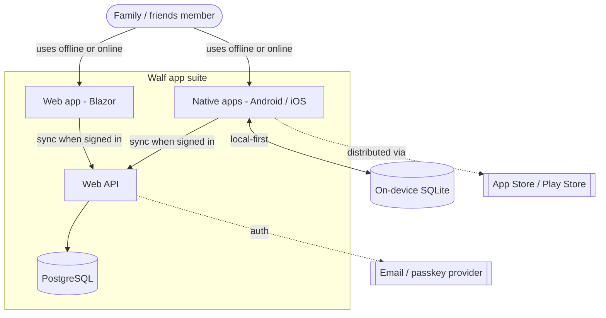

# 3. Context and Scope

## 3.1 Business context

## 3.2 Scope

**In scope:** the suite shell (branding, login, dashboard, shared config), the Secret-Santa app,
local-first storage, optional account-based sync, Web + native clients, DE/EN/FR localization.

**Out of scope (for now):** additional apps beyond Secret-Santa, payment, third-party social
integrations. These may enter via the [roadmap](../roadmap/roadmap.md).

## 3.3 External interfaces

| Interface | Purpose | Direction |
|-----------|---------|-----------|
| Web API (REST) | Sync, account, shared config | Clients ↔ server |
| Identity / passkey provider | Authentication (email+password, WebAuthn) | Server ↔ provider |
| App/Play Store | Native distribution | Outbound |
| On-device SQLite | Local-first persistence | Client-internal |

_C4 Context/Container diagrams (PlantUML, pre-rendered) will be added under
[`docs/diagrams`](../diagrams/index.md) as the design firms up — see [ADR-0004](../adr/0004-plantuml-prerender.md)._
