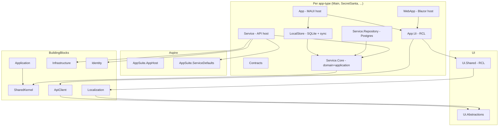

# 5. Building Block View

> The technology choices are **ratified** ([ADR-0005–0015](09-architecture-decisions.md)). The
> building blocks (`SharedKernel`, `Application`) and the **Main** app-type projects **exist**
> (walking skeleton, milestone 5); a throwaway `Heartbeat` sample exercises the full pipeline
> (domain → dispatcher → repository → EF Core → Postgres → Minimal API → WASM). The **SecretSanta**
> app-type is being implemented in milestone 6a as the **offline MVP — no server tier**
> (`Contracts`/`Core`/`LocalStore`/`Ui`/`WebApp` + a MAUI head, per
> [FEAT-001](../features/FEAT-001-secret-santa-mvp.md)); the dispatcher + domain run **client-side**
> with local storage ([ADR-0015](../adr/0015-mvp-client-offline-storage.md)).
>
> **M1 ([FEAT-002](../features/FEAT-002-m1-identity.md)) makes the remaining planned blocks real:**
> `Identity` and `Infrastructure` on the server side, and `Ui.Abstractions`, `Localization`,
> `ApiClient` and `Ui.Shared` on the client side
> ([ADR-0025](../adr/0025-shared-ui-building-blocks.md)). Only the sync tier is still a plan.

## 5.1 Level 1 — solution structure

Single solution; physical folders mirror solution folders. Projects are prefixed `AppSuite.`
(placeholder), app-specific ones `AppSuite.<AppType>.`.

Note where `ApiClient` hangs: off `App.Ui`, not off the host. The typed client and the session
handling are feature code that a MAUI head reuses unchanged; only the *implementations* of the
`Ui.Abstractions` seams — browser storage, the WebAuthn ceremony, saving a file — belong to a host.

## 5.2 Projects & responsibilities

| Project | Responsibility |
|---------|----------------|
| `AppSuite.AppHost` | Aspire orchestrator; local F5 entrypoint; wires DB, services, web hosts. |
| `AppSuite.ServiceDefaults` | OpenTelemetry, health checks, resilience, service discovery. |
| `AppSuite.SharedKernel` | DDD tactical base types (entity, value object, aggregate root, domain event). No I/O deps. |
| `AppSuite.Application` | CQRS abstractions, pipeline behaviors, `Result`, unit-of-work. |
| `AppSuite.Infrastructure` | Shared EF conventions, outbox, clock, ID generation, SMTP mail. |
| `AppSuite.Identity` | Identity model, JWT, refresh-token chains, WebAuthn/passkeys. |
| `AppSuite.Localization` | `AppCultures` (DE/EN/FR, `de-CH` default), `CultureProvider`, DI extension. |
| `AppSuite.ApiClient` | `ApiResult`/`ApiError` + `ProblemDetails` reading; access/refresh token stores; `AuthorizedHttpMessageHandler` (bearer + silent refresh). No app DTOs, no routes. |
| `AppSuite.Ui.Shared` | RCL: the suite theme ([ADR-0024](../adr/0024-ui-styling-and-theming.md)) and the components more than one app needs — `AuthCard`, `BusyButton`, `ProblemAlert`, `CultureSelector`, `CultureBoundary`. |
| `AppSuite.Ui.Abstractions` | Platform seams: `IKeyValueStore`, `ICultureProvider`, `IPasskeyCeremony`, `IFileSaver`. **References nothing** — no packages, no JS interop — which is what lets a MAUI head swap the implementations and change nothing else. |
| `AppSuite.<App>.Contracts` | API DTOs for the app-type (bounded-context boundary). |
| `AppSuite.<App>.Service.Core` | Domain + application layer; defines repository **ports**. |
| `AppSuite.<App>.Service.Repository` | EF Core + Postgres adapter. |
| `AppSuite.<App>.Service` | API host / composition root. |
| `AppSuite.<App>.Ui` | RCL: the app's pages & components. |
| `AppSuite.<App>.WebApp` | Standalone **Blazor WebAssembly PWA** host ([ADR-0005](../adr/0005-web-hosting-render-model.md)). |
| `AppSuite.<App>.App` | MAUI Blazor Hybrid host (Android/iOS). |
| `AppSuite.<App>.LocalStore` | SQLite adapter + client sync engine. |
| `AppSuite.<App>.*.Test` | Unit/integration/architecture tests co-located with the subject. |

**App-types now:** `Main` (shell: branding, login, dashboard, shared config) and `SecretSanta`.
More follow the same template.

> **Web offline-storage caveat:** on native, `LocalStore` uses on-device SQLite. On the standalone
> WASM web client, `LocalStore` cannot use device SQLite directly; it persists to `localStorage`
> behind `IKeyValueStore` / `IGroupRepository`
> ([ADR-0015](../adr/0015-mvp-client-offline-storage.md)), extended with sync metadata by
> [ADR-0016](../adr/0016-sync-and-conflict-resolution.md). WASM SQLite/OPFS and IndexedDB remain
> parked behind a concrete trigger (data volume or partial-query needs).

## 5.3 Bounded contexts

The [glossary](../glossary/index.md) tags each term with a context. Those labels were provisional
until this chapter confirmed them; they are now **fixed**:

| Context | Owns | Lives in | Status |
|---------|------|----------|--------|
| **Secret-Santa** | [Group](../glossary/group.md), [Member](../glossary/member.md), [Exclusion](../glossary/exclusion.md), [Draw](../glossary/draw.md), [Assignment](../glossary/assignment.md), [Wishlist](../glossary/wishlist.md), [Budget](../glossary/budget.md), [Event details](../glossary/event-details.md), [Reveal link](../glossary/reveal-link.md) | `AppSuite.SecretSanta.*` | shipped (FEAT-001) |
| **Identity** | [User](../glossary/user.md), [Passkey](../glossary/passkey.md) — credentials, profile, account lifecycle | `AppSuite.Identity` + the Main service host; the client half in `AppSuite.Main.Ui` (`Auth/`, `Api/`) over `AppSuite.ApiClient` | **M1** ([FEAT-002](../features/FEAT-002-m1-identity.md)) |
| **Circles** | [Circle](../glossary/circle.md), [Circle membership](../glossary/circle-membership.md), [Invitation](../glossary/invitation.md), [Managed member](../glossary/managed-member.md) | `AppSuite.Circles.*` (planned) | M2 |
| **Platform** | [Sync](../glossary/sync.md) — local↔server reconciliation | `AppSuite.Infrastructure` + per-app `LocalStore` | M3 |

**The Secret-Santa context does not depend on Identity.** A [Member](../glossary/member.md) carries an
**optional `UserId` — an identifier, not a reference to a user**
([ADR-0019](../adr/0019-member-user-linking.md)), so the two contexts stay independently deployable and
Secret-Santa keeps working with no account at all.

`AppSuite.Identity` sits in `BuildingBlocks/` rather than under `Main` because
[ADR-0009](../adr/0009-authentication-and-passkeys.md) makes one account serve **all** apps: any future
app-type's API host authenticates the same bearer tokens
([ADR-0021](../adr/0021-web-auth-token-model.md)).

## 5.4 Dependency rule

Dependencies point **inward**; the domain (`Service.Core` / `SharedKernel`) has **no** dependency
on EF, ASP.NET, HTTP, or MAUI. Enforced by an **architecture test** (ArchUnitNET). Full reference
rules are in the [architecture guidelines](../guidelines/architecture-guidelines.md).

On the client side the same rule reads outward-in from the host, and is enforced by
`MainUiLayeringTests`:

- `<App>.Ui` may reference `Ui.Shared`, `Ui.Abstractions`, `Localization`, `ApiClient` and its own
  `Contracts` — and **never** `AppSuite.Identity`, `<App>.Service*`, EF Core, or the WebAssembly
  host. Reaching for the server's Identity code from the browser would move a security decision
  somewhere the browser can read it.
- `ApiClient` and `Ui.Abstractions` stay free of `Microsoft.JSInterop` and
  `Microsoft.AspNetCore.Components.WebAssembly`; the moment either references a platform it stops
  being reusable by the MAUI head.
