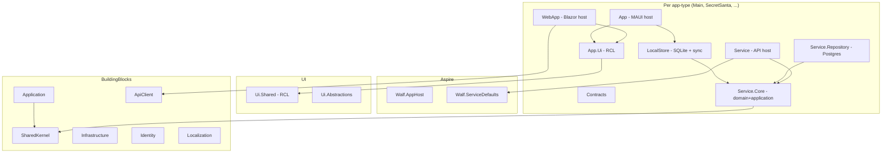

# 5. Building Block View

> The technology choices are **ratified** ([ADR-0005–0013](09-architecture-decisions.md)). The
> building blocks (`SharedKernel`, `Application`) and the **Main** app-type projects now **exist**
> (walking skeleton, milestone 5); a throwaway `Heartbeat` sample exercises the full pipeline
> (domain → dispatcher → repository → EF Core → Postgres → Minimal API → WASM). `Ui.Shared`,
> `Identity`, `Localization`, `LocalStore`, the MAUI head, and the SecretSanta app-type follow the
> same template when needed.

## 5.1 Level 1 — solution structure

Single solution; physical folders mirror solution folders. Projects are prefixed `Walf.`
(placeholder), app-specific ones `Walf.<AppType>.`.

## 5.2 Projects & responsibilities

| Project | Responsibility |
|---------|----------------|
| `Walf.AppHost` | Aspire orchestrator; local F5 entrypoint; wires DB, services, web hosts. |
| `Walf.ServiceDefaults` | OpenTelemetry, health checks, resilience, service discovery. |
| `Walf.SharedKernel` | DDD tactical base types (entity, value object, aggregate root, domain event). No I/O deps. |
| `Walf.Application` | CQRS abstractions, pipeline behaviors, `Result`, unit-of-work. |
| `Walf.Infrastructure` | Shared EF conventions, outbox, clock, ID generation. |
| `Walf.Identity` | Identity model, JWT, WebAuthn/passkeys. |
| `Walf.Localization` | DE/EN/FR resources & culture services. |
| `Walf.ApiClient` | Shared typed HttpClient + auth handler. |
| `Walf.Ui.Shared` | RCL: layout, theming, branding, shared components. |
| `Walf.Ui.Abstractions` | Platform-service interfaces (`IDataStore`, `IConnectivity`, `ISecureStorage`, `ICultureProvider`, …). |
| `Walf.<App>.Contracts` | API DTOs for the app-type (bounded-context boundary). |
| `Walf.<App>.Service.Core` | Domain + application layer; defines repository **ports**. |
| `Walf.<App>.Service.Repository` | EF Core + Postgres adapter. |
| `Walf.<App>.Service` | API host / composition root. |
| `Walf.<App>.Ui` | RCL: the app's pages & components. |
| `Walf.<App>.WebApp` | Standalone **Blazor WebAssembly PWA** host ([ADR-0005](../adr/0005-web-hosting-render-model.md)). |
| `Walf.<App>.App` | MAUI Blazor Hybrid host (Android/iOS). |
| `Walf.<App>.LocalStore` | SQLite adapter + client sync engine. |
| `Walf.<App>.*.Test` | Unit/integration/architecture tests co-located with the subject. |

**App-types now:** `Main` (shell: branding, login, dashboard, shared config) and `SecretSanta`.
More follow the same template.

> **Web offline-storage caveat:** on native, `LocalStore` uses on-device SQLite. On the standalone
> WASM web client, `LocalStore` cannot use device SQLite directly; its offline persistence
> (WASM SQLite/OPFS vs IndexedDB) is decided together with the sync strategy (deferred — see the
> [ADR register](../adr/index.md)).

## 5.3 Dependency rule

Dependencies point **inward**; the domain (`Service.Core` / `SharedKernel`) has **no** dependency
on EF, ASP.NET, HTTP, or MAUI. Enforced by an **architecture test** (ArchUnitNET). Full reference
rules are in the [architecture guidelines](../guidelines/architecture-guidelines.md).
