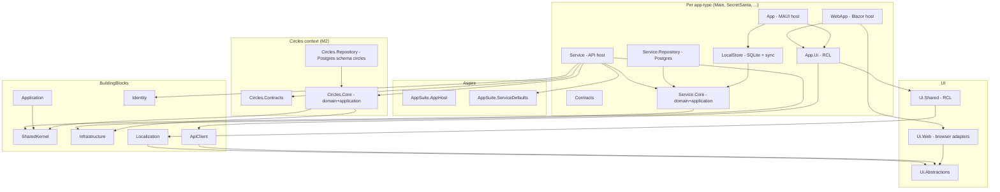

# 5. Building Block View

> The technology choices are **ratified** ([ADR-0005–0015](09-architecture-decisions.md)). The
> building blocks (`SharedKernel`, `Application`) and the **Main** app-type projects **exist**
> (walking skeleton, milestone 5); a throwaway `Heartbeat` sample exercises the full pipeline
> (domain → dispatcher → repository → EF Core → Postgres → Minimal API → WASM). The **SecretSanta**
> app-type is being implemented in milestone 6a as the **offline MVP — no server tier**
> (`Contracts`/`Core`/`LocalStore`/`Ui`/`WebApp` + a MAUI head, per
> [FEAT-001](../features/FEAT-001-secret-santa-mvp.md)); the dispatcher + domain run **client-side**
> with local storage ([ADR-0015](../adr/0015-mvp-client-offline-storage.md)).
>
> **M1 ([FEAT-002](../features/FEAT-002-m1-identity.md)) makes the remaining planned blocks real:**
> `Identity` and `Infrastructure` on the server side, and `Ui.Abstractions`, `Localization`,
> `ApiClient` and `Ui.Shared` on the client side
> ([ADR-0025](../adr/0025-shared-ui-building-blocks.md)).
>
> **M2 ([FEAT-003](../features/FEAT-003-m2-circles.md)) has built the `Circles` context** —
> `Circles.Contracts` / `Circles.Core` / `Circles.Repository`, hosted by the Main API host — which is
> the follow-up [ADR-0018](../adr/0018-circle-and-sharing-model.md) recorded against this chapter.
> Only the sync tier is still a plan.

## 5.1 Level 1 — solution structure

Single solution; physical folders mirror solution folders. Projects are prefixed `AppSuite.`
(placeholder), app-specific ones `AppSuite.<AppType>.`.

Note where `ApiClient` hangs: off `App.Ui`, not off the host. The typed client and the session
handling are feature code that a MAUI head reuses unchanged; only the *implementations* of the
`Ui.Abstractions` seams — browser storage, the WebAuthn ceremony, saving a file — are platform code.

`Ui.Web` hangs off the **hosts**, never off `Ui.Shared`. Both web hosts register its
`BrowserKeyValueStore` in their own composition root, so the seam a MAUI head has to replace stays a
single visible line; and because `Ui.Shared` does not depend on it, a MAUI head can take the shared
Razor components without inheriting `localStorage`
([ADR-0028](../adr/0028-browser-platform-adapters-block.md)).

## 5.2 Projects & responsibilities

| Project | Responsibility |
|---------|----------------|
| `AppSuite.AppHost` | Aspire orchestrator; local F5 entrypoint; wires DB, services, web hosts. |
| `AppSuite.ServiceDefaults` | OpenTelemetry, health checks, resilience, service discovery. |
| `AppSuite.SharedKernel` | DDD tactical base types (entity, value object, aggregate root, domain event). No I/O deps. |
| `AppSuite.Application` | CQRS abstractions, pipeline behaviors, `Result`, unit-of-work. |
| `AppSuite.Infrastructure` | Shared EF conventions, outbox, clock, ID generation, SMTP mail. |
| `AppSuite.Identity` | Identity model, JWT, refresh-token chains, WebAuthn/passkeys. |
| `AppSuite.Localization` | `AppCultures` (DE/EN/FR, `de-CH` default), `CultureProvider`, DI extension. |
| `AppSuite.ApiClient` | `ApiResult`/`ApiError` + `ProblemDetails` reading; access/refresh token stores; `AuthorizedHttpMessageHandler` (bearer + silent refresh). No app DTOs, no routes. |
| `AppSuite.Ui.Shared` | RCL: the suite theme ([ADR-0024](../adr/0024-ui-styling-and-theming.md)) and the components more than one app needs — `AuthCard`, `BusyButton`, `ProblemAlert`, `CultureSelector`, `CultureBoundary`. |
| `AppSuite.Ui.Abstractions` | Platform seams: `IKeyValueStore`, `ICultureProvider`, `IPasskeyCeremony`, `IFileSaver`, `StorageUnavailableException`. **References nothing** — no packages, no JS interop — which is what lets a MAUI head swap the implementations and change nothing else. |
| `AppSuite.Ui.Web` | Browser implementations of those seams, shared by both web hosts: `BrowserKeyValueStore` over `sessionStorage`/`localStorage` ([ADR-0028](../adr/0028-browser-platform-adapters-block.md)). Not an RCL — adapters only, no components — so `Ui.Shared` stays usable by a MAUI head. |
| `AppSuite.Circles.Contracts` | DTOs for the Circles context. Returns **no member's email address**, enforced by an assembly scan with a two-name exemption list — an address going *in* (`InviteRequest`) and the pending-invitation list an admin typed themselves ([NFR-006](../requirements/non-functional/NFR-006-circle-authorization.md)). |
| `AppSuite.Circles.Core` | The [Circle](../glossary/circle.md) aggregate (memberships, invitations, decline records, roles, managed members), its application handlers, and **four ports**: `ICircleRepository`, `IAccountDirectory` (the one crossing to Identity, by value), `IInvitationMailer` (*enqueue and return, never send inline* — the contract NFR-005 depends on) and `IInvitationRateLimiter`. No ASP.NET, no EF. |
| `AppSuite.Circles.Repository` | EF Core adapter with its **own `DbContext` and its own Postgres schema `circles`** inside `maindb`. Implements `ICircleRepository` **and `IInvitationRateLimiter`** — FR-017's counters are `circles` tables (`invitation_attempts`, rolling windows over two indexes), so an adapter in the host would have meant the host writing into another context's tables. No foreign key to the Identity tables — a membership holds a `UserId` **value** ([ADR-0019](../adr/0019-member-user-linking.md)). Concurrency is `xmin` on the circle row, marked modified on every save so the token covers changes to *child* rows too. |
| `AppSuite.<App>.Contracts` | API DTOs for the app-type (bounded-context boundary). |
| `AppSuite.<App>.Service.Core` | Domain + application layer; defines repository **ports**. |
| `AppSuite.<App>.Service.Repository` | EF Core + Postgres adapter. |
| `AppSuite.<App>.Service` | API host / composition root. |
| `AppSuite.<App>.Ui` | RCL: the app's pages & components. |
| `AppSuite.<App>.WebApp` | Standalone **Blazor WebAssembly PWA** host ([ADR-0005](../adr/0005-web-hosting-render-model.md)). |
| `AppSuite.<App>.App` | MAUI Blazor Hybrid host (Android/iOS). |
| `AppSuite.<App>.LocalStore` | SQLite adapter + client sync engine. |
| `AppSuite.<App>.*.Test` | Unit/integration/architecture tests co-located with the subject. |

**App-types now:** `Main` (shell: branding, login, dashboard, shared config) and `SecretSanta`.
More follow the same template.

> **Web offline-storage caveat:** on native, `LocalStore` uses on-device SQLite. On the standalone
> WASM web client, `LocalStore` cannot use device SQLite directly; it persists to `localStorage`
> behind `IKeyValueStore` / `IGroupRepository`
> ([ADR-0015](../adr/0015-mvp-client-offline-storage.md)), extended with sync metadata by
> [ADR-0016](../adr/0016-sync-and-conflict-resolution.md). WASM SQLite/OPFS and IndexedDB remain
> parked behind a concrete trigger (data volume or partial-query needs).

## 5.3 Bounded contexts

The [glossary](../glossary/index.md) tags each term with a context. Those labels were provisional
until this chapter confirmed them; they are now **fixed**:

| Context | Owns | Lives in | Status |
|---------|------|----------|--------|
| **Secret-Santa** | [Group](../glossary/group.md), [Member](../glossary/member.md), [Exclusion](../glossary/exclusion.md), [Draw](../glossary/draw.md), [Assignment](../glossary/assignment.md), [Wishlist](../glossary/wishlist.md), [Budget](../glossary/budget.md), [Event details](../glossary/event-details.md), [Reveal link](../glossary/reveal-link.md) | `AppSuite.SecretSanta.*` | shipped (FEAT-001) |
| **Identity** | [User](../glossary/user.md), [Passkey](../glossary/passkey.md) — credentials, profile, account lifecycle | `AppSuite.Identity` + the Main service host; the client half in `AppSuite.Main.Ui` (`Auth/`, `Api/`) over `AppSuite.ApiClient` | **M1** ([FEAT-002](../features/FEAT-002-m1-identity.md)) |
| **Circles** | [Circle](../glossary/circle.md), [Circle membership](../glossary/circle-membership.md), [Invitation](../glossary/invitation.md), [Managed member](../glossary/managed-member.md) | `AppSuite.Circles.Contracts/.Core/.Repository`, hosted by the Main service; the client half in `AppSuite.Main.Ui` | **M2** ([FEAT-003](../features/FEAT-003-m2-circles.md)) |
| **Platform** | [Sync](../glossary/sync.md) — local↔server reconciliation | `AppSuite.Infrastructure` + per-app `LocalStore` | M3 |

**Neither Secret-Santa nor Circles depends on Identity, and Secret-Santa does not depend on Circles.**
Both cross-context links are the same shape: a [Member](../glossary/member.md) carries an **optional
`UserId`**, and a [circle membership](../glossary/circle-membership.md) carries a `UserId` — an
**identifier, not a reference to a user**, with no foreign key behind it
([ADR-0019](../adr/0019-member-user-linking.md)). The contexts therefore stay independently
deployable, and Secret-Santa keeps working with no account and no circle at all. A group created
*from* a circle (M4) holds at most a circle identifier, and must tolerate that identifier resolving to
nothing after the circle is deleted
([FR-022](../requirements/functional/FR-022-delete-circle.md)).

`AppSuite.Identity` sits in `BuildingBlocks/` rather than under `Main` because
[ADR-0009](../adr/0009-authentication-and-passkeys.md) makes one account serve **all** apps: any future
app-type's API host authenticates the same bearer tokens
([ADR-0021](../adr/0021-web-auth-token-model.md)).

**Circles sits there for the same reason, but is layered differently.** A
[Circle](../glossary/circle.md) is the standing set of people that *every* app reuses
([ADR-0018](../adr/0018-circle-and-sharing-model.md)), so putting it under `Main` would have to be
undone by the first app that reads it. Unlike Identity — a supporting subdomain wrapping a framework,
and therefore one flat project — Circles is a real domain whose invariants must hold transactionally
(**exactly one owner**, no managed admin, one pending invitation per address). It therefore gets the
full inward-pointing split: `Core` owns the aggregate and the ports, `Repository` is the EF adapter,
`Contracts` is the boundary.

It is **not an app-type**: it has no head, no `WebApp` and no `LocalStore`. The Main API host maps
`/api/v1/circles` and `/api/v1/invitations`, and the client half is pages in `AppSuite.Main.Ui` —
the same division of labour M1 used for Identity. Circles is **online-only** until sync (M3) decides
whether a set of people that several devices edit belongs under last-write-wins at all
([ADR-0016](../adr/0016-sync-and-conflict-resolution.md)).

**What the host contributes**, since none of it may live in the context itself:

| In `AppSuite.Main.Service` | Why it is here and not in `Circles.*` |
|---|---|
| `CircleEndpoints`, `InvitationEndpoints` | ASP.NET, which `Circles.Core` may not reference. |
| `CircleRoleFilter` + `CircleRoleRequirement` | The requirement is endpoint **metadata**, not a filter argument, so `CircleEndpointGuardTests` can read it back off the endpoint data source and fail the build when a circle route is added without a guard. The caller's membership is loaded **per request** — no role ever enters a token, which is what makes a removal take effect on the next request (FR-020, NFR-006). |
| `OutboxInvitationMailer` | Implements `IInvitationMailer` over `IOutbox`. Referencing `AppSuite.Infrastructure` from the domain would have pulled MailKit in for one call. |
| `SoleOwnerCircleGuard` | Implements M1's `IAccountDeletionGuard`. Blocks on **every** circle the account owns — not only the ones nobody else could own — because deleting the owner's membership would otherwise leave a circle with no owner, a state the domain does not define. Each blocker names itself and carries the way out (`owner_must_transfer_ownership` / `owner_must_delete_circle`). |
| `CircleMembershipCleanup` | Implements `IAccountDeletionCleanup`, the **second** deletion seam, added in `AppSuite.Main.Service.Core` by this milestone. Removes the departing account's memberships and the invitations it sent; **leaves managed members**, which are circle data that survives their creator (FR-019). |

`AppSuite.ApiClient` gained `ApiError.Code` for this milestone: every circle refusal carries a stable
code beside its English title, and the reader had been discarding it — so a DE/EN/FR client could only
ever have said "there was a conflict" ([ADR-0011](../adr/0011-localization-format-and-culture.md)).
`CircleErrorCodeCoverageTests` keeps the code table and the translated sentences in step in both
directions.

The client half is **four** pages in `AppSuite.Main.Ui/Pages/Circles/`: `MyCircles` (list + create),
`CircleDetail` (people, invitations, managed members, roles, transfer, leave, delete), `JoinRequests`
(`/invitations`) and `InvitationLanding` (`/invitation/{token}`). Everything from invite through delete
is one change to one aggregate and one people list, so splitting it across routes would only mean
reloading the circle to answer "who is in it" on each one. The two invitation pages stay separate
because they are two different ways in: one carries a token from a mail, the other carries none.

## 5.4 Dependency rule

Dependencies point **inward**; the domain (`Service.Core` / `SharedKernel`) has **no** dependency
on EF, ASP.NET, HTTP, or MAUI. Enforced by an **architecture test** (ArchUnitNET). Full reference
rules are in the [architecture guidelines](../guidelines/architecture-guidelines.md).

`AppSuite.Circles.Core` is bound by the same rule as any `Service.Core`: no EF, no ASP.NET, no HTTP.
Two further rules exist because the temptation is obvious — **no Circles project may reference
`AppSuite.Identity`** (a `UserId` is a value, and reaching for the user would create the coupling
ADR-0019 exists to prevent), and **no Secret-Santa project may reference Circles** in either
direction.

On the client side the same rule reads outward-in from the host, and is enforced by
`MainUiLayeringTests` and `SharedUiBlockLayeringTests`:

- `<App>.Ui` may reference `Ui.Shared`, `Ui.Abstractions`, `Localization`, `ApiClient` and its own
  `Contracts` — and **never** `AppSuite.Identity`, `<App>.Service*`, EF Core, or the WebAssembly
  host. Reaching for the server's Identity code from the browser would move a security decision
  somewhere the browser can read it.
- `ApiClient` and `Ui.Abstractions` stay free of `Microsoft.JSInterop` and
  `Microsoft.AspNetCore.Components.WebAssembly`; the moment either references a platform it stops
  being reusable by the MAUI head.
- **`Ui.Shared` must not reference `Ui.Web`**, and `Ui.Web` must not reference `Ui.Shared`, the
  `ApiClient`, or any app. `Ui.Shared` is what a MAUI head renders; `Ui.Web` is what only a browser
  can run. Keeping the arrow absent in both directions is what lets a native head take the first
  without the second ([ADR-0028](../adr/0028-browser-platform-adapters-block.md)).
