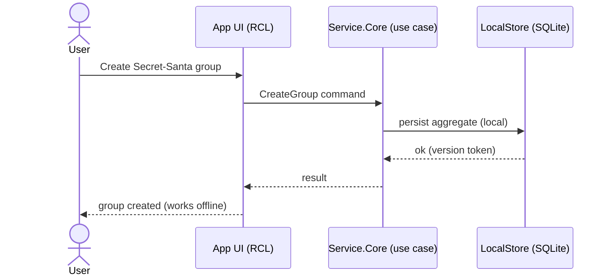
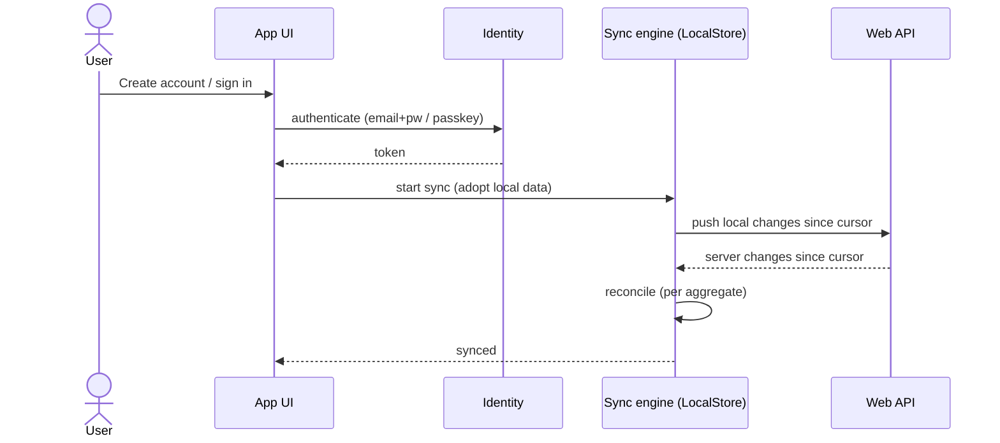

# 6. Runtime View

> _Proposed_ — key runtime scenarios. Detailed sequence diagrams are added per feature spec.

## 6.1 Offline use (no account)

## 6.2 Signing in and first sync ("claim" local data)

## 6.3 Ongoing sync

Delta pull/push per aggregate using a version/cursor; conflict handling per the (to-be-decided)
sync ADR. The domain stays sync-ignorant; reconciliation lives in an anti-corruption boundary.
