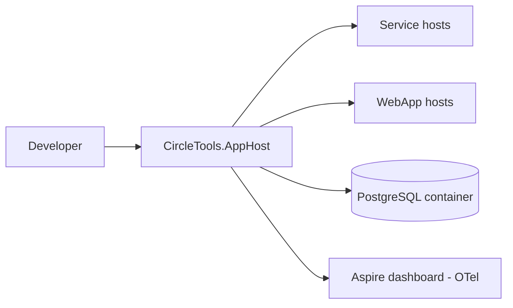

# 7. Deployment View

> The cloud provider and topology are **decided** in
> [ADR-0036](../adr/0036-cloud-provider-and-hosting.md) (Infomaniak VPS + Docker Compose), the
> transactional email sender in [ADR-0037](../adr/0037-transactional-email-provider.md), and the CI/CD
> **pipeline** in [ADR-0038](../adr/0038-ci-cd-pipeline.md) (GitHub Actions — the CI gate is built; CD
> to the VPS lands at milestone 8). This chapter captures the shape.

## 7.1 Environments

| Environment | Purpose |
|-------------|---------|
| Local (dev) | Aspire AppHost runs API + web + Postgres containers; dashboard for observability. |
| Cloud (later) | Managed hosting for Web/API/DB under a `.ch`/`.com` domain; apps live as subdomains (`<app>.<suite-domain>`). |
| App stores | Signed Android (Play) & iOS (App Store) artifacts, localized listings (DE/EN/FR). |

## 7.2 Local development (today)

> **Implemented (M5):** `dotnet run --project src/Aspire/CircleTools.AppHost` starts the Aspire dashboard,
> a `postgres` container, the `main-api` service, and the `main-web` WASM PWA. Verified working.

## 7.3 Cloud (decided — ADR-0036 / ADR-0037)

- **Web + API:** a single **Infomaniak VPS** (Swiss) running **Docker Compose** — **Caddy** reverse proxy
  (Let's Encrypt TLS via HTTP-01) serving the static WASM PWA, plus the API container. **DNS is at
  Infomaniak** with A records pointing straight at the VPS — no edge proxy
  ([ADR-0063](../adr/0063-drop-cloudflare-infomaniak-dns-and-caddy-tls.md) dropped the Cloudflare edge),
  so the whole request path stays in Switzerland.
- **Database:** **PostgreSQL as a container** on the same VPS (self-managed), with a **nightly `pg_dump`
  to Infomaniak Swiss Backup** offsite; managed Postgres is the documented upgrade path.
- **Transactional email:** **Brevo** (EU) behind the invitation outbox port
  ([ADR-0037](../adr/0037-transactional-email-provider.md)).
- **Observability:** self-hosted **Loki + Prometheus + Grafana** containers on the same VPS
  ([ADR-0051](../adr/0051-production-observability-backend.md)) — Prometheus scrapes the API's internal
  `/metrics`, the API ships OTLP logs to Loki, and **Grafana** is the admin view on its own subdomain
  (`grafana.circletools.ch`) behind a login. Prometheus and Loki are never published; telemetry stays on
  the box.
- **Static docs:** the DocFX site published to a static host / Pages.
- Data at rest stays in Switzerland; recurring cost ≈ CHF 12–14/mo. **CI** runs on GitHub Actions
  ([ADR-0038](../adr/0038-ci-cd-pipeline.md)); the **CD** step to this VPS is built at milestone 8 once
  it is provisioned (SSH → `compose pull && up`).

## 7.4 App stores

The native heads deploy through a second, quite different channel: two store review processes rather
than infrastructure we control. Two properties of it shape the architecture rather than just the
release process.

**The build host is a hardware constraint, not a tooling choice.** iOS artifacts can only be produced
on macOS with Apple's toolchain, and the required Xcode version implies a required macOS version,
which implies required hardware — so the toolchain floor propagates all the way down to which Mac
must exist. Settled in [ADR-0031](../adr/0031-ios-build-host.md).

**Some identifiers are permanent.** The bundle identifier / `ApplicationId` cannot change after the
first release, and passkey relying-party IDs do not migrate
([ADR-0023](../adr/0023-local-dev-infrastructure-in-apphost.md)). Both derive from the suite domain,
which makes [naming](../process/naming.md) a prerequisite of first submission rather than a cosmetic
step.

Publisher identity is decided in [ADR-0030](../adr/0030-mobile-store-publisher-identity.md); the
recurring platform obligations are stated as
[NFR-007](../requirements/non-functional/NFR-007-store-distributability.md); the procedure lives in
the [mobile-apps runbook](../deployment/mobile-apps.md), and what can be tested on which machine
today in [device testing](../deployment/device-testing.md).

## 7.5 Suite composition — federated, not a container ([ADR-0046](../adr/0046-suite-packaging-and-app-composition.md))

Both channels above deploy a **federated** suite: **one origin and one store listing per app**, unified
by the shared account rather than by a shell.

- **Web:** `circletools.ch` is the Main **hub** (account, dashboard, Circles, SSO authority — a web app
  in its own right, **not** a host that embeds other apps); each app is a standalone WASM PWA on its own
  subdomain (`secretsanta.circletools.ch`, `<app>.circletools.ch`). The passkey **RP-ID is the apex
  `circletools.ch`**, so one passkey spans every subdomain.
- **Stores:** one listing + one permanent `ch.circletools.<app>` bundle id per app; **no** monolithic
  container app and **no** Main mobile head (account/Circles live inside each app's head via
  `Ui.Account`). Adding an app is **N → N+1 origins and listings**, not a change to any existing one.
- **One identity backend, N frontends:** every app (web and mobile) authenticates against the single
  Main identity API and its one account; per-app installs do not mean per-app accounts. Cross-app
  [SSO](../adr/0039-cross-app-single-sign-on.md) carries one sign-in across the origins.
