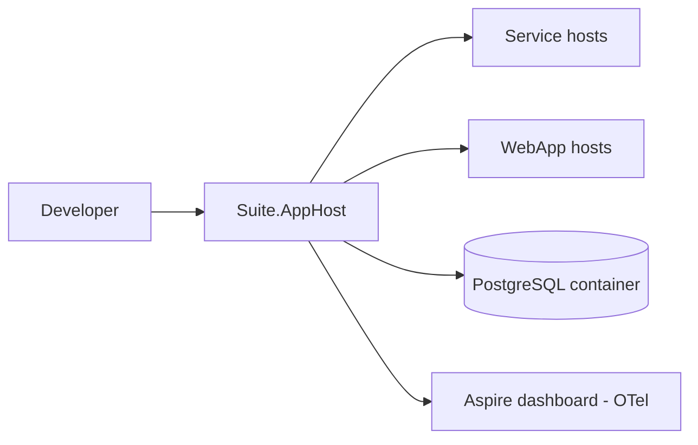

# 7. Deployment View

> _Proposed / to be decided_ — the concrete cloud provider and topology are an open decision
> (see the [ADR backlog](../adr/index.md)). This chapter captures the intended shape.

## 7.1 Environments

| Environment | Purpose |
|-------------|---------|
| Local (dev) | Aspire AppHost runs API + web + Postgres containers; dashboard for observability. |
| Cloud (later) | Managed hosting for Web/API/DB under a `.ch`/`.com` domain; apps live as subdomains (`<app>.<suite>.ch`). |
| App stores | Signed Android (Play) & iOS (App Store) artifacts, localized listings (DE/EN/FR). |

## 7.2 Local development (today)

## 7.3 Cloud (intended)

- **Web + API:** container-based hosting behind HTTPS on the suite domain.
- **Database:** managed PostgreSQL.
- **Static docs:** the DocFX site published to a static host / Pages.
- Provider, regions (Swiss data residency), and CI/CD are pending ADRs.
