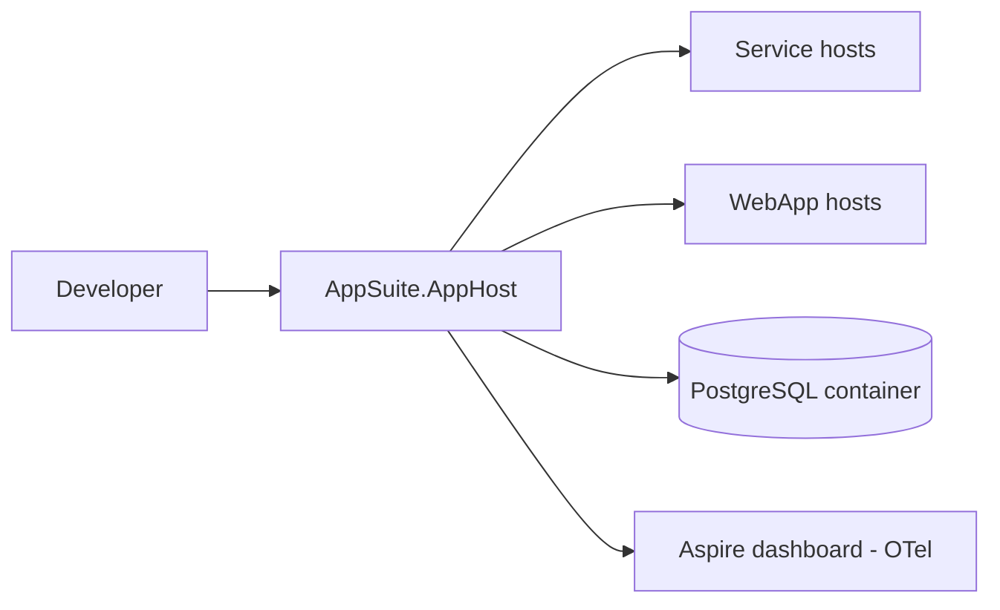

# 7. Deployment View

> _Proposed / to be decided_ — the concrete cloud provider and topology are an open decision
> (see the [ADR backlog](../adr/index.md)). This chapter captures the intended shape.

## 7.1 Environments

| Environment | Purpose |
|-------------|---------|
| Local (dev) | Aspire AppHost runs API + web + Postgres containers; dashboard for observability. |
| Cloud (later) | Managed hosting for Web/API/DB under a `.ch`/`.com` domain; apps live as subdomains (`<app>.<suite-domain>`). |
| App stores | Signed Android (Play) & iOS (App Store) artifacts, localized listings (DE/EN/FR). |

## 7.2 Local development (today)

> **Implemented (M5):** `dotnet run --project src/Aspire/AppSuite.AppHost` starts the Aspire dashboard,
> a `postgres` container, the `main-api` service, and the `main-web` WASM PWA. Verified working.

## 7.3 Cloud (intended)

- **Web + API:** container-based hosting behind HTTPS on the suite domain.
- **Database:** managed PostgreSQL.
- **Static docs:** the DocFX site published to a static host / Pages.
- Provider, regions (Swiss data residency), and CI/CD are pending ADRs.

## 7.4 App stores

The native heads deploy through a second, quite different channel: two store review processes rather
than infrastructure we control. Two properties of it shape the architecture rather than just the
release process.

**The build host is a hardware constraint, not a tooling choice.** iOS artifacts can only be produced
on macOS with Apple's toolchain, and the required Xcode version implies a required macOS version,
which implies required hardware — so the toolchain floor propagates all the way down to which Mac
must exist. Settled in [ADR-0031](../adr/0031-ios-build-host.md).

**Some identifiers are permanent.** The bundle identifier / `ApplicationId` cannot change after the
first release, and passkey relying-party IDs do not migrate
([ADR-0023](../adr/0023-local-dev-infrastructure-in-apphost.md)). Both derive from the suite domain,
which makes [naming](../process/naming.md) a prerequisite of first submission rather than a cosmetic
step.

Publisher identity is decided in [ADR-0030](../adr/0030-mobile-store-publisher-identity.md); the
recurring platform obligations are stated as
[NFR-007](../requirements/non-functional/NFR-007-store-distributability.md); the procedure lives in
the [mobile-apps runbook](../deployment/mobile-apps.md), and what can be tested on which machine
today in [device testing](../deployment/device-testing.md).
