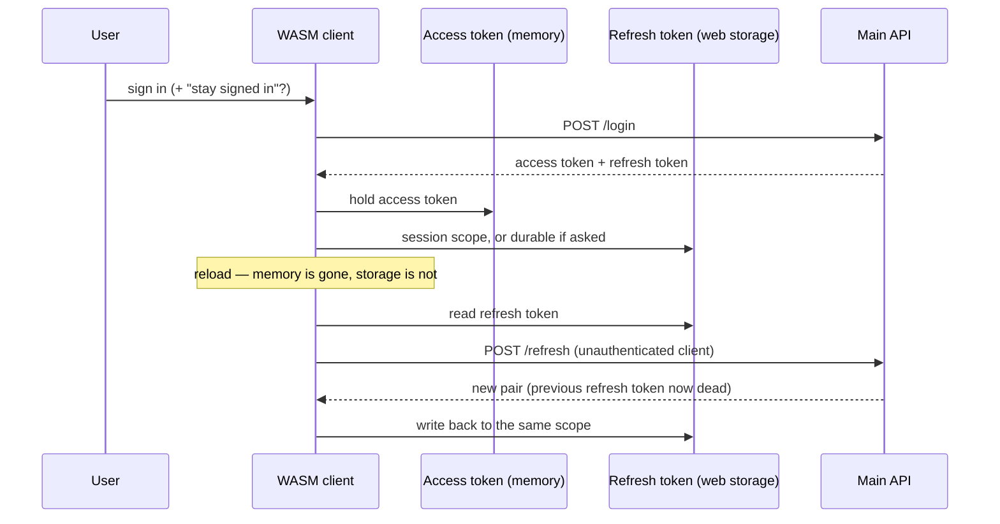

# 8. Cross-cutting Concepts

> _Proposed_ — concepts that apply across building blocks. Each firms up via ADRs and guidelines.

## 8.1 Domain model & DDD

Tactical patterns (entities, value objects, aggregates, domain events, repositories) in
`SharedKernel` and each `Service.Core`. Ubiquitous language per the [glossary](../glossary/index.md).

## 8.2 Persistence & local-first

Repository **ports** in the domain; **EF Core** behind both adapters — a **Postgres** adapter
(`Service.Repository`) on the server and a **SQLite** adapter (`LocalStore`) on native clients
([ADR-0007](../adr/0007-persistence-approach.md)). Keys are client-generated **GUID v7**
([ADR-0008](../adr/0008-entity-id-strategy.md)), so aggregates can be created offline without a
server round-trip. Aggregates are the unit of persistence and sync.

The **web client** persists to `localStorage` behind `IKeyValueStore` / `IGroupRepository`
([ADR-0015](../adr/0015-mvp-client-offline-storage.md)); under sync the persisted `GroupState` also
carries **sync metadata** — version token, tombstone flag, cursor
([ADR-0016](../adr/0016-sync-and-conflict-resolution.md)). IndexedDB and SQLite-in-OPFS stay parked
behind a concrete trigger.

## 8.3 Synchronization

**Local-first**: the device stays authoritative and usable offline; the server is a relay and backup,
never a gatekeeper ([NFR-001](../requirements/non-functional/NFR-001-local-first-offline.md)). Sync
applies only to a signed-in [User](../glossary/user.md) — without an account there is no server and no
sync.

The mechanism ([ADR-0016](../adr/0016-sync-and-conflict-resolution.md)): the **aggregate is the sync
unit** (never merged field-by-field, which would break its invariants); each carries a **version
token**; deletes leave **tombstones** so they propagate instead of resurrecting; changes travel as a
**delta pull/push** against a client cursor, triggered **on app start and on change**. Conflicts
resolve **last-write-wins per aggregate** by server-recorded time, behind a named **escalation hook**
that detects genuine divergent-edit collisions and emits telemetry — so a conflict UI can be added
later without re-architecting. The accepted cost is that two devices editing the same aggregate
offline will silently lose the earlier edit.

Anonymous local data meets an account through an explicit **claim**: the user chooses **per group**
what to take into the account on first sign-in, and local data is kept as a cache afterwards
([ADR-0017](../adr/0017-anonymous-to-account-claim.md)).

## 8.4 Identity & authentication

`AppSuite.Identity` centralizes the single suite account using **ASP.NET Core Identity** with the
**built-in .NET 10 passkey** support: email+password and optional **passkeys/WebAuthn**
([ADR-0009](../adr/0009-authentication-and-passkeys.md)). Offline mode uses **no** identity, and an
account is optional and additive throughout.

**Token model** ([ADR-0021](../adr/0021-web-auth-token-model.md)): bearer tokens for APIs from both
clients. Native MAUI keeps them in `SecureStorage`. The standalone WASM PWA
([ADR-0005](../adr/0005-web-hosting-render-model.md)) has no server-side host, so there is no BFF and
no `HttpOnly` cookie available — the accepted consequence is that **XSS yields a usable token**. It is
contained, not solved, by: **short-lived access tokens held in memory**, **refresh-token rotation**
(reuse of a consumed refresh token revokes the chain), and a **strict CSP**, which is the primary
control and must stay strict — relaxing it silently removes the main mitigation.

### How a browser session actually behaves

The client half lives in `AppSuite.ApiClient` and `AppSuite.Main.Ui/Auth`, and the flow is worth
stating because several parts of it only look right if you know what they are for.

- **The access token is never persisted.** A reload therefore always starts signed out and recovers
  by refreshing, which is why startup awaits one silent refresh before the first render.
- **The refresh token's scope is the user's choice** — `sessionStorage` by default, `localStorage`
  behind "stay signed in" ([ADR-0026](../adr/0026-refresh-token-persistence.md)). Rotation writes
  back to whichever scope it found, so a refresh never quietly lengthens a session.
- **Refreshing goes through an unauthenticated client.** Routing it through the handler that
  triggers refreshes would recurse; that is the whole reason the client is split in two.
- **Concurrent 401s collapse into one refresh.** The server treats a replayed refresh token as theft
  and revokes the chain; it forgives replays inside a 30-second grace window, but a client that
  relies on that is building on the safety net.
- **Unreachable is not signed out.** A failed refresh caused by the network keeps the refresh token,
  so the session returns when the network does. Only a *rejected* refresh clears it.
- **WebAuthn ceremonies are the one place cookies are used**, and only for the seconds a prompt is
  open: Identity keeps the challenge in a cookie between the "options" call and the credential
  submission. Cross-origin, that needs `SameSite=None; Secure`, CORS `AllowCredentials()` against an
  explicit origin list, and `credentials: "include"` on those two calls. This does not reopen the
  no-cookie-sessions decision — sign-in still yields a bearer token.

## 8.5 Localization (DE/EN/FR)

Central `AppSuite.Localization` using **RESX + `IStringLocalizer`** ([ADR-0011](../adr/0011-localization-format-and-culture.md));
`de-CH` default culture; culture is a synced user preference. Formatting via `CultureInfo`; no
locale/currency logic in the domain. See the [localization guidelines](../guidelines/localization-guidelines.md).

**Switching language does not reload the page.**
[UC-MAIN-005](../use-cases/main/UC-MAIN-005-manage-profile.md) requires the change to take effect
"without a reload or a flash of the wrong language". Blazor WebAssembly does not give this for free,
and three separate things have to be true — each of which failed on its own in a browser before it
worked:

1. **The resources for the new language must already be in the browser.** The runtime downloads
   satellite assemblies for the *startup* culture only, so switching to French otherwise falls back
   silently to the neutral (English) strings — a picker that appears to work and produces the wrong
   language. The host therefore starts the runtime with
   `loadAllSatelliteResources: true` (`wwwroot/js/app.js`), which fetches all three up front. Two
   small extra downloads; the framework's own answer is to reload the page on every change, which is
   exactly what the use case rules out.
2. **The culture must be applied to the current thread, not just the defaults.**
   `CultureProvider.SetCultureAsync` assigns `CurrentCulture`/`CurrentUICulture` as well as
   `DefaultThreadCurrent*`; the defaults are consulted only by threads that have not already resolved
   their own, which by the time a user clicks the picker is no longer true.
3. **The tree must actually be rebuilt.** `IStringLocalizer` reads `CurrentUICulture` at lookup time,
   so in principle a re-render is enough — but `StateHasChanged` on a component above the router does
   not reliably reach the layout, which hangs off Router → RouteView → LayoutView. `CultureBoundary`
   therefore hands the culture name to its child content and `App.razor` puts an `@key` on the
   `Router`, so a change rebuilds the subtree and every component reads the new culture on its first
   render.

The storage key is per app (`CultureOptions.StorageKey`), so each app keeps its own remembered
preference.

One consequence of the keyed rebuild is worth knowing before writing a page: **changing the language
discards the state of whatever page is on screen.** The profile page carries its "saved"
confirmation in the query string for exactly this reason.

Signing in applies the **account's** language over whatever the browser last remembered — the
preference travels in the access token, so it costs no extra round trip, and a borrowed device does
not leave someone reading a stranger's language.

## 8.6 Configuration sharing

suite-wide settings (branding, theme, locale, feature flags) exposed via an `IAppConfig`
abstraction, consistent across Web and native; user/suite prefs persisted locally and synced.

## 8.7 Observability

`AddServiceDefaults()` wires OpenTelemetry (traces/metrics/logs), health checks, and HTTP
resilience for every service host. Client telemetry is optional and consent-gated
([ADR-0012](../adr/0012-observability-and-telemetry.md)).

## 8.8 Security & privacy

Privacy by design: minimal PII, input validation, secrets never in the repo, Swiss/GDPR
awareness. See the [security & privacy guidelines](../guidelines/security-privacy-guidelines.md).

**Assignment privacy differs by mode**
([NFR-002](../requirements/non-functional/NFR-002-assignment-privacy.md)):

- **Account-free mode** — enforced by **absence**. No [Draw](../glossary/draw.md) result reaches any
  server; assignments live in the organizer's local storage and inside individual
  [reveal links](../glossary/reveal-link.md) ([ADR-0014](../adr/0014-reveal-link-encoding-and-privacy.md)).
  *The link is the secret.* Verified by network capture.
- **Account mode** — enforced by **authorization**
  ([ADR-0020](../adr/0020-server-side-assignment-privacy.md)). Assignments are stored in Postgres so a
  signed-in member can see theirs on any device. The API returns **only the caller's own row**; the
  full mapping goes to the organizer alone. Verified by authorization tests.
  Stated plainly: **the operator can technically read every pairing**. That is the accepted cost of
  the decision; the data is kept minimal, and **per-member envelope encryption is the recorded future
  hardening step**.

**Account-enumeration resistance** ([ADR-0018](../adr/0018-circle-and-sharing-model.md)): an
[Invitation](../glossary/invitation.md) never reveals to the inviter whether the address already has
an account — the UI always says *"invitation sent"* and the branch resolves on the recipient's side.
Invitations expire, can be revoked, and are rate-limited per inviter.

## 8.9 Error handling

Domain exceptions vs. `Result` for expected failures; no control-flow-by-exception; API errors as
`ProblemDetails`.

## 8.10 Circles & sharing

[Circle](../glossary/circle.md) is the standing set of people that apps share
([ADR-0018](../adr/0018-circle-and-sharing-model.md)) — the aggregate root, owning
[memberships](../glossary/circle-membership.md) with roles (owner / admin / member), pending
invitations, and [managed members](../glossary/managed-member.md) who have a profile but no account.

`Circle` is the **canonical code name** — tables, DTOs and URLs — while the name users see is a
**per-circle label they choose**, defaulting to "Family". `Group` stays reserved for the Secret-Santa
aggregate: a circle is the standing set of people, a group is one gift exchange.

The dependency points **one way**: a Secret-Santa group may be created *from* a circle, copying its
people in as [Members](../glossary/member.md) and freezing that set when the draw runs, but the
Secret-Santa domain holds at most a circle identifier and never references the Circles context. A
`Member` may carry an optional `UserId` ([ADR-0019](../adr/0019-member-user-linking.md)); unlinked
members stay first-class and keep their reveal links.
