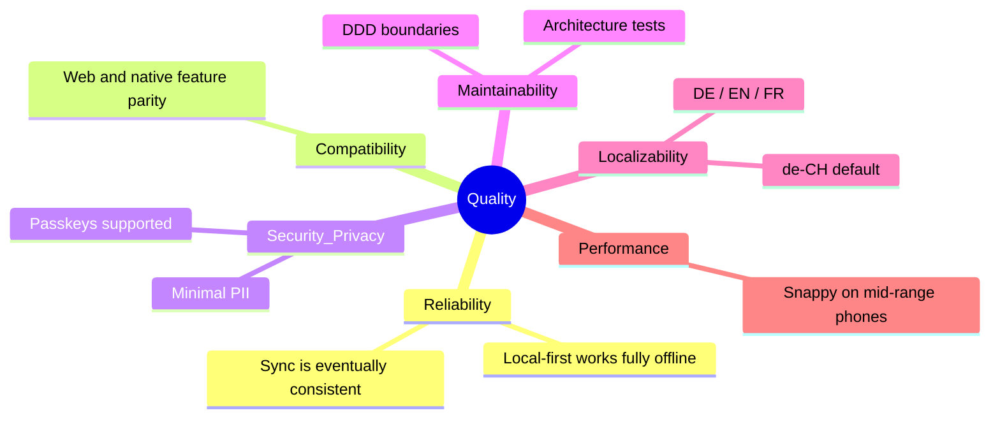

# 10. Quality Requirements

## 10.1 Quality tree

## 10.2 Quality scenarios

| ID | Scenario | Target |
|----|----------|--------|
| QS-1 (Q1) | Device is offline; user creates and completes a Secret-Santa draw | Fully works; no error, no account needed |
| QS-2 (Q1) | User signs in on a second device | Existing local data is reconciled without loss |
| QS-3 (Q2) | A feature is added once | Available on Web and native without code duplication |
| QS-4 (Q3) | No account is used | No personal data leaves the device |
| QS-5 (Q5) | User switches language to FR | All UI strings switch; formats follow `fr-CH` |
| QS-6 (Q4) | A new app-type is added | Follows the same project template; boundaries pass architecture tests |

Measurable targets are refined into [NFRs](../requirements/index.md).
