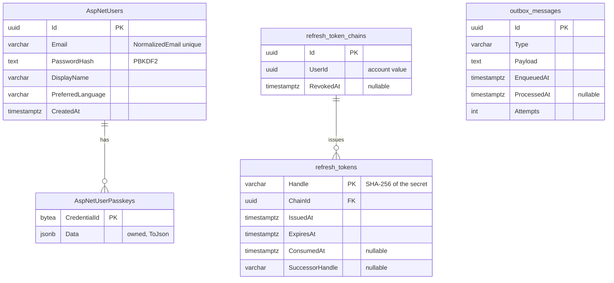
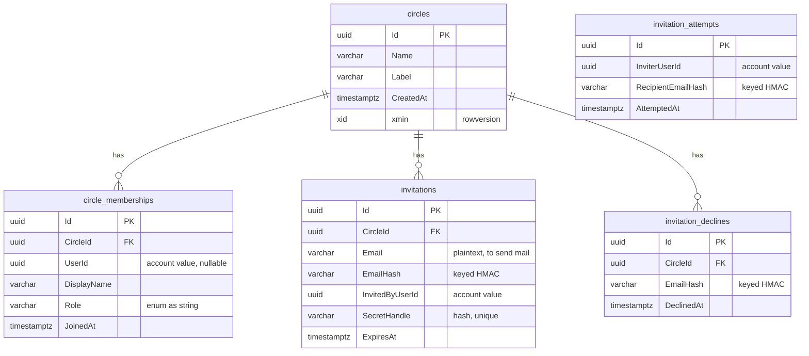
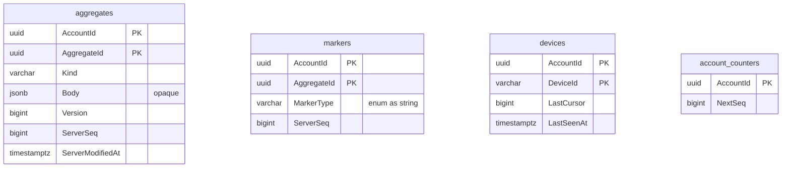
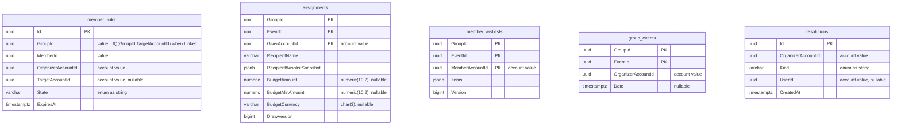
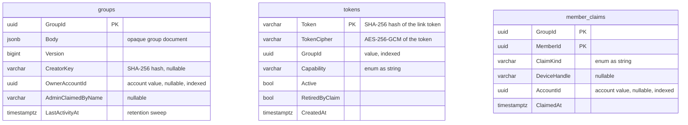

# Database schema (PostgreSQL)

The backend is **one PostgreSQL database** whose tables are partitioned into **five schemas**, one per
bounded context, each with its own EF Core `DbContext` and its own `__EFMigrationsHistory` table so the
migration sets stay independent ([ADR-0003](../adr/0003-modular-monolith-with-aspire.md)):
`public` (Identity + tokens + outbox), `circles`, `sync`, `linking`, and `shared`.

A deliberate rule cuts across all of them: **no foreign key references `AspNetUsers` from another
context** ([ADR-0019](../adr/0019-member-user-linking.md)). An account is held as a **value** (a bare
`uuid`), and account deletion is a host-orchestrated cleanup, not a database cascade — so a circle or a
shared group survives the deletion of any one account. The diagrams below therefore show foreign keys
*within* an aggregate only; account ids and cross-context group/member ids are value references, drawn as
dashed links and called out in prose.

The diagrams reflect the schema as of **2026-09-15**, including the pre-launch hardening in
[ADR-0061](../adr/0061-share-token-and-creator-key-at-rest-protection.md) (share tokens/creator key at
rest) and [ADR-0062](../adr/0062-email-address-hashing-keyed-hmac.md) (email hashing). Only the defining
columns are shown; the full column set lives in the entity types.

## `public` — Identity, tokens & outbox (Main context)

ASP.NET Core Identity with a `uuid` key ([ADR-0008](../adr/0008-entity-id-strategy.md)); passwords are
PBKDF2-hashed by Identity, and a refresh token is stored only as the **SHA-256 handle** of its secret
([ADR-0026](../adr/0026-refresh-token-persistence.md)). The standard `AspNetRoles`,
`AspNetUserClaims`, `AspNetUserLogins`, `AspNetUserRoles`, `AspNetUserTokens`, and `AspNetRoleClaims`
tables also exist and are omitted here for clarity.

## `circles` — the Circle aggregate

A circle owns its memberships, pending invitations, and decline records (in-aggregate cascade delete).
`UserId` on a membership is a nullable account **value** (null = a managed member with no account).
`EmailHash` / `RecipientEmailHash` are **keyed HMAC-SHA256** of the address
([ADR-0062](../adr/0062-email-address-hashing-keyed-hmac.md)); the pending `invitations` row also keeps
the plaintext `Email` because sending the mail needs it, and is deleted the moment it is consumed. The
`circles` row carries a `xmin` system-column rowversion for optimistic concurrency.

## `sync` — account-scoped opaque sync store

The generic sync tier ([ADR-0016](../adr/0016-sync-and-conflict-resolution.md),
[ADR-0033](../adr/0033-which-aggregates-sync.md)): each aggregate is an **opaque `jsonb` body** the
server never interprets, keyed by `(AccountId, AggregateId)`, with a server sequence for ordering. No
foreign keys — every id is a value.

## `linking` — the ADR-0020 per-caller assignment surface

The one server-side store that understands the Secret-Santa shape
([ADR-0020](../adr/0020-server-side-assignment-privacy.md),
[ADR-0042](../adr/0042-events-as-first-class-entities.md), FEAT-005). No foreign keys: `GroupId`,
`EventId`, member ids and account ids are all values into the opaque group document. `member_links`
carries a **partial unique index** on `(GroupId, TargetAccountId) WHERE State = 'Linked'` — the database
invariant behind "one account backs at most one member per group". Budget money is `numeric(10,2)`.

## `shared` — account-free, link-shared groups

The third storage tier ([ADR-0058](../adr/0058-account-free-link-shared-groups.md), FEAT-013): a group
lives here addressed by **share tokens**, with an optional owning account (`OwnerAccountId`, a value,
null while account-free). Per [ADR-0061](../adr/0061-share-token-and-creator-key-at-rest-protection.md),
a token is looked up by the **SHA-256 hash** stored in `tokens.Token` (the primary key) and kept
recoverable for the resume-share path as **AES-256-GCM** ciphertext in `TokenCipher`; the creator key is
stored only as its **SHA-256 hash**. `member_claims.AccountId` and `groups.OwnerAccountId` are indexed
for account-deletion cleanup.

> The `groups` ⇄ `tokens` ⇄ `member_claims` link is by `GroupId` **value** (indexed), not a foreign key —
> the three tables are cleaned up together in one transaction by the store, not by a database cascade.

## Regenerating

These are inline Mermaid diagrams (no pre-render step). Keep them in step with the EF Core entity
configurations under `src/Apps/Main/CircleTools.Main.Service.Repository` and
`src/BuildingBlocks/CircleTools.Circles.Repository`; a schema change should update the matching diagram in
the same PR.
