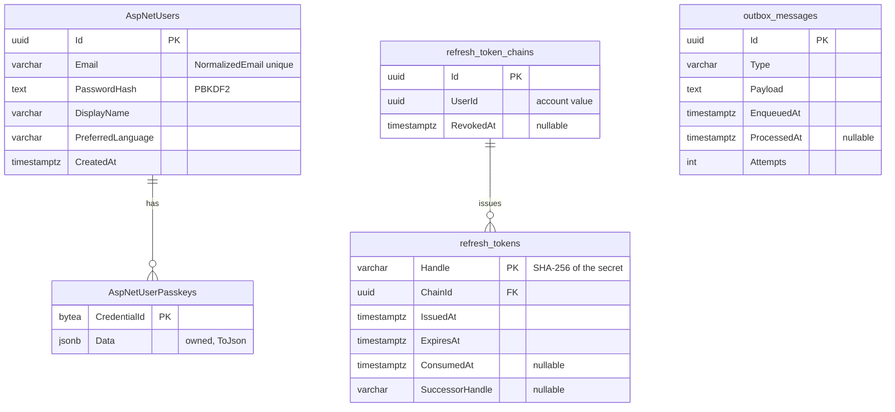
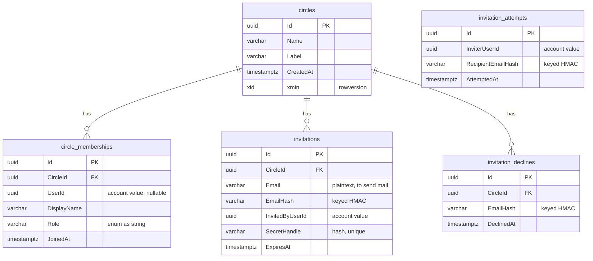
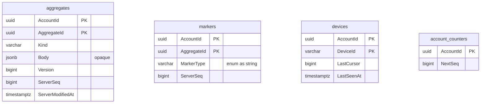

# Database schema (PostgreSQL)

The backend is **one PostgreSQL database** whose tables are partitioned into **four schemas**, one per
bounded context, each with its own EF Core `DbContext` and its own `__EFMigrationsHistory` table so the
migration sets stay independent ([ADR-0003](../adr/0003-modular-monolith-with-aspire.md)):
`public` (Identity + tokens + outbox), `circles`, `sync`, and `secretsanta`. The `linking` and `shared` schemas
were dropped with [ADR-0086](../adr/0086-one-way-to-be-in-a-group.md) (migration `RetireOldGroupStores`).

A deliberate rule cuts across all of them: **no foreign key references `AspNetUsers` from another
context** ([ADR-0019](../adr/0019-member-user-linking.md)). An account is held as a **value** (a bare
`uuid`), and account deletion is a host-orchestrated cleanup, not a database cascade — so a circle or a
online group survives the deletion of any one account. The diagrams below therefore show foreign keys
*within* an aggregate only; account ids and cross-context group/member ids are value references, drawn as
dashed links and called out in prose.

The diagrams reflect the schema as of **2026-10-25**, including the at-rest protection of link secrets
([ADR-0061](../adr/0061-share-token-and-creator-key-at-rest-protection.md)) and email hashing
([ADR-0062](../adr/0062-email-address-hashing-keyed-hmac.md)). Only the defining
columns are shown; the full column set lives in the entity types.

## `public` — Identity, tokens & outbox (Main context)

ASP.NET Core Identity with a `uuid` key ([ADR-0008](../adr/0008-entity-id-strategy.md)); passwords are
PBKDF2-hashed by Identity, and a refresh token is stored only as the **SHA-256 handle** of its secret
([ADR-0026](../adr/0026-refresh-token-persistence.md)). The standard `AspNetRoles`,
`AspNetUserClaims`, `AspNetUserLogins`, `AspNetUserRoles`, `AspNetUserTokens`, and `AspNetRoleClaims`
tables also exist and are omitted here for clarity.

## `circles` — the Circle aggregate

A circle owns its memberships, pending invitations, and decline records (in-aggregate cascade delete).
`UserId` on a membership is a nullable account **value** (null = a managed member with no account).
`EmailHash` / `RecipientEmailHash` are **keyed HMAC-SHA256** of the address
([ADR-0062](../adr/0062-email-address-hashing-keyed-hmac.md)); the pending `invitations` row also keeps
the plaintext `Email` because sending the mail needs it, and is deleted the moment it is consumed. The
`circles` row carries a `xmin` system-column rowversion for optimistic concurrency.

## `sync` — account-scoped opaque sync store

The account sync ([ADR-0016](../adr/0016-sync-and-conflict-resolution.md),
[ADR-0033](../adr/0033-which-aggregates-sync.md)): each per-account document — profile and UI preferences since
ADR-0086 — is an **opaque `jsonb` body** the server never interprets, keyed by `(AccountId, AggregateId)`, with a
server sequence for ordering. `markers` hold tombstones only. No foreign keys — every id is a value.

## `secretsanta` — the Secret-Santa group store

One store for every [online group](../glossary/online-group.md)
([ADR-0086](../adr/0086-one-way-to-be-in-a-group.md), FEAT-027). The group's document is `jsonb` that the server
reads through the domain's `GroupDocument` format, so it can merge members' own entries and derive every view on
read. Who may do what is in `role_assignments`: one owner (account or organizer link) and the participants
(account or device key), optionally as one member.

Secrets — organizer tokens, device keys, join tokens, reveal tokens — are stored as their **SHA-256 hash** (the
lookup key) and, where a device must be shown the link again, as **AES-256-GCM** ciphertext
([ADR-0061](../adr/0061-share-token-and-creator-key-at-rest-protection.md)). Writes to a group lock its `groups`
row (`SELECT … FOR UPDATE`), so an entry written during a push is never lost. No foreign keys: every table refers
to the group by `GroupId` value, and the store deletes a group's rows together in one transaction.

```mermaid
erDiagram
    groups {
        uuid GroupId PK
        jsonb Body "the GroupDocument, member entries merged in"
        bigint Version
        int SchemaVersion
        bool JoinEnabled
        varchar CreatorKeyHash "nullable"
        uuid UpdatedBy "role assignment value, nullable"
        timestamptz LastActivityAt "indexed; retention sweep"
    }
    role_assignments {
        uuid Id PK
        uuid GroupId "value, indexed"
        varchar Role "owner | participant"
        varchar PrincipalKind "account | organizerLink | deviceKey"
        uuid AccountId "account value, nullable; UQ(GroupId,AccountId)"
        uuid MemberId "nullable; UQ(GroupId,MemberId)"
        varchar SecretHash "nullable; UQ"
        varchar SecretCipher "organizer link only, nullable"
        varchar State "invited | active"
        varchar Route "created | joinLink | invitation | circle | ownMember | takeOver"
        timestamptz ExpiresAt "invitations, nullable"
    }
    join_links {
        varchar TokenHash PK
        varchar TokenCipher
        uuid GroupId "value, indexed"
        bool Active "a replaced link stays inactive"
    }
    member_entries {
        uuid GroupId PK
        uuid MemberId PK
        varchar GiftNote "500, nullable"
        jsonb Wishlists "per event"
        varchar KeptBy "participant | revealLink"
        bigint Version
    }
    reveal_tokens {
        varchar TokenHash PK
        varchar TokenCipher
        uuid GroupId "value; UQ(GroupId,EventId,GiverMemberId)"
        uuid EventId
        uuid GiverMemberId
    }
```

## Regenerating

These are inline Mermaid diagrams (no pre-render step). Keep them in step with the EF Core entity
configurations under `src/Apps/Main/CircleTools.Main.Service.Repository`,
`src/Apps/SecretSanta/CircleTools.SecretSanta.Service.Repository` and `src/BuildingBlocks/CircleTools.Circles.Repository`; a schema change should update the matching diagram in
the same PR.
