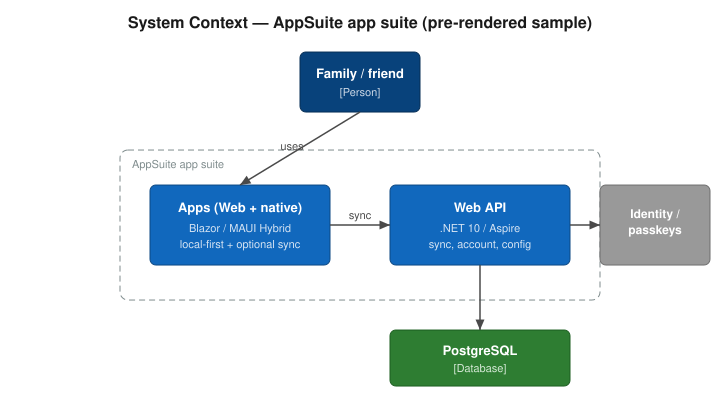

# Diagrams

- **Mermaid** diagrams are written inline in the docs (see [arc42](../arc42/03-context-and-scope.md)).
- **PlantUML / C4-PlantUML** diagrams live here as `.puml` sources under `c4/` and are
  **pre-rendered to SVG** into `exported/` (see [ADR-0004](../adr/0004-plantuml-prerender.md)).

## Pages

- [**Database schema**](database-schema.md) — the PostgreSQL tables per bounded-context schema
  (`public`, `circles`, `sync`, `linking`, `shared`), as inline Mermaid ER diagrams.

## Example — C4 System Context (pre-rendered)

Source: [`c4/system-context.puml`](c4/system-context.puml)



Regenerate after editing `.puml` sources:

```bash
java -jar plantuml.jar -tsvg -o ../exported c4/*.puml
```
