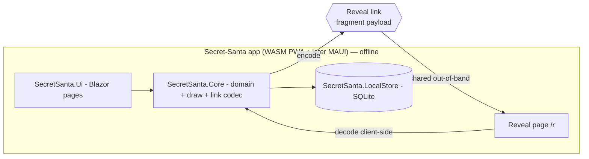

# FEAT-001 — Secret-Santa MVP (offline, local-first)

## Problem & goals

- **Problem:** organizing a Secret-Santa by hand is fiddly (fair drawing, exclusions, telling each
  person privately who they got).
- **Goals:** a delightful, private, **fully offline & account-free** way to run a gift exchange:
  configure a group → add members with wishlists → set exclusions → run a fair draw → hand each
  member a self-contained [reveal link](../glossary/reveal-link.md).
- **Non-goals (MVP):** accounts, backend, cross-device sync, server-stored assignments, notifications,
  multiple simultaneous organizers. These are the **post-MVP (v2)** phase (central login + sync +
  linking members to accounts — see the [backlog](../roadmap/backlog.md) and [ADR backlog](../adr/index.md)).

## Requirements & use cases covered

| Item | Covered | Notes |
|------|:------:|-------|
| [UC-SS-001](../use-cases/secret-santa/UC-SS-001-create-group.md) / [FR-001](../requirements/functional/FR-001-create-secret-santa-group.md) | ✅ | Create & configure group (name, budget, event details) |
| [UC-SS-002](../use-cases/secret-santa/UC-SS-002-manage-members.md) / [FR-002](../requirements/functional/FR-002-manage-members-and-wishlists.md) | ✅ | Members + wishlists |
| [UC-SS-003](../use-cases/secret-santa/UC-SS-003-define-exclusions.md) / [FR-003](../requirements/functional/FR-003-define-exclusions.md) | ✅ | Exclusions |
| [UC-SS-004](../use-cases/secret-santa/UC-SS-004-run-draw.md) / [FR-004](../requirements/functional/FR-004-run-fair-draw.md) | ✅ | Fair draw (rules + history + graceful failure) |
| [UC-SS-005](../use-cases/secret-santa/UC-SS-005-share-reveal-links.md) / [FR-005](../requirements/functional/FR-005-generate-reveal-links.md) | ✅ | Generate/share reveal links |
| [UC-SS-006](../use-cases/secret-santa/UC-SS-006-open-reveal-link.md) / [FR-006](../requirements/functional/FR-006-reveal-page-decode.md) | ✅ | Reveal page decode + reveal button |
| [NFR-001](../requirements/non-functional/NFR-001-local-first-offline.md) / [NFR-002](../requirements/non-functional/NFR-002-assignment-privacy.md) / [NFR-003](../requirements/non-functional/NFR-003-multilingual-de-en-fr.md) | ✅ | Offline · privacy · DE/EN/FR |

## Design overview

Flow: **create group → add members/wishlists → set exclusions → run draw → generate one reveal link
per member → member opens link → summary shown, giftee behind Reveal button.**

## Project structure (MVP — no server yet)

New bounded-context projects under `src/Apps/SecretSanta/`, following the topology in
[arc42 ch.5](../arc42/05-building-block-view.md) but **omitting the server/API tier** (added in v2):

| Project | Role |
|---------|------|
| `AppSuite.SecretSanta.Core` | Domain + application: aggregates, draw algorithm, reveal-link **codec** (encode/decode), commands/queries via the [dispatcher](../adr/0006-application-layer-and-mediation.md). Pure, no I/O. |
| `AppSuite.SecretSanta.Contracts` | Reveal-link payload DTO + (future) API DTOs. |
| `AppSuite.SecretSanta.LocalStore` | Client persistence behind `IKeyValueStore` + `IGroupRepository` ([ADR-0015](../adr/0015-mvp-client-offline-storage.md)): **localStorage** on WASM, a **JSON file** on MAUI, one `GroupState` JSON contract. (EF Core SQLite deferred as a later native option.) |
| `AppSuite.SecretSanta.Ui` | Razor Class Library: pages (group, members, exclusions, draw, share, **reveal**). |
| `AppSuite.SecretSanta.WebApp` | Standalone Blazor WASM **PWA** ([ADR-0005](../adr/0005-web-hosting-render-model.md)); hosts the app **and** the static `/r` reveal route (works offline once cached). |
| `*.Test` | Unit tests (draw rules, codec round-trip). |

> **Deferred to v2:** `AppSuite.SecretSanta.Service` (API) + `.Service.Repository` (Postgres) + sync —
> not needed while the MVP is offline. The MAUI native head is a follow-up within 6a/after.

## Domain model impact

- **Aggregate root `Group`** — owns `Member`s, `Exclusion`s, `Budget`, `EventDetails`, and a **draw
  history** (ordered list of past `Draw`s). GUID v7 ids ([ADR-0008](../adr/0008-entity-id-strategy.md)).
- **`Member`** — display name + optional `Wishlist` (ordered gift-idea items).
- **`Exclusion`** — directed "giver X must not give to recipient Y".
- **`Draw`** — a set of `Assignment`s (giver→recipient) + timestamp; the current draw + history entries.
- **Value objects:** `Budget`, `EventDetails` (date/location/notes), `Wishlist`.
- **Domain service `DrawGenerator`** — produces a valid `Draw` satisfying rules (a) exclusions,
  (b) no reciprocal, (c) no repeat of previous draw; returns a typed failure when over-constrained.
  Rule (c) compares the **whole permutation**, so an individual giver may keep the same recipient
  across two draws as long as the draws are not identical.
- **Draw validity is scoped to the member set.** A `Draw` maps a fixed set of givers to recipients,
  so **adding or removing a member voids the draw**: `Group.AddMember`/`RemoveMember` clear the draw
  history and raise `DrawInvalidatedByMembershipChange`, which the next successful draw clears. This
  keeps `CurrentDraw` from ever referencing a member who is no longer in the group — otherwise the
  share screen would emit a plausible-looking but incomplete set of links and silently drop whoever
  was left dangling. Editing a member's name or wishlist does **not** void the draw. Note the
  trade-off: because the history is cleared, rule (c) has no previous draw to compare against after
  a membership change.
- **Reveal links cannot be revoked** once sent ([ADR-0014](../adr/0014-reveal-link-encoding-and-privacy.md)),
  so both paths that obsolete links are surfaced in the UI: re-drawing asks for confirmation, and the
  members screen warns before a membership change voids an existing draw.
- New glossary terms already recorded: [Wishlist](../glossary/wishlist.md), [Budget](../glossary/budget.md),
  [Event details](../glossary/event-details.md), [Reveal link](../glossary/reveal-link.md).

## Reveal-link design (per [ADR-0014](../adr/0014-reveal-link-encoding-and-privacy.md))

- **URL:** `https://secretsanta.<suite-domain>/r#for=<giver>&v=1&d=<Base64Url(Deflate(UTF-8(json)))>`
  — everything in the **fragment** (never sent to a server); `for=` is the only readable token.
- **Payload JSON (v1):** `{ "r": "<recipient name>", "w": ["<wishlist items>"], "b": "<budget>", "e": { "date": …, "location": …, "notes": … } }`. `v` is the format version for forward-compat.
- **Codec** lives in `SecretSanta.Core` so the generator and the reveal page share one implementation
  (round-trip unit-tested).
- **Reveal page UX:** greeting to `for=<giver>`, budget, and event details render immediately; the
  **recipient name + wishlist are behind a "Reveal" button** (anti-spoiler).
- **Constraints:** target a practical URL budget (aim ≤ ~1.5–2 KB; wishlists are short text). The
  warn threshold is **resolved**: `RevealLinkBuilder.MaxRecommendedUrlLength = 2000` characters; the
  Share screen flags any longer link to the organizer (`ShareLinkTooLong`).

## Data & migration

- **Client storage** ([ADR-0015](../adr/0015-mvp-client-offline-storage.md)): the whole `GroupState`
  collection is serialized to JSON and stored under one key — **localStorage** (WASM) or a **JSON
  file** (MAUI) — via `IKeyValueStore`. No server DB in the MVP; schema evolution is versioned in code.
- Draw history is retained (needed for the no-repeat rule).

## Localization impact

- All user-facing strings in **DE/EN/FR** (`de-CH` default), incl. draw failure messages and the
  reveal page ([NFR-003](../requirements/non-functional/NFR-003-multilingual-de-en-fr.md), [ADR-0011](../adr/0011-localization-format-and-culture.md)).

## Testing strategy

- **Unit:** `DrawGenerator` (valid draws; honors exclusions/no-reciprocal/no-repeat; 2-member and
  over-constrained failure cases), reveal-link **codec round-trip** (encode→decode equality; version
  handling; URL-safety), value-object invariants.
- **Component (bUnit):** reveal page shows summary but hides giftee until "Reveal".
- **Architecture:** `SecretSanta.Core` free of EF/ASP.NET/Npgsql (ArchUnitNET).
- Paired test plan **[TP-001](TP-001-secret-santa-mvp.md)** — written; test matrix and exit criteria met.

## Rollout / feature flags

- Single offline release; no flags needed. Reveal page must be reachable/hostable for links to open
  (deployment milestone) — until then it runs locally / in the WASM dev host.

## Risks & open questions

- **Draw solver** for tightly-constrained groups (many exclusions) — **resolved:** randomized retry
  with a bounded attempt count (`DrawGenerator.MaxAttempts = 2000`), then a typed failure
  (`OverConstrained` / `TwoMemberReciprocalImpossible`) with organizer guidance. Covered by
  `DrawGeneratorTests` (see UC-SS-004).
- **URL length** for large wishlists — **resolved:** warn threshold =
  `RevealLinkBuilder.MaxRecommendedUrlLength` (2000 chars); Share screen flags longer links.
- **v2 seam:** keep `Member` free of account concepts now, but anticipate a future `Member`↔`User`
  link (post-MVP) so the domain doesn't need reshaping later.

## Definition of Done

- [x] All covered UCs/FRs/NFRs met; acceptance criteria satisfied (see [TP-001](TP-001-secret-santa-mvp.md))
- [x] Builds clean under analyzers (warnings = errors); architecture tests green
- [x] Draw + codec unit tests pass; reveal-page component test passes
- [x] Strings localized (DE/EN/FR) — key parity enforced by `LocalizationParityTests`
- [x] Docs/glossary/API comments updated; traceability closed (FEAT-001 ↔ TP-001)
- [x] Runs fully offline with no account/backend
