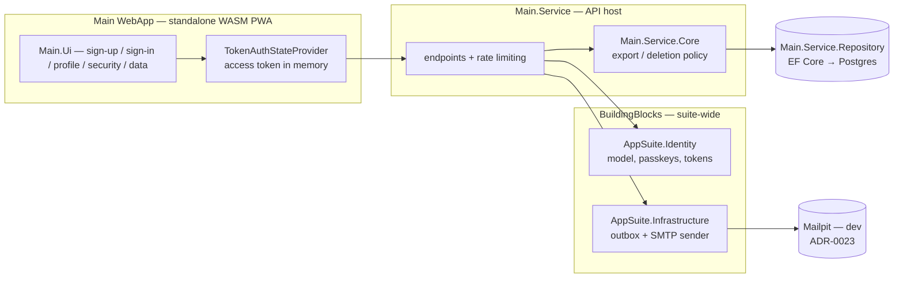

# FEAT-002 — M1 — Identity in the Main shell

## Problem & goals

- **Problem:** every app re-asks who you are, and nothing can be shared or synced without a durable
  identity. v2 needs **one suite account**, and it must arrive without damaging the account-free
  product that already ships.
- **Goals:** a [User](../glossary/user.md) can sign up, verify their address, sign in (password or
  [Passkey](../glossary/passkey.md)), manage their profile and language, recover a forgotten password,
  export their data, and delete their account — with
  [enumeration resistance](../requirements/non-functional/NFR-005-account-enumeration-resistance.md)
  holding on every address-accepting surface.
- **Non-goals:** [Circles](../glossary/circle.md) (M2), [Sync](../glossary/sync.md) (M3), the
  anonymous→account claim flow (M3), Secret-Santa `Member` linking and in-app reveal (M4), avatars
  (M2). **An account grants no new capability in M1** — that is expected, and is what makes M1
  independently shippable rather than useful on its own.

## Requirements & use cases covered

| Item | Covered? | Notes |
|------|----------|-------|
| [UC-MAIN-001](../use-cases/main/UC-MAIN-001-create-account.md) → [FR-007](../requirements/functional/FR-007-create-suite-account.md) | ✅ | incl. 30-day purge of pending accounts |
| [UC-MAIN-002](../use-cases/main/UC-MAIN-002-sign-in-with-password.md) → [FR-008](../requirements/functional/FR-008-sign-in-with-password.md) | ✅ | 15 min / 30 day, rotation + reuse detection |
| [UC-MAIN-007](../use-cases/main/UC-MAIN-007-reset-password.md) → [FR-009](../requirements/functional/FR-009-reset-password.md) | ✅ | |
| [UC-MAIN-003](../use-cases/main/UC-MAIN-003-register-passkey.md) → [FR-010](../requirements/functional/FR-010-manage-passkeys.md) | ⚠️ **partial** | web only; the MAUI cross-client criterion needs the real domain ([ADR-0023](../adr/0023-local-dev-infrastructure-in-apphost.md)) |
| [UC-MAIN-004](../use-cases/main/UC-MAIN-004-sign-in-with-passkey.md) → [FR-011](../requirements/functional/FR-011-sign-in-with-passkey.md) | ⚠️ **partial** | same |
| [UC-MAIN-005](../use-cases/main/UC-MAIN-005-manage-profile.md) → [FR-012](../requirements/functional/FR-012-manage-profile.md) | ⚠️ **partial** | the *offline* language-change criterion needs sync (M3); M1 is online-only |
| [FR-013](../requirements/functional/FR-013-change-email-address.md) | ✅ | verify-before-swap |
| [UC-MAIN-006](../use-cases/main/UC-MAIN-006-delete-account-and-export-data.md) → [FR-014](../requirements/functional/FR-014-export-personal-data.md) | ✅ | export mirrors in-app visibility |
| → [FR-015](../requirements/functional/FR-015-delete-account.md) | ⚠️ **partial** | the sole-circle-owner guard has nothing to guard in M1 — see below |
| [NFR-003](../requirements/non-functional/NFR-003-multilingual-de-en-fr.md) | ✅ | UI **and** transactional email |
| [NFR-004](../requirements/non-functional/NFR-004-data-protection-and-retention.md) | ⚠️ **partial** | residency target open (hosting ADR) |
| [NFR-005](../requirements/non-functional/NFR-005-account-enumeration-resistance.md) | ✅ | all four M1 surfaces |

**Three criteria cannot close in M1**, and the test plan must record them as deferred rather than
appear to cover them:

1. **FR-010/011 — MAUI cross-client passkeys.** Needs `apple-app-site-association` / Digital Asset
   Links served from the real domain; not reproducible locally.
2. **FR-012 — offline language change.** The criterion says the change applies locally and is pushed
   on the next sync. **Sync does not exist until M3.** In M1 the profile is online-only, and the local
   half of that behaviour is deliberately unimplemented.
3. **FR-015 — sole circle owner must transfer ownership first.** **Circles do not exist until M2**, so
   the guard has nothing to check. M1 implements it as an explicit extension point
   (`IAccountDeletionGuard`) with no registered guards, so M2 adds a guard rather than reopening the
   deletion path.

## Design overview

## Project structure

This feature **creates two building blocks that arc42 ch.5 already plans but that do not exist yet** —
`AppSuite.Identity` and `AppSuite.Infrastructure`. Identity is suite-wide by
[ADR-0009](../adr/0009-authentication-and-passkeys.md) ("one account across all apps"), so it belongs
in `BuildingBlocks/`, not inside `Main`.

| Project | Change |
|---------|--------|
| `AppSuite.Identity` | **NEW (planned in ch.5)** — `AppSuiteUser : IdentityUser<Guid>` incl. `DisplayName` / `PreferredLanguage`, ASP.NET Core Identity + `AddPasskeys()` configuration, token issuance and the **refresh-chain rotation & reuse detection**. |
| `AppSuite.Infrastructure` | **NEW (planned in ch.5)** — the **outbox** (already its stated role) plus the SMTP `IEmailSender` and DE/EN/FR templates for the four transactional mails. The outbox is what makes dispatch *queued*, which NFR-005's timing rule requires. |
| `AppSuite.Main.Service.Core` | **+** export assembly and deletion policy, incl. `IAccountDeletionGuard`. Stays pure — no ASP.NET, no EF. |
| `AppSuite.Main.Service.Repository` | **+** Identity & passkey schema mapping, first migration into `maindb`, retention-job queries. |
| `AppSuite.Main.Service` | **+** endpoint mapping, rate limiting, DI composition. |
| `AppSuite.Main.Contracts` | **+** request/response DTOs and the export schema. |
| `AppSuite.Main.Ui` | **+** pages: sign-up, sign-in, verify, reset, profile, security (passkeys), data & account. |
| `AppSuite.Main.WebApp` | **+** auth state provider, in-memory access token, silent refresh, CSP. |

The SMTP adapter sits in `AppSuite.Infrastructure` rather than in the API host because an outbound-mail
adapter is an infrastructure concern, and the
[architecture guidelines](../guidelines/architecture-guidelines.md) keep those out of hosts. It also
keeps the [ADR-0023](../adr/0023-local-dev-infrastructure-in-apphost.md) seam independently testable.

## Domain model impact

- **Identity is a supporting subdomain, not a rich one.** ASP.NET Core Identity owns credentials,
  passkeys and the account lifecycle ([ADR-0009](../adr/0009-authentication-and-passkeys.md));
  modelling a parallel `User` aggregate would duplicate the framework for no gain. The profile fields
  ride on `AppSuiteUser`, and `Main.Service.Core` owns only what genuinely needs domain reasoning: the
  **export and deletion policies**.
- **`AppSuiteUser : IdentityUser<Guid>`** lives in `AppSuite.Identity`, carrying `DisplayName`,
  `PreferredLanguage` and `CreatedAt`. GUID v7 ids ([ADR-0008](../adr/0008-entity-id-strategy.md)).
- **Display names are not unique** — no constraint, no index enforcing it
  ([FR-012](../requirements/functional/FR-012-manage-profile.md)).
- **No `UserId` is written to Secret-Santa data in M1.** The optional link
  ([ADR-0019](../adr/0019-member-user-linking.md)) is M4; deletion's unlink step therefore has nothing
  to unlink yet and is implemented against the same `IAccountDeletionGuard` extension point.
- **Glossary:** [Passkey](../glossary/passkey.md) added; [User](../glossary/user.md) already recorded.

## API / contract changes

Minimal APIs per [ADR-0010](../adr/0010-api-style-and-versioning.md), under `/api/v1/account`:

| Endpoint | Purpose |
|----------|---------|
| `POST /register` · `POST /verify-email` · `POST /resend-verification` | FR-007 |
| `POST /login` · `POST /refresh` · `POST /logout` | FR-008 |
| `POST /forgot-password` · `POST /reset-password` | FR-009 |
| `GET/POST/DELETE /passkeys` · `POST /passkeys/options` | FR-010 |
| `POST /login/passkey` · `POST /login/passkey/options` | FR-011 |
| `GET/PUT /profile` | FR-012 |
| `POST /change-email` · `POST /confirm-email-change` | FR-013 |
| `POST /export` · `GET /export/{token}` | FR-014 |
| `DELETE /account` | FR-015 |

**Every address-accepting endpoint returns the same shape regardless of whether the address exists**
(NFR-005) and is rate-limited per address and per source.

## Data & migration considerations

- **Postgres:** first Identity migration into `maindb` — Identity's own tables plus passkey
  credentials, `UserProfile` columns, refresh-token chains, and pending email-change records.
- **SQLite (local):** unchanged. M1 stores nothing new on the client except the refresh token.
- **Sync impact:** none — sync arrives in M3. Profile edits are online-only in M1.
- **Retention:** a hosted service purges pending accounts older than 30 days (NFR-004).

## Localization impact

New DE/EN/FR strings for every page above, **and for the four transactional emails**. Emails render in
the **account's** preferred language, not the requesting browser's — the requester may not be the
owner ([UC-MAIN-007](../use-cases/main/UC-MAIN-007-reset-password.md)). `de-CH` default per
[ADR-0011](../adr/0011-localization-format-and-culture.md).

## Testing strategy

Paired plan: **[TP-002](TP-002-m1-identity.md)**. Levels: unit (profile, export assembly, deletion policy), integration
(endpoints against Postgres + Mailpit via [ADR-0023](../adr/0023-local-dev-infrastructure-in-apphost.md)),
**authorization tests** for the export boundary (FR-014 reuses ADR-0020's), **paired
enumeration tests** asserting identical body, status and timing distribution per NFR-005, and
architecture tests keeping ASP.NET/EF out of `Service.Core`.

## Rollout / deployment & feature flags

- M1 ships behind no flag: signing in simply grants nothing yet.
- **M1 cannot reach production** until the transactional-email provider and the hosting/domain
  decisions land — see the [open backlog](../adr/index.md#open-decisions-backlog). Development is
  unblocked by ADR-0023; deployment is not.

## Risks & open questions

- **Refresh-token rotation with reuse detection is not built into ASP.NET Core Identity.** The
  bearer-token scheme issues and accepts refresh tokens, but chain tracking, single-use enforcement and
  treating reuse as theft are **custom work** — as is the racing-refresh case ADR-0021 calls out (two
  tabs refreshing at once must not look like theft). This is the largest implementation risk in M1 and
  the most security-sensitive; it needs its own tests.
- **Timing equality (NFR-005) is a design constraint, not a test.** Mail dispatch must be queued
  before the response is written, or the existing-address path is measurably slower. Getting this
  wrong is invisible in functional tests.
- **The CSP directive set** cannot be finalised without the hosting origin; M1 ships a strict
  development CSP and a deployment check is added with the hosting ADR.
- **RP-ID is `appsuite.test` in development.** Passkeys do not migrate across RP IDs — real users must
  not register any before the domain is settled (ADR-0023).
- **arc42 ch.5** does not yet describe the **Identity** bounded context; this feature lands it, so ch.5
  is updated as part of the work.

## Definition of Done

- [ ] Meets acceptance criteria of all covered requirements, **except the three recorded as deferred above**
- [ ] Builds clean under analyzers (warnings = errors)
- [ ] Tests per TP-002 pass; coverage target met
- [ ] Architecture boundaries respected (arch tests green — no ASP.NET/EF in `Service.Core`)
- [ ] Docs, glossary, and API comments updated; **arc42 ch.5 gains the Identity context**
- [ ] Localized strings provided (DE/EN/FR), **including the four emails**
- [ ] Verified in a real browser across DE/EN/FR, with the browser console clean
- [ ] Traceability links closed
