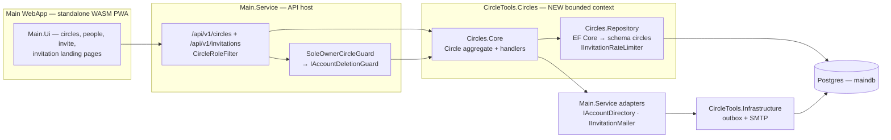

# FEAT-003 — M2 — Circles in the Main shell

## Problem & goals

- **Problem:** every app re-asks who your people are. A family or friend-group has no lasting
  existence in the suite, and nobody but the organizer can contribute
  ([IDEA-002](../roadmap/backlog.md)).
- **Goals:** a verified [User](../glossary/user.md) can create a [Circle](../glossary/circle.md),
  invite people to it by email without the invite form becoming an account-enumeration oracle, keep
  [managed members](../glossary/managed-member.md) for the people who will never sign up, administer
  roles and membership, leave, and delete — with
  [circle data authorization](../requirements/non-functional/NFR-006-circle-authorization.md) holding
  server-side on every endpoint.
- **Non-goals:**
  - **Creating a Secret-Santa group *from* a circle.** That is the payoff, and it is **M4**
    (`UC-SS-007+`). M2 builds the standing set of people; nothing consumes it yet, exactly as M1
    granted no capability. This is what keeps M2 independently reviewable.
  - **[Sync](../glossary/sync.md) and offline circles.** M3. Circles are **online-only** in M2 — a
    signed-in, verified account and a reachable API. The account-free Secret-Santa product is
    untouched ([NFR-001](../requirements/non-functional/NFR-001-local-first-offline.md)).
  - **Notifications of any kind.** No mail on acceptance, on removal, or on deletion. M2 adds exactly
    one new transactional mail: the invitation.
  - **Avatars**, deferred here from M1, are deferred again — nothing in M2 needs them.

## Requirements & use cases covered

| Item | Covered? | Notes |
|------|----------|-------|
| [UC-MAIN-008](../use-cases/main/UC-MAIN-008-create-circle.md) → [FR-016](../requirements/functional/FR-016-create-circle.md) | ✅ | name + per-circle label, owner membership created atomically |
| [UC-MAIN-009](../use-cases/main/UC-MAIN-009-invite-to-circle.md) → [FR-017](../requirements/functional/FR-017-invite-to-circle.md) | ⚠️ **partial** | built and testable against Mailpit; **cannot ship** without the transactional-email provider decision |
| [UC-MAIN-010](../use-cases/main/UC-MAIN-010-respond-to-invitation.md) → [FR-018](../requirements/functional/FR-018-respond-to-circle-invitation.md) | ✅ | both paths, one accept code path |
| [UC-MAIN-011](../use-cases/main/UC-MAIN-011-manage-managed-members.md) → [FR-019](../requirements/functional/FR-019-manage-managed-members.md) | ✅ | incl. promotion by linking |
| [UC-MAIN-012](../use-cases/main/UC-MAIN-012-manage-circle-people.md) → [FR-020](../requirements/functional/FR-020-manage-circle-roles-and-membership.md) | ✅ | roles, removal, immediate transfer |
| [UC-MAIN-013](../use-cases/main/UC-MAIN-013-leave-circle.md) → [FR-021](../requirements/functional/FR-021-leave-circle.md) | ✅ | incl. the sole-owner branches. *Closed at review:* the confirmation now states what leaving does **not** take — the account, and the user's own groups, members and completed draws |
| [UC-MAIN-014](../use-cases/main/UC-MAIN-014-delete-circle.md) → [FR-022](../requirements/functional/FR-022-delete-circle.md) | ⚠️ **partial** | one transaction, no soft-delete; the confirmation now names the circle, counts who loses access and names every managed member. The dangling-identifier criterion needs M4 |
| [FR-015](../requirements/functional/FR-015-delete-account.md) — sole-owner guard | ✅ | **closes the criterion M1 carried**: `IAccountDeletionGuard` finally gets its guard |
| [NFR-003](../requirements/non-functional/NFR-003-multilingual-de-en-fr.md) | ✅ | UI **and** the invitation mail |
| [NFR-004](../requirements/non-functional/NFR-004-data-protection-and-retention.md) | ⚠️ **partial** | managed-member minimisation and invitation retention are M2's; the residency target still waits on hosting |
| [NFR-005](../requirements/non-functional/NFR-005-account-enumeration-resistance.md) | ✅ | the invite form is the fifth address-accepting surface and the most tempting one |
| [NFR-006](../requirements/non-functional/NFR-006-circle-authorization.md) | ✅ | the whole feature is where this NFR lands |

**One criterion cannot close in M2**, and [TP-003](TP-003-m2-circles.md) records it rather than
appearing to cover it: FR-019's *"a managed member copied into a Secret-Santa group is unaffected by
their removal from the circle"*. Nothing copies a circle into a group until M4, so there is no copy to
leave unchanged. The rule is stated in the model now (the Secret-Santa context is never referenced)
and becomes testable in M4.

## The numbers M2 owes the requirements

Seven requirements deliberately left numbers and product questions to this spec. Fixing them here,
with the reason attached, is the point of the phase.

| # | Left open by | Decision | Why this and not something else |
|---|---|---|---|
| Invitation lifetime | FR-017 | **14 days** | An invitation is unsolicited mail landing in *someone else's* inbox, unlike M1's verification link, which follows an action the user just took. It has to survive a holiday week; it must not sit live for a year. A resend issues a **fresh secret and a fresh 14 days**, and kills the previous link — one invitation, one live link, always. |
| Invitations per inviter | FR-017 | **20 / hour, 60 / day**, across all circles | Above any plausible burst (adding a 30-person circle is one sitting) and far below what a script needs to use the suite as a mail relay. |
| Mails per recipient address | FR-017 | **3 / 24 h**, whatever the sender or circle | This is the only limit that protects the **third party**. Keyed on the inviter it would be trivially bypassed by inviting from three circles; keyed on the address it bounds what one person can inflict on another. |
| Pending invitations per circle | FR-017 | **50** | A circle capped at 100 people cannot legitimately owe more than half of them an answer at once. |
| Re-invite after a decline | FR-017, FR-018 | **7 days**, enforced **silently** | A decline consumes the invitation and vanishes from the pending list, exactly like an expiry — that is what stops "declined" from proving the address has an account. A cooldown that *told* the inviter would undo it. So a re-invite inside the window answers "invitation sent" as always, sends no mail, and creates no pending invitation. **Accepted cost:** an admin who mistyped, or whose friend changed their mind, waits a week with no explanation. Seven days rather than thirty because this is a family product, and the invisible failure has to stay short. |
| People per circle | FR-019 | **100 memberships**, managed members included | An abuse limit, not a product limit. The largest realistic case — an extended family, a school class — is well under it; unbounded rows are the actual risk. Configuration, not a constant, so evidence can move it without a migration. |
| Circles per user | FR-016 | **20 owned**, unlimited joined | You cannot be spammed into circles you did not accept, so only creation needs a bound. |
| Circle creation rate | FR-016 | **10 / day** per user | Same reasoning; low enough to matter, high enough that nobody real meets it. |
| Is the inviter told about an acceptance? | FR-018 | **No.** The person appearing in the people list is the signal | M2 has no notification channel and this feature is not the place to invent one. It also keeps ADR-0018's promise intact: the inviter's view is *"pending, then a person appears"*, and never anything else. |
| Is a removed person told? | FR-020 | **No mail.** The circle is simply gone from their list, and an open page reports it plainly on the next request | Removal is a social act with no reply channel; mailing it makes the product a participant in the argument. Same reasoning as FR-021's "leaving must not need permission". |
| Do managed members appear in another member's export? | FR-019 | **Yes** — display name and the managed marker, exactly what the people list shows | [ADR-0022](../adr/0022-account-deletion-and-data-export.md): the export mirrors in-app visibility. A member can see the people list, so hiding it in the export would be theatre — and adding **nothing beyond** the list keeps NFR-006's no-addresses rule true in the export too. |
| Does circle deletion need re-authentication? | FR-022 | **No password. The owner types the circle's name** | Account deletion asks for the password because the threat is a stolen session taking everything. The threat here is the **misclick** — and a hijacker who wants to hurt you deletes the account, which is already guarded. Typing the name defends against the real failure mode and avoids training users to type their password into in-app prompts. |
| Pre-deletion export window? | FR-022 | **No** | Every member can already export at any time (FR-014), and a window is a soft-delete state by another name — the thing FR-022 and ADR-0022 both refused. |
| How are elevated roles surfaced? | FR-020 | A badge on **owner and admin only** in the people list; managed members carry their own marker | Badging all three roles makes the list noise; the owner needs to see at a glance who *else* can act. |

## Design overview

**The mail goes out through a port, not through `IOutbox` directly.** `Circles.Core` names what it
needs — `IInvitationMailer.QueueAsync`, whose contract is *enqueue and return, never send inline* —
and the API host implements it over the existing outbox. Referencing `CircleTools.Infrastructure` from
the domain project would have pulled MailKit into it for one call, and the timing property that
matters (NFR-005) is stated more clearly as a rule on the port than as a habit at the call site.

The shape follows M1's: a **suite-wide bounded context in `BuildingBlocks/`**, hosted by the Main API
host, with its client half in `Main.Ui`. Circles is not an app-type — it has no head of its own — and
it is not Main's private data either: [ADR-0018](../adr/0018-circle-and-sharing-model.md) makes a
circle the standing set of people that *every* app reuses, so putting it under `Main` would have to be
undone by the first app that reads it.

It differs from `CircleTools.Identity` in one way that decides the project layout. Identity is a
**supporting** subdomain wrapping a framework; Circles is a real domain with invariants that must hold
transactionally — exactly one owner, no managed admin, one pending invitation per address. So it gets
the full inward-pointing layering (`Core` → ports, `Repository` → EF adapter) rather than a single
flat project.

## Project structure

| Project | Change |
|---------|--------|
| `CircleTools.Circles.Contracts` | **NEW** — request/response DTOs. **No DTO describing a person carries an email field**, and an architecture test says so with a two-name exemption list (NFR-006). *Corrected during implementation:* "no email field anywhere" is unachievable — `InviteRequest` is an address going **in**, and the pending-invitation list is unusable without showing which address each entry is for. Neither is what NFR-006 forbids: no *member's* address is ever returned, and neither reveals whether an address has an account. The exemption list is what keeps a third one from appearing unnoticed. |
| `CircleTools.Circles.Core` | **NEW** — the `Circle` aggregate, `CircleMembership`, `Invitation`, `DeclineRecord`, roles, the application handlers, and four **ports**: `ICircleRepository`, `IAccountDirectory` (the one crossing to Identity), `IInvitationMailer` and `IInvitationRateLimiter`. No ASP.NET, no EF. |
| `CircleTools.Circles.Repository` | **NEW** — EF Core adapter, own `CirclesDbContext`, own migrations, **own Postgres schema `circles`** in the existing `maindb`. Implements `ICircleRepository` and — *corrected during implementation* — `IInvitationRateLimiter` as well: the table below assigned that port to the API host, but FR-017's counters were always specified as part of the `circles` schema, and an adapter in `Main.Service` would have meant the host writing directly into another context's tables. The two ports that genuinely cannot live here are `IAccountDirectory` (needs Identity) and `IInvitationMailer` (needs the outbox). |
| `CircleTools.Main.Service` | **+** `/api/v1/circles` and `/api/v1/invitations`, the `CircleRoleFilter`, the circles rate-limit policies, DI composition, and the registration of `SoleOwnerCircleGuard`. |
| `CircleTools.Main.Service.Core` | **+** `IAccountDeletionCleanup` — the second deletion seam (see below). |
| `CircleTools.Infrastructure` | **+** the invitation mail template in DE/EN/FR — the fifth transactional mail, through the existing outbox. |
| `CircleTools.Main.Ui` | **+** `CirclesApiClient`, `CircleErrorText`, and the pages. *Corrected during implementation:* the list above reads as one page per action, and the build is **four** — `MyCircles` (list + create), `CircleDetail`, `JoinRequests` (`/invitations`) and `InvitationLanding` (`/invitation/{token}`). Everything from invite through delete is one change to one aggregate and one people list, so splitting them across routes would only mean reloading the circle to answer "who is in it" on each one. The two invitation pages stay separate because they are two different ways in: one carries a token from a mail, the other carries none. |
| `CircleTools.ApiClient` | **+** `ApiError.Code` — *not foreseen*. Every circle refusal carries a stable code so a DE/EN/FR client can translate it, but the reader discarded it, so the UI could only ever have said "there was a conflict". See below. |
| `CircleTools.Ui.Shared` | **+** only if a component is genuinely needed twice; M2 does **not** promote anything speculatively ([ADR-0025](../adr/0025-shared-ui-building-blocks.md)). |
| `CircleTools.Circles.Core.Test`, `CircleTools.Circles.Repository.Test` | **NEW** — see [TP-003](TP-003-m2-circles.md). |

**Same database, separate schema.** `circles` and the Identity/Main tables share `maindb`, because
[ADR-0003](../adr/0003-modular-monolith-with-aspire.md) is a modular monolith and a second database
buys nothing today. A separate schema and a separate `DbContext` keep the seam visible and make
splitting it later a deployment change rather than a rewrite. There is **no foreign key to
`AspNetUsers`**: a membership holds a `UserId` **value**, the same one-way rule
[ADR-0019](../adr/0019-member-user-linking.md) sets for Secret-Santa `Member`s.

### The second deletion seam

M1 shipped `IAccountDeletionGuard` for exactly this milestone, and it is half of what deletion needs.
The guard answers *may this account be deleted* — M2 registers `SoleOwnerCircleGuard`, which refuses
while the user still owns a circle and names the circles, so the UI can offer transfer
(FR-020) or deletion (FR-022).

Nothing, however, **removes the departing user's other memberships**. Without that, deleting an
account leaves rows pointing at a `UserId` that no longer resolves — a person who is in the people
list and is nobody. So M2 adds `IAccountDeletionCleanup`, and the Circles context implements it:
delete this user's memberships and any invitations they issued. **Managed members are not touched** —
FR-019 makes them circle data that survives their creator.

Three corrections the implementation made here:

- **The guard blocks on every circle the account owns, not only the ones nobody else could own.**
  "Sole owner" above reads as `Circle.IsSoleOwner`, and that reading is wrong: for a circle that has
  other members, deletion would run `PurgeAccount` over the owner's own membership and leave the
  circle with **no owner at all**. Nothing in the domain defines an ownerless circle, precisely
  because `Circle.Leave` guarantees one can never occur — the guard has to hold the same line
  `Leave` does. Each blocked circle therefore carries the way out that fits it, using the same two
  codes `Leave` returns: `owner_must_transfer_ownership` when somebody else could take it,
  `owner_must_delete_circle` when nobody could.
- **The refusal is structured, not a sentence.** `IAccountDeletionGuard` returned `string?` in M1,
  which cannot name circles and cannot be translated. It now returns a code plus the blockers, each
  with an id, a name and its resolution — the same reasoning ADR-0011 already forced on M1's
  password errors. Changing the shape cost nothing because M1 registered no guards.
- **The cleanup is *not* in the same transaction as the deletion**, as stated above, and cannot
  cheaply be: Identity and Circles have separate `DbContext`s over one database, so a single
  transaction would mean sharing a connection between them — a change worth an ADR, not a
  side effect of this milestone. What actually holds is **ordering**: guards, then sessions, then
  the cleanups, then the account row. If the account delete fails after a cleanup, a live account
  has been dropped from its circles — bad, but bounded, and it happens only to the user who just
  asked for exactly that. The reverse order would leave orphan rows in **other people's** circles,
  permanently, with the account gone and no way to retry. Same principle as M1's "sessions first":
  order the steps so the state that survives a partial failure is the recoverable one.

## Domain model impact

- **`Circle` is the aggregate root**, and memberships, pending invitations and decline records live
  **inside it**. That is not tidiness: "exactly one owner", "a managed member is never an admin", "one
  pending invitation per address" and every cap are circle-scoped invariants, and an invariant that
  spans aggregates cannot be enforced without a lock. A circle is at most 100 people and 50 pending
  invitations, so loading the whole thing is cheap.
  *Rejected:* `Invitation` as its own aggregate. It would make acceptance a two-aggregate transaction
  and push the uniqueness rule into a database index — enforcement in a place the domain cannot see.
- **`CircleMembership`** carries the role and is either **account-backed** (a `UserId`) or **managed**
  (a display name and optional preferred language, no address — [FR-019](../requirements/functional/FR-019-manage-managed-members.md)).
  **Promotion links the existing membership** to the new `UserId` rather than replacing it, and the
  account's display name then wins: one person, one name, and the history stays attached.
- **Transfer of ownership is one operation on one aggregate** — the target becomes owner and the
  previous owner becomes admin in the same change. It cannot half-happen, which is what makes
  FR-020's "the circle has exactly one owner" checkable rather than aspirational.
- **`Invitation`** holds the invited address (needed to send and resend), an **expiry**, and the
  **hash of a single-use secret** — never the secret, the same rule as refresh tokens. Consumed,
  revoked and expired invitations are **deleted**, not flagged.
- **A decline leaves a `DeclineRecord`**: the **hash** of the address and a timestamp, nothing else.
  It is all the cooldown needs, and it means a declined invitation stops holding an address the
  circle has no further business with (NFR-004).
- **No new domain events.** The invitation mail is enqueued by the handler through `IInvitationMailer`
  (which the host implements over `IOutbox`); an event in between would be indirection with exactly
  one consumer.
- **Glossary:** [Circle](../glossary/circle.md), [Circle membership](../glossary/circle-membership.md),
  [Invitation](../glossary/invitation.md), [Managed member](../glossary/managed-member.md) all exist
  already — M2 writes no new terms, it implements the ones ADR-0018 fixed.

## API / contract changes

Minimal APIs per [ADR-0010](../adr/0010-api-style-and-versioning.md).

| Endpoint | Who | Requirement |
|---|---|---|
| `POST /api/v1/circles` · `GET /api/v1/circles` | verified user | FR-016 |
| `GET /api/v1/circles/{id}` · `PUT /api/v1/circles/{id}` | member · owner+admin | FR-016, FR-020 |
| `POST /api/v1/circles/{id}/invitations` · `GET …/invitations` · `POST …/invitations/{iid}/resend` · `DELETE …/invitations/{iid}` | owner+admin | FR-017 |
| `POST /api/v1/circles/{id}/managed-members` · `PUT …/{mid}` · `DELETE …/{mid}` | owner+admin | FR-019 |
| `PUT /api/v1/circles/{id}/memberships/{mid}/role` · `POST …/transfer-ownership` | **owner only** | FR-020 |
| `DELETE /api/v1/circles/{id}/memberships/{mid}` | owner; admin except on admins | FR-020 |
| `POST /api/v1/circles/{id}/leave` | any member | FR-021 |
| `DELETE /api/v1/circles/{id}` | **owner only**, name typed back | FR-022 |
| `GET /api/v1/invitations` | verified user — join requests matching their **verified** address | FR-018 |
| `GET /api/v1/invitations/{token}` · `POST …/{token}/decline` | **anonymous** | FR-018 |
| `POST /api/v1/invitations/{token}/accept` | signed-in, verified, address must match | FR-018 |
| `POST /api/v1/invitations/{circleId}/{invitationId}/accept` · `…/decline` | signed-in, verified, address must match | FR-018 |

Three corrections the implementation made to the table above, all of them visible to a client:

- **The in-app path needed routes of its own** — the last row. Listing `GET /api/v1/invitations` alone
  left the account path with nothing to call, and it cannot borrow the `{token}` routes: its whole
  point is that it carries **no token from any mail**. Nor can it live under `/api/v1/circles`, where
  `CircleRoleFilter` would answer `404` to exactly the people these routes exist for — someone who is
  not in the circle yet. What admits them is the same verified-address check the link path makes.
- **Every refusal carries a stable `code` beside its English title** (`circle_full`,
  `email_not_verified`, …). The product is DE/EN/FR and a client cannot translate prose, which is the
  reasoning [ADR-0011](../adr/0011-localization-format-and-culture.md) already forced on M1's password
  errors.
- **A rate-limited invitation says when the caller may continue.** The limiter computed that instant
  and the handler discarded it, so the endpoint could only answer "not now". `CircleResult` now
  carries an optional `RetryAfter`, which the endpoint relays as a `Retry-After` header — where
  `ApiResponseReader` already looks for it — closing FR-017's *"a message saying when they may
  continue"* at the API rather than only at the limiter.

**Not a member and no such circle answer identically — `404`, same body, on every route.** A member
whose *role* is insufficient gets `403`, which reveals nothing they did not already know. This is one
endpoint filter, `CircleRoleFilter`, that loads the caller's current membership per request; no role
ever enters a token (NFR-006), so a removal takes effect on the next request rather than at the next
refresh.

**There is exactly one accept path.** The no-account branch does not create the membership as a side
effect of email verification: the client keeps the token from the link through sign-up and calls
`POST /accept` with its first session. Both branches then converge on the same check — *the caller's
verified address is the invited address* — in one place. Auto-joining on verification would have
scattered that invariant, and would auto-accept **every** pending invitation for the address, which
nobody asked for.

**Decline is anonymous, and that is a real trade-off.** Anyone holding a forwarded link can decline
an invitation that was not theirs. The alternative — requiring an account — makes "declined" prove the
address has one, which is the oracle [ADR-0018](../adr/0018-circle-and-sharing-model.md) paid UX for
already. The damage is bounded (the inviter resends); the leak would not have been.

### Rate limiting

The existing `account-sensitive` policy is per-IP and stays. M2 adds three **application-level**
limits, because per-IP is the wrong key for all of them — the inviter, the recipient and the circle
are the things being protected, and they are not IP addresses. They are enforced in the handler
against persisted counters, and their rejection body is the same shape as the limiter's
(`{message}`), which `ApiResponseReader` already understands.

## Data & migration considerations

- **Postgres:** first `circles` schema migration — `circles`, `circle_memberships`, `invitations`,
  `invitation_declines`, plus the per-inviter/per-address counters. Optimistic concurrency on the
  circle row (`xmin`), so two admins acting at once cannot both win a transfer — FR-020's
  "target's membership ended concurrently" criterion is exactly this.
  Three details the implementation had to fix, all in `CirclesDbContext` and its migration:
  - **`xmin` alone does not cover the aggregate.** Postgres bumps it per *row*, and every
    interesting change — a role, a membership ending, an invitation — is a change to a *child* row.
    So `SaveAsync` marks the circle row modified on every save, which puts the token in the `WHERE`
    clause of a statement that is always issued. Without it two concurrent transfers both succeed.
  - **The counters are rows, not counters.** All three limits are rolling windows, and a
    fixed-window counter lets twice the limit through across the boundary. `invitation_attempts`
    holds an inviter, an address *hash* and an instant; the windows are counted over two indexes,
    and the rows are swept once no limit counts them (NFR-004). It is also the only shape that can
    answer FR-017's "say when they may continue".
  - **The circle-creation limit is counted from the circles themselves**, not from a creation log.
    A circle created and then transferred away stops counting — accepted, because this is an abuse
    limit, transferring needs a second consenting account, and the alternative is storing a creator
    identifier on every circle forever to answer a question that expires after a day.
- **SQLite (local):** unchanged. Circles are online-only in M2.
- **Sync impact:** none yet, by design. M3 has to decide whether a circle syncs at all; a standing set
  of people that several devices edit is a poor fit for last-write-wins on a whole aggregate
  ([ADR-0016](../adr/0016-sync-and-conflict-resolution.md)), and M2 deliberately does not prejudge it.
- **Retention (NFR-004):** expired invitations are purged by the same hosted-service pattern as
  pending accounts. A pending invitation is the only place M2 stores an address belonging to someone
  who has not agreed to anything — so it does not outlive its purpose. The same sweep takes elapsed
  decline records and counted invitation attempts, which after their window suppress and bound
  nothing. The aggregate also drops its own expired invitations whenever it is loaded; the job is
  what reaches the circles nobody opens.

## Localization impact

New DE/EN/FR strings for every page above, plus:

- **the invitation mail**, in the **recipient's** account language when the address has one and the
  **inviter's** otherwise (FR-017) — the inviter never sees the mail, so choosing by recipient leaks
  nothing;
- **the three default labels** — *Familie* / *Family* / *Famille* — which are defaults **at creation
  time only**. Once stored, a label is user data: never re-translated, never re-defaulted
  (FR-016). The UI must therefore never look a label up in a resource file.

## Testing strategy

Paired plan: **[TP-003](TP-003-m2-circles.md)**. The weight sits where the risk is: the **role
matrix** (seven use cases × three roles × non-member is where the eighth endpoint quietly breaks the
rule), the **enumeration parity** of the invite form, and the **aggregate invariants** at unit level
where they can be exhaustively driven. Two fitness functions carry NFR-006's "a new endpoint added
later" criterion: one asserts every route under `/api/v1/circles` carries the role filter, the other
that no Circles contract type has an email field.

## Rollout / deployment & feature flags

- No flag. A verified account gains circles; nothing else changes.
- **Blocked on the same two decisions as M1**, and invitations sharpen the first: the
  **transactional-email provider** is now onboarding-critical, not merely account-critical — an
  invitation that does not arrive is a person who never joins. Development proceeds against Mailpit
  ([ADR-0023](../adr/0023-local-dev-infrastructure-in-apphost.md)); shipping does not.

## Risks & open questions

- **The silent decline cooldown is the decision most likely to be wrong.** It trades an admin's
  confusion for a recipient's protection, and only real use will say whether seven days is right. It
  is configuration; changing it costs nothing.
- **Two "member" words** — Secret-Santa's `Member` and `CircleMembership` — is ADR-0018's recorded
  risk, and M2 is where it first bites, in the **UI** as much as the model: the people list of a
  circle and the member list of a group will sit two clicks apart. Naming discipline extends to
  component and string names.
- **Caps and limits are guesses.** Every number above is configuration with a documented default, and
  none of them is enforced in the domain by a constant.
- **The invitation is the first thing the suite sends to someone who has no relationship with it.**
  Deliverability, unsubscribe expectations and abuse reporting are real operational concerns that no
  local sink can exercise, and they belong to the email-provider decision.
- **A circle is the first data that belongs to other people**, so the failure mode of an authorization
  bug changes character: M1 leaked your own data to you, M2 would leak a family's data to a stranger.
  This is why NFR-006 is verified by a matrix and two fitness functions rather than by careful review.
- **Escalate to an ADR if it appears:** any need to sync circles offline (that is M3's decision, not a
  patch), and any pressure to notify — the moment one mail is added on acceptance, the product has a
  notification system and needs to decide it deliberately.

## Definition of Done

- [x] Meets acceptance criteria of all covered requirements, except the three recorded as deferred
      above and in [TP-003](TP-003-m2-circles.md). **Two were found unmet at close and fixed rather
      than deferred:** FR-021's leave confirmation did not say that the account and the user's own
      Secret-Santa data survive, and FR-022's delete confirmation did not name the circle, count who
      loses access, or name the managed members
- [x] Builds clean under analyzers (warnings = errors)
- [x] Tests per TP-003 pass
- [x] Architecture boundaries respected — `Circles.Core` free of ASP.NET and EF; no Secret-Santa
      project references Circles; no Circles project references `CircleTools.Identity`
- [x] Docs and API comments updated; [arc42 ch. 5](../arc42/05-building-block-view.md) and
      [ch. 8](../arc42/08-crosscutting-concepts.md) reflect the built shape — the four ports, the rate
      limiter in `Circles.Repository`, both deletion seams and their ordering, `CircleRoleFilter` as
      readable metadata, `ApiError.Code`, and the four `Main.Ui` pages
- [x] Localized strings provided (DE/EN/FR), including the invitation mail and the confirmation
      sentences added at close — and, after the browser walk, the **singular** of both counted
      strings: FR-022's delete sentence (`CircleDeleteLosesAccessOne`) and FR-016's circle-list size
      (`CirclesPeopleCountOne`). One format string cannot carry both cases in any of the three
      languages: German, English and French all inflect, so *"{0} people"* renders *"1 people"* for a
      circle whose owner is its only account-backed person — which is every circle at the moment it is
      created, and in the list it is the first thing a new user sees. The pages pick the singular
      entry; the plural keeps the placeholder. Nothing here is a pluralization library: one extra
      resource entry is what a translator would write, and M2 is the wrong place to introduce plural
      machinery for two strings. The rule is now in the
      [localization guidelines](../guidelines/localization-guidelines.md) so the next counted string
      does not repeat it
- [x] **Verified in a real browser** across DE/EN/FR with a clean console — create → invite → accept
      on both paths → decline → managed member → promote → role change → transfer → leave → delete.
      Done for the milestone, and the two confirmation screens changed at close were walked again on
      **2026-07-30**. Their prose is asserted against the real DE/EN/FR resources by
      `CircleConfirmationTextTests`, which is evidence about the sentences and not about the screen —
      and the screen had one more defect in it, below
- [x] FR-015's sole-owner guard demonstrated end to end, closing the criterion M1 carried
- [x] Traceability links closed — every row of TP-003's matrix names a test class that exists
      (the M1 lesson held, and cost more than expected: see TP-003's closing notes)
