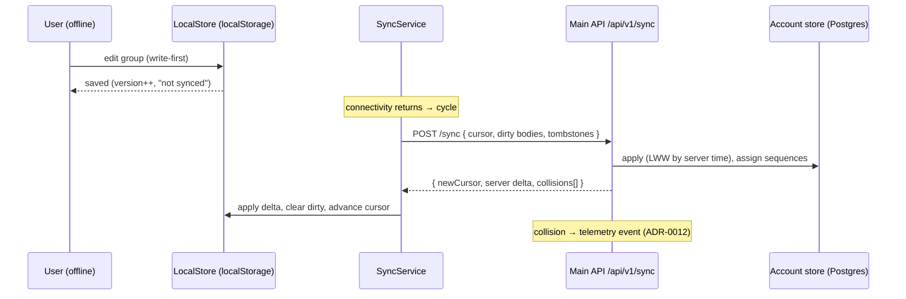

# FEAT-004 — M3 — Sync & Claim

## Problem & goals

- **Problem:** M1 gave a user a name and a password; M2 gave them a circle. Nothing they actually make
  in the Secret-Santa app moves between their own devices, so — for the app that ships — signing in
  still buys less than not signing in ([IDEA-001](../roadmap/backlog.md),
  [FR-023](../requirements/functional/FR-023-sync-across-devices.md)).
- **Goals:** a signed-in [User](../glossary/user.md) sees the same account-scoped data on every device
  with no manual transfer; they can **[claim](../glossary/claim.md)** existing account-free
  [Groups](../glossary/group.md) into the account, per group, and take them back out again; and every
  Secret-Santa flow keeps working **offline while signed in**, reconciling on reconnect. Convergence and
  data safety hold as [NFR-008](../requirements/non-functional/NFR-008-sync-convergence-and-data-safety.md)
  states them, and this milestone closes FR-012's carried criterion — the offline language change,
  pushed on the next sync.
- **Non-goals:**
  - **Syncing circle data.** [ADR-0033](../adr/0033-which-aggregates-sync.md) narrows
    [ADR-0016](../adr/0016-sync-and-conflict-resolution.md): the `Group` and profile preferences sync;
    the [Circle](../glossary/circle.md) does **not** and stays online-only as M2 built it. M3 owns the
    UI that says a circle screen needs a connection, and writes **no** circle data locally for later
    push.
  - **A conflict-resolution UI.** Last-write-wins ships behind an escalation hook that **emits
    telemetry**; the UI is parked on the evidence that hook produces (ADR-0016). Building conflict UX
    for a hypothetical is out of scope — but a **stubbed** hook is explicitly not acceptable (see the
    M2 lesson under *Risks*).
  - **Continuous background sync.** Triggers are app start, on change, on reconnect, and manual retry.
    Background polling is parked (ADR-0016).
  - **Linking a `Member` to a `User`, and creating a group *from* a circle.** That is **M4**
    (`UC-SS-009+`). M3 syncs a group as it already is; it does not give a member their own device view.
  - **IndexedDB / SQLite-in-OPFS.** `localStorage` stays, extended with sync metadata (ADR-0015/0016);
    the alternative stores remain parked behind a concrete trigger.

## Requirements & use cases covered

| Item | Covered? | Notes |
|------|----------|-------|
| [UC-MAIN-015](../use-cases/main/UC-MAIN-015-sync-across-devices.md) → [FR-023](../requirements/functional/FR-023-sync-across-devices.md) | ✅ | delta pull/push of claimed groups + profile preferences; circles excluded per ADR-0033 |
| [UC-MAIN-016](../use-cases/main/UC-MAIN-016-work-offline-and-reconcile.md) → [FR-024](../requirements/functional/FR-024-offline-editing-and-reconciliation.md) | ✅ | offline edit → local write + version bump + *not synced*; reconcile on reconnect; LWW + telemetry hook |
| [UC-SS-007](../use-cases/secret-santa/UC-SS-007-claim-local-groups.md) → [FR-025](../requirements/functional/FR-025-claim-local-groups.md) | ✅ | first-sign-in claim screen, per-group opt-in; per-group claim afterwards; partial-failure idempotency |
| [UC-SS-008](../use-cases/secret-santa/UC-SS-008-remove-group-from-account.md) → [FR-026](../requirements/functional/FR-026-remove-group-from-account.md) | ✅ | un-claim = server delete only, local copies kept; requires a connection; distinct from a delete |
| [FR-012](../requirements/functional/FR-012-manage-profile.md) | ✅ (its carried half) | the **offline** language change is queued and pushed on the next sync — the criterion M1 carried is closed here |
| [NFR-008](../requirements/non-functional/NFR-008-sync-convergence-and-data-safety.md) | ✅ | convergence + data safety; the single accepted loss is counted LWW; targets in TP-004 |
| [NFR-002](../requirements/non-functional/NFR-002-assignment-privacy.md) | ✅ (made visible) | a claimed group carries its draw, so assignments reach the server here; the claim screen states it before upload |
| [NFR-001](../requirements/non-functional/NFR-001-local-first-offline.md) | ✅ (preserved) | the local copy is written first and always usable; sync is never in the write path |

## Design overview

Sync is the **Platform** context ([arc42 ch. 5 §5.3](../arc42/05-building-block-view.md)) — a
cross-cutting capability, not an aggregate of its own. It stores each app's aggregate as a **versioned,
account-scoped opaque document**: Platform knows the id, the version, the account scope and the
server-recorded modification time; it does **not** know the group's schema. The Secret-Santa
[Contracts](../glossary/group.md) define the body. This keeps ADR-0016's rule — sync sits *behind* the
existing ports and never leaks into aggregates — literally true: the `Group` aggregate gains nothing.

- **Client** (`CircleTools.SecretSanta.LocalStore` + shared `CircleTools.ApiClient`). The `IGroupRepository`
  / `IKeyValueStore` ports from [ADR-0015](../adr/0015-mvp-client-offline-storage.md) stay; a **syncing
  implementation** wraps the existing `localStorage`-backed one. The persisted `GroupState` memento
  gains per-aggregate sync metadata; the store gains a **device id** and a **cursor**. A local edit is
  written first, bumps the version, is flagged *not yet synced*, and takes full effect with **zero
  awaited network calls** (NFR-008). A `SyncService` runs a cycle on the four triggers.
- **Server** (a sync surface on the Main API host, `CircleTools.Main.Service`; storage in
  `CircleTools.Main.Service.Repository`). One delta-exchange endpoint plus a claim/un-claim pair, all
  bearer-authorized ([ADR-0021](../adr/0021-web-auth-token-model.md)) and scoped to the caller's
  account. The server assigns a **per-account monotonic sequence** to every applied change; the client
  cursor is the highest sequence it has seen, so a pull is "everything above my cursor".
- **Profile preferences** (display name, preferred language) sync as a **single per-account profile
  document** through the same cycle, so one mechanism covers both the group case and FR-012's offline
  language change.
- **Circles are untouched** — no local write, no sync path. Offline circle screens state they need a
  connection (ADR-0033).

## Domain model impact

- **Aggregates / entities / value objects:** **none added or changed** in `SecretSanta.Core`. Sync is
  behind the ports (ADR-0016). The `GroupState` **memento** in
  `CircleTools.SecretSanta.Core/Persistence/` gains sync metadata (below); the aggregate itself is
  unaware of it.
- **New Platform concepts (not app-domain):** a per-aggregate **version token**, a
  [**tombstone**](../glossary/tombstone.md) (id + version at deletion, no content), and an **un-claim
  marker** — the signal that a group *left the account* but its local copies are kept, which a
  tombstone must never do. Markers and tombstones are Platform mechanism, not Secret-Santa domain.
- **Glossary:** [Sync](../glossary/sync.md), [Claim](../glossary/claim.md),
  [Tombstone](../glossary/tombstone.md) move from Draft to reflect ADR-0033; no new terms are coined
  (an "un-claim marker" is an implementation detail of sync, not ubiquitous language — the user-facing
  concept is *removing a group from your account*, already in [Claim](../glossary/claim.md)).

## API / contract changes

All under `/api/v1` ([ADR-0010](../adr/0010-api-style-and-versioning.md)), bearer-authorized, scoped to
the caller's account.

- **`POST /api/v1/sync`** — one delta exchange per cycle. Request: `{ deviceId, cursor, changes[],
  tombstones[] }`, where `changes[]` carries the **full body + version** of each locally-dirty
  aggregate (typed by aggregate kind: `group` | `profile`) and `tombstones[]` carries `{ kind, id,
  version }`. Response: `{ cursor, changes[], tombstones[], unclaimed[], collisions[] }` — everything
  with a server sequence above the request cursor, the new cursor, and a collision descriptor per LWW
  discard. A **no-op cycle** (nothing dirty, cursor current) carries **no aggregate bodies** in either
  direction — the request lists no changes and the response returns none (NFR-008).
- **`POST /api/v1/sync/groups/{id}/claim`** — first upload of a not-yet-account-scoped group. Because
  ids are client-minted ([ADR-0008](../adr/0008-entity-id-strategy.md)), re-claiming a group that did
  arrive **updates** it rather than duplicating it, which is what makes a partly-failed multi-group
  claim safe to retry (FR-025). After a successful claim the group is account-scoped and rides the
  normal `/sync` cycle.
- **`DELETE /api/v1/sync/groups/{id}`** (un-claim) — deletes the **server** copy only (including its
  assignments, ADR-0020) and records an **un-claim marker** so other devices drop the account scope but
  **keep** their local copy. It is **not** a tombstone. Requires a connection (FR-026); the client
  clears the local account scope only after the server confirms, so a flag is never flipped with an
  orphaned server copy behind it. Idempotent: un-claiming a group already removed elsewhere clears the
  local scope and surfaces no error.
- **Versioning / compatibility:** additive — new routes only; no existing account/circle/heartbeat
  contract changes. Contracts for the sync envelope live in `CircleTools.Main.Contracts`; the group body
  shape is `CircleTools.SecretSanta.Contracts`' existing `GroupDtos`, so Platform stays ignorant of the
  Secret-Santa schema.

## Data & migration considerations

- **Postgres (server):** a new account-scoped store (own schema, e.g. `sync`) with: an **aggregates**
  table `(account_id, aggregate_id, kind, body jsonb, version, server_seq, server_modified_at)` keyed by
  account + id; a **markers** table for tombstones and un-claim markers `(account_id, kind, aggregate_id,
  version, server_seq, marker_type)`; and a **device registry** `(account_id, device_id, last_cursor)`
  so retention can find the slowest device. `server_seq` is a per-account monotonic counter;
  `server_modified_at` is the LWW ordering key (server clock, never device time). No foreign key to the
  Identity model (same independence rule Circles follows). Assignments are stored in-body as plaintext,
  authorized by account ownership (ADR-0020).
- **SQLite / `localStorage` (client):** the `GroupState` memento gains `version`, `accountScope`
  (null = local-only), and `dirty`; the store gains `deviceId`, `cursor`, and a small **tombstone /
  pending-marker set**. Existing keys (`circletools.secretsanta.groups`) are **migrated in place** with a
  schema-version bump — no user loses a group. `localStorage` stays (ADR-0015/0016); SQLite/OPFS parked.
- **Sync impact:** the aggregate is the unit; never a field-wise merge. LWW by `server_modified_at`.
  Deletes travel as tombstones; un-claims as markers. **Tombstone / marker retention:** a marker is
  pruned only once **every** registered device's `last_cursor` has advanced past the marker's
  `server_seq` (prune below `min(last_cursor)`), so a delete cannot resurrect and an un-claim cannot
  re-drop on a device that never saw it.

## Localization impact

New user-facing strings, all in **DE / EN / FR** (tone per [ADR-0032](../adr/0032-ui-tone-of-voice-and-gender-neutral-terms.md)):

- **Claim screen:** the per-group list; "nothing selected" is a state, not a string; the standing
  warnings (local copy stays; unclaimed groups live on this device only; a drawn group uploads its
  assignments and the operator can technically read them). The list's **count fragment must have a
  singular** — the M2 trap (`"1 Personen"` / `"1 people"` / `"1 personnes"`), and a claim screen shows
  exactly one group often. FR-025 requires the singular in each language.
- **Sync status:** *synced* / *not synced* / *failed — retry*, phrased as **fact, not error**.
- **Un-claim confirmation:** wording that distinguishes *remove from account* from *delete the group*,
  and the offline-unavailable reason.
- **Offline circle notice:** circle screens state they need a connection (ADR-0033).

## Testing strategy

Paired plan: **[TP-004](TP-004-m3-sync-and-claim.md)**. It is weighted toward the two invisible-failure
properties of NFR-008 — **convergence** and **data safety** — because both fail silently and a green
suite says nothing about either. The centre of the plan is a **two-client integration harness** driving
real sync cycles against the API: offline edits, concurrent edits (exactly one survivor **and** a
collision telemetry event), deletes (no resurrection past a seen tombstone), replayed pushes
(idempotent, zero duplicates), a no-op cycle (no aggregate bodies), and a local-storage **count
assertion around every account action** (sign-in, claim, un-claim, sign-out, account deletion → count
unchanged). Plus the FR-025 DE/EN/FR singular-count check and the ≤200-aggregate ≤5 s timing target.

## Rollout / deployment & feature flags

- **No feature flag needed for correctness**, but the whole surface is inert for account-free users —
  sync only ever runs for a signed-in user, so the account-free product is unchanged by construction.
- **Migration order:** apply the client `localStorage` schema-version bump on load (idempotent, keeps
  existing groups) before the first sync; apply the server `sync` schema migration with the rest.
- **Blocked on the same deployment ADRs as M1/M2 for *shipping*** (transactional email, hosting/Swiss
  residency) — but **not** for *building*, thanks to containerised dev infra
  ([ADR-0023](../adr/0023-local-dev-infrastructure-in-apphost.md)).

## Numbers & product questions this spec fixes

The requirements deferred these to the feature spec (ADR-0016 explicitly sends the wire format and
tombstone retention here). Fixed:

| Question | Decision |
|----------|----------|
| **Sync unit & endpoint shape** | One `POST /api/v1/sync` delta exchange per cycle; full body for dirty aggregates, `(id, version)` never carried alone for a body that must move; response is the delta above the cursor. Claim and un-claim are their own routes. |
| **Cursor & ordering** | Per-account monotonic `server_seq`; cursor = highest seen. Ordering / LWW by **`server_modified_at`** (server clock), never device time. |
| **Tombstone & marker retention** | Prune below `min(device last_cursor)` — only once every registered device has advanced past the marker. |
| **Un-claim vs delete** | Un-claim = server delete + **un-claim marker** (keep local copies); delete = tombstone (remove everywhere). The two are never the same signal (FR-026). |
| **Claim idempotency** | Client-minted ids (ADR-0008) mean a re-claim **updates**; a partly-failed multi-group claim is safe to retry, and the arrived groups stay claimed (FR-025). |
| **Triggers** | App start, on change (debounced), on reconnect, manual retry. Not continuous (parked). |
| **No-op cost** | A cycle with nothing dirty and a current cursor transfers **no aggregate bodies** either way. |
| **Collision handling** | LWW discards the earlier-`server_modified_at` side **in full** and **emits a telemetry event** (aggregate kind + id) per ADR-0012. Not shown to the user in M3 (FR-024); the UI is parked on this counter. |
| **Profile preferences** | Sync as a single per-account `profile` document through the same cycle — covers FR-012's offline language change with no second mechanism. |

## Risks & open questions

- **The escalation hook must be wired and observable, not a stub.** This is the M2 lesson stated as a
  build risk: M2 shipped a fitness function that existed only as a design comment. If the collision
  hook does not actually emit telemetry, the parked conflict UI loses the evidence it is parked on, and
  we will wrongly conclude collisions never happen. TP-004 asserts a collision emits its event.
- **Device registry growth / stale devices.** Retention keys on `min(device last_cursor)`; a device
  that signs in once and never returns would freeze pruning. Mitigation: age out a device registration
  after a long inactivity window; recorded here as the one retention edge to settle in build.
- **Server clock as the ordering authority.** Inherited from ADR-0016 and accepted: a purely offline
  reorder is decided by arrival order at the server, not by when the user typed it.
- **Assignments now leave the device at claim, not at M4.** NFR-002's amended, account-mode half takes
  effect here; the claim screen must state it **before** the upload (FR-025), not in a later settings
  page.

## Definition of Done

- [x] Meets acceptance criteria of FR-023, FR-024, FR-025, FR-026, NFR-008 (and closes FR-012's carried
      offline-language criterion)
- [x] Builds clean under analyzers (warnings = errors)
- [x] Tests per [TP-004](TP-004-m3-sync-and-claim.md) pass; coverage target met; the two-client harness green
- [x] Architecture boundaries respected — sync stays behind the ports; `SecretSanta.Core` unchanged;
      Platform stores app aggregates as opaque documents (arch tests green)
- [x] The collision telemetry hook is wired and asserted (not a stub)
- [x] Docs, glossary (Sync/Claim/Tombstone), and API comments updated
- [x] Localized strings provided (DE/EN/FR), including the claim-screen **singular** count
- [x] Browser walkthrough in DE/EN/FR, **two devices / two profiles**: claim → edit on A → see on B →
      edit offline on both → reconcile → delete → un-claim → offline circle notice
- [x] Traceability links closed
