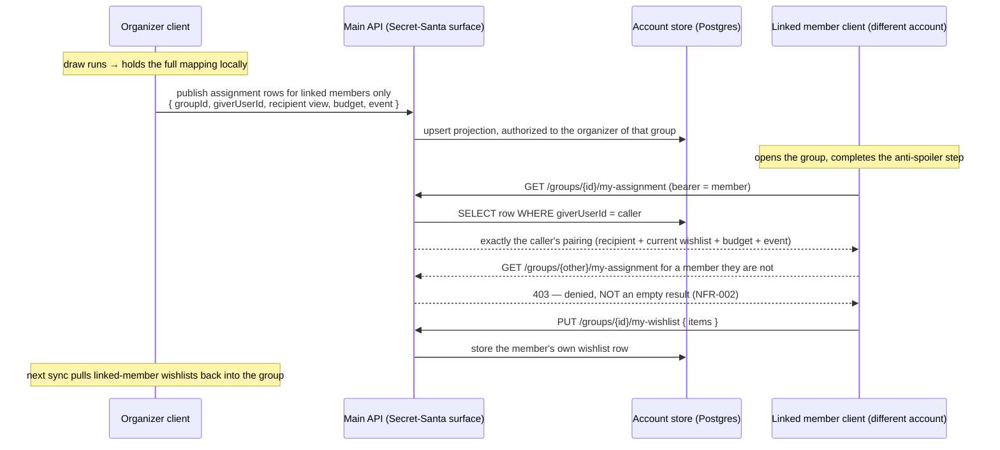

# FEAT-005 — M4 — Linking

## Problem & goals

- **Problem:** M1 gave a person an account, M2 gave them a [Circle](../glossary/circle.md), M3 made
  their own [Groups](../glossary/group.md) follow them between their own devices. But a group is still
  a thing **one** organizer owns and everyone else is a name in: the family is retyped every December
  ([FR-027](../requirements/functional/FR-027-create-group-from-circle.md)), a participant with an
  account still cannot see their own [Assignment](../glossary/assignment.md) without the organizer
  handing them a [reveal link](../glossary/reveal-link.md)
  ([FR-029](../requirements/functional/FR-029-see-my-assignment.md)), and the organizer still types
  everyone's [Wishlist](../glossary/wishlist.md) for them
  ([FR-030](../requirements/functional/FR-030-edit-my-wishlist.md)). Signing in is worth **less** than
  it should be for anyone who is not the organizer.
- **Goals:** make a [Member](../glossary/member.md) able to *be* a person.
  - **Create a group from a circle** — bring the standing set of people in as members instead of
    retyping them, linked where they have an account, as a **snapshot** that does not track the circle
    afterwards ([FR-027](../requirements/functional/FR-027-create-group-from-circle.md)). This closes
    the carried Secret-Santa halves of [FR-019](../requirements/functional/FR-019-manage-managed-members.md)
    and [FR-022](../requirements/functional/FR-022-delete-circle.md).
  - **Link a member to an account** — with the account holder's **consent**, so that person owns their
    wishlist and (once drawn) sees their assignment; and **unlink**, reverting cleanly
    ([FR-028](../requirements/functional/FR-028-link-member-to-account.md)).
  - **See my assignment while signed in** — on any device, with no link, behind the same anti-spoiler
    step as the reveal page, protected by **server-side authorization**
    ([FR-029](../requirements/functional/FR-029-see-my-assignment.md)).
  - **Edit my own wishlist** — self-owned per membership, syncing like any other edit
    ([FR-030](../requirements/functional/FR-030-edit-my-wishlist.md)).
- **Non-goals:**
  - **A live circle→group link.** The group is a **copy taken at create time** — a person added to or
    removed from the circle later does not change the group
    ([ADR-0018](../adr/0018-circle-and-sharing-model.md) D2). Building a live view is explicitly
    rejected: it would silently rewrite a completed December draw when the circle changes in January.
  - **Circle sync.** The circle is **read once** to populate the create-from-circle picker (an
    authorized read, [NFR-006](../requirements/non-functional/NFR-006-circle-authorization.md)); it is
    **not** synced and no circle data is written locally ([ADR-0033](../adr/0033-which-aggregates-sync.md)
    is unchanged).
  - **Notifications.** M4 has no notification channel (as M2 had none). A linked member **discovers**
    the group and their assignment when they next open the app; a notification is parked, consistent
    with the brainstorming decision to defer them.
  - **Organizer rights through a link.** A linked member sees their own assignment and owns their own
    wishlist and **nothing else** — running the draw, editing the group, generating links and reading
    the full mapping stay with the organizer ([ADR-0019](../adr/0019-member-user-linking.md)).
  - **Per-member envelope encryption of assignments.** Assignments are stored plaintext and protected
    by authorization ([ADR-0020](../adr/0020-server-side-assignment-privacy.md) chose P1); P3 stays the
    recorded **future hardening** step, not M4 work.
  - **A conflict-resolution UI, continuous background sync.** Unchanged from M3 (ADR-0016): the new
    writes ride the same triggered cycle and the same last-write-wins.

## Requirements & use cases covered

| Item | Covered? | Notes |
|------|----------|-------|
| [UC-SS-009](../use-cases/secret-santa/UC-SS-009-create-group-from-circle.md) → [FR-027](../requirements/functional/FR-027-create-group-from-circle.md) | ✅ | circle read → snapshot copy into a new account-scoped group; linked where accounted, duplicate-account guard, defensive origin reference |
| [UC-SS-010](../use-cases/secret-santa/UC-SS-010-link-member-to-account.md) → [FR-028](../requirements/functional/FR-028-link-member-to-account.md) | ✅ | consent-based **member-link** (reuses the M2 invitation machinery), self-link auto-accept, one-user-per-group guard, unlink, account-deletion cascade |
| [UC-SS-011](../use-cases/secret-santa/UC-SS-011-see-my-assignment.md) → [FR-029](../requirements/functional/FR-029-see-my-assignment.md) | ✅ | server-authorized **my-assignment** read — **deny, not filter**; ≤1 assignment for a non-organizer; anti-spoiler; offline-readable cache |
| [UC-SS-012](../use-cases/secret-santa/UC-SS-012-edit-my-wishlist.md) → [FR-030](../requirements/functional/FR-030-edit-my-wishlist.md) | ✅ | self-owned wishlist per membership; ownership moves on link, returns on unlink; per-group with copy-previous offer; reveal-link snapshot caveat surfaced |
| [FR-019](../requirements/functional/FR-019-manage-managed-members.md) | ✅ (carried half) | a managed member copied into a group is a snapshot — unaffected by later removal from the circle |
| [FR-022](../requirements/functional/FR-022-delete-circle.md) | ✅ (carried half) | a group whose origin circle is later deleted opens unchanged; the dangling origin reference is never dereferenced |
| [FR-015](../requirements/functional/FR-015-delete-account.md) | ✅ (its M4 obligation) | account deletion **cascades to a graceful unlink** — every referencing member survives (name + wishlist), the group does not break |
| [NFR-002](../requirements/non-functional/NFR-002-assignment-privacy.md) | ✅ (the account-mode half, in action) | this feature **is** the amended NFR-002: authorization, verified by cross-member authorization tests, not by absence |
| [NFR-005](../requirements/non-functional/NFR-005-account-enumeration-resistance.md) | ✅ (extended) | the member-link request reveals nothing about whether an address has an account; decline/expiry are indistinguishable |
| [NFR-006](../requirements/non-functional/NFR-006-circle-authorization.md) | ✅ (reused) | the circle read for the picker is authorized per request against current membership |
| [NFR-001](../requirements/non-functional/NFR-001-local-first-offline.md) | ✅ (preserved) | unlinked members and account-free groups are untouched; linking is strictly additive; a mixed group is the normal case |

## Design overview

M4 is the first milestone in which a **second account** touches a group. Everything before it was
single-account: M3 syncs a group as an **opaque, account-scoped document** to the **organizer's own**
devices ([FEAT-004](FEAT-004-m3-sync-and-claim.md), [ADR-0016](../adr/0016-sync-and-conflict-resolution.md)).
A linked member is a **different** user, and needs to read one slice of the organizer's group (their
own assignment) and write another (their own wishlist). M3's mechanism cannot express that — its unit
is a whole document returned to its owning account, with no per-row authorization. So the load-bearing
new piece of M4 is a **structured, per-caller-authorized surface** that sits *beside* M3's opaque
sync, not inside it. This is exactly the surface [ADR-0020](../adr/0020-server-side-assignment-privacy.md)
sanctioned when it decided the server may store **the giver, the recipient, and the group — and
nothing more** — authorized so a member reads only their own pairing.

Four flows, three of them building on M1–M3, one genuinely new:

1. **Create a group from a circle (FR-027).** The Secret-Santa client reads the caller's circles from
   the **existing** Main circle API (an authorized read, NFR-006 — no new sync path, ADR-0033), shows
   the people with everyone pre-selected, and **composes a new group locally**: one `Member` per chosen
   person, carrying an optional `UserId` for accounted people and the **origin circle-person id**
   recorded but never dereferenced. The group is account-scoped from birth and rides the normal M3
   claim/sync cycle — no separate claim. The **host** maps circle DTOs to member creation; the
   Secret-Santa **domain never references the Circles context** ([ADR-0019](../adr/0019-member-user-linking.md)).

2. **Link / unlink (FR-028).** Establishing a link needs the account holder's consent, and the request
   must not reveal whether an address has an account — which is *exactly* the M2 invitation problem
   already solved. M4 **reuses the invitation machinery** (outbox mail, expiry, revoke, constant-time
   account lookup) as a **member-link** variant scoped to a member rather than a circle join. The
   organizer sends to an email → *"request sent"*; the recipient resolves it in-app; **only on
   acceptance** does the link exist. A **self-link auto-accepts**. The server records the link; the
   **organizer's client** writes the authoritative `Member.UserId` onto its group and syncs it, so the
   group document stays the single source of truth for the roster.

3. **See my assignment (FR-029) & edit my wishlist (FR-030) — the new cross-account surface.** When the
   organizer runs (or re-runs) a draw, the organizer's client **publishes**, for each **linked**
   member, a minimal assignment record to the Main service. A linked member reads their **own** slice
   through an endpoint that **authorizes every read and denies — not filters — a request for anyone
   else's**, capping a non-organizer response at one assignment. A linked member **writes their own
   wishlist** to the same surface; the organizer's client reads linked-member wishlists back on sync so
   givers (in-app or via a re-issued link) see the current text. The server never computes a draw and
   never learns more than giver/recipient/group.

## Domain model impact

- **`SecretSanta.Core` — `Member` gains two optional fields, and only two:**
  - **`UserId?`** — the nullable account reference ([ADR-0019](../adr/0019-member-user-linking.md)).
    The domain stores an **identifier, not a user**; it never navigates to Identity or Circles.
    Wishlist ownership and assignment visibility are **not** new domain state — they are *resolved from
    link state* in the application layer, keeping the null-branch in one place (ADR-0019's stated
    mitigation) rather than scattered through the domain.
  - **`OriginCirclePersonId?`** — the circle person a member was copied from (FR-027). It is recorded
    at create time and **read defensively: never dereferenced into the circle**, so a deleted circle
    cannot make the group fail to open (FR-022's carried half). It is an opaque `Guid` to the domain —
    the domain does not know it is a circle person.
- **Draw invalidation is unchanged.** Editing the group's members still invalidates its draw; editing
  the *circle* does not touch the group at all (it is a snapshot). Linking or unlinking a member
  changes how they are *served*, not the participant set, so it **does not invalidate a completed
  draw** — a subtle but important rule the spec fixes (see the numbers table).
- **New server-side concepts (Main service, *not* Secret-Santa domain language):** a **member-link**
  record `(groupId, memberId, userId, state)`; an **assignment projection** row
  `(groupId, giverUserId → recipient view)`; a **member self-wishlist** row `(groupId, memberUserId,
  items)`. These are application/infrastructure mechanism on the server, authorized per caller. They
  are **not** new ubiquitous terms — "link" and "linked member" already exist in the glossary, and a
  member-link request is an application of the existing [Invitation](../glossary/invitation.md).
- **Glossary:** [Member](../glossary/member.md) moves to reflect linking as live (already drafted for
  it). **[Assignment](../glossary/assignment.md) must be amended**: its current line "not stored on any
  server" is the pre-v2 statement and is now **scoped to account-free mode** — in account mode the
  pairing is stored server-side and protected by authorization ([ADR-0020](../adr/0020-server-side-assignment-privacy.md)).
  No new term is coined.

## API / contract changes

All under `/api/v1` ([ADR-0010](../adr/0010-api-style-and-versioning.md)), bearer-authorized and
account-scoped, on the **Main API host** (where sync already lives). Additive — new routes only.

- **Circle read for the picker — reused, no change.** The create-from-circle flow calls the existing
  circle read endpoints (`AppSuite.Circles.Contracts`). No circle data is persisted client-side
  (ADR-0033).
- **Member-link (FR-028), reusing the invitation infrastructure:**
  - **`POST /api/v1/member-links`** — `{ groupId, memberId, email }`. Sends a member-link invitation
    through the existing outbox mailer and **always** responds *"request sent"* (`202`), revealing
    nothing about account existence — routed through the same constant-time account lookup as M2
    ([NFR-005](../requirements/non-functional/NFR-005-account-enumeration-resistance.md)). A
    **self-link** (the email resolves to the caller) is **auto-accepted** and returns linked.
  - **`GET /api/v1/member-links/pending`** — the caller's pending member-link requests (mirrors M2's
    `JoinRequestResponse`): group name, the member's display name, the inviter, and nothing that leaks
    another member's data.
  - **`POST /api/v1/member-links/{id}/accept` · `/decline`** — the recipient resolves it. Accept
    records the link and runs the **one-user-per-group** guard; decline and expiry are **indistinguishable
    to the organizer** (NFR-005). A managed-member link is refused with the **promotion** path offered
    (FR-019/ADR-0018).
  - **`DELETE /api/v1/member-links/{id}`** — the organizer **revokes** a pending request or **unlinks**
    an established link. Unlink is not a delete: the member and wishlist content survive.
  - **Link resolutions ride the sync cycle back to the organizer.** An accepted/declined/cascaded link
    is applied to the organizer's group by the organizer's client on the next `POST /api/v1/sync`
    (a new instruction kind on the existing envelope), which then sets/clears `Member.UserId` and
    syncs — one mechanism, no second poller (the M3 ethos).
- **Assignment & self-wishlist (FR-029, FR-030) — the new authorized surface:**
  - **`GET /api/v1/groups/{id}/my-assignment`** — returns **only the caller's own** pairing (recipient
    display name, that recipient's **current** wishlist, budget, event). A request by a caller who is
    not that member is **denied (`403`), never filtered to empty**; a non-organizer response **never
    carries more than one** assignment. The client decides nothing (ADR-0020).
  - **`GET /api/v1/my-assignments`** — the cross-group overview; each row is the caller's own pairing
    in one drawn group, each surfaced behind its own anti-spoiler step client-side.
  - **`PUT /api/v1/groups/{id}/my-wishlist`** — `{ items[] }`, the linked member's own wishlist for
    that membership. Empty items are ignored (matching organizer-side editing). Offline edits are
    written locally and reconciled last-write-wins per aggregate (FR-024).
  - **`GET /api/v1/my-wishlists`** — the caller's wishlists across their memberships, so a new
    membership can **offer to copy** a previous one (FR-030); copying is a client action, not shared
    state.
- **Assignment publication (organizer → server).** The organizer's client publishes the assignment
  rows for **linked members only** as part of its sync cycle when a draw completes or is re-run; a
  stale row for a superseded draw is replaced, so a linked member's next read is the **current**
  pairing and never a previous one (FR-029).
- **Versioning / compatibility:** additive. The member-link and assignment/wishlist contracts are
  **Secret-Santa-shaped** and live in `AppSuite.SecretSanta.Contracts`; the Main host references them
  for this surface. This is the **one deliberate exception** to M3's "Platform stays ignorant of the
  Secret-Santa schema": ADR-0020 authorized a Secret-Santa-specific assignment store on the server.
  The **generic sync store from M3 stays opaque and untouched** — the group document still round-trips
  without the server deserializing it. See *Risks* for when this exception should graduate.

## Data & migration considerations

- **Postgres (server):** a new account-scoped **linking** schema (separate from `sync`):
  - **`member_links`** `(id, group_id, member_id, organizer_account_id, target_account_id?, invited_email_hash, state, created_at, expires_at)` — reusing the invitation lifecycle (expiry, revoke, constant-time lookup). No FK to Identity (same independence rule Circles follows).
  - **`assignments`** `(group_id, organizer_account_id, giver_account_id, recipient_member_id, recipient_display_name, recipient_wishlist_snapshot?, budget, event, draw_version)` — the **minimal** projection ADR-0020 permits: giver, recipient, group. Keyed so the read is a single authorized row lookup by `giver_account_id = caller`. `draw_version` lets a re-run replace prior rows atomically.
  - **`member_wishlists`** `(group_id, member_account_id, items jsonb, version)` — a linked member's self-owned wishlist. The recipient's **current** wishlist shown to a giver is composed at read time: a **linked** recipient's own row if present, else the organizer-published snapshot.
  - Assignments are subject to **deletion & export** obligations (revDSG/GDPR, ADR-0020): account
    deletion removes the caller's assignment/wishlist rows and unlinks; export includes them.
- **SQLite / `localStorage` (client):** the `GroupState` memento already carries members; each member
  gains `userId` and `originCirclePersonId` (both nullable), migrated in place with a schema-version
  bump — no group is lost. A linked-member device caches its **own** last-synced assignment and its own
  wishlist for offline read (FR-029/FR-030); it caches **no other member's** assignment — the
  authorization decision was made server-side at fetch and the cache never re-decides it.
- **Sync impact:** the group aggregate is unchanged in shape as an opaque document; link resolutions
  travel as a new instruction on the existing envelope; assignment rows and self-wishlists travel on
  the **new** authorized surface, not the opaque store. Last-write-wins per aggregate applies to a
  self-wishlist exactly as to any group edit.

## Localization impact

New user-facing strings, all **DE / EN / FR** (tone per [ADR-0032](../adr/0032-ui-tone-of-voice-and-gender-neutral-terms.md)):

- **Create-from-circle picker:** the circle chooser and the people list with everyone pre-selected; the
  *"N people in this circle"* count — which **must have a singular** in all three languages (the
  recurring M2 `"1 Personen"` trap, and a picker shows one person often); the *"brought in unlinked
  because someone else already uses that account"* notice (duplicate-account guard).
- **Link / unlink:** *"request sent"* / *"link pending"* (phrased so decline and expiry are
  indistinguishable), the self-link confirmation, the managed-member refusal that **offers promotion**,
  and the unlink confirmation stating the wishlist is kept.
- **My assignment:** the anti-spoiler reveal action (reused from the reveal page), the recipient +
  wishlist + budget + event labels; the recipient's **free-text wishlist is shown untranslated**.
- **My wishlist:** the editor UI, and the **reveal-link caveat** — that in-app reveal is current but a
  giver holding an already-issued link sees the old text until it is re-issued (FR-030). Content is
  stored and shown untranslated.
- **Privacy copy:** in account mode the operator can technically read the pairings — stated plainly, in
  those words, not as "secure" (ADR-0020).

## Testing strategy

Paired plan: **[TP-005](TP-005-m4-linking.md)**. Where TP-004 centred on the two-client convergence
harness, TP-005 centres on **authorization**, because that is where M4's sharpest new failure mode
lives: the account-free design had nothing to leak, whereas one wrong authorization rule here leaks the
exact secret the app exists to keep ([ADR-0020](../adr/0020-server-side-assignment-privacy.md),
[NFR-002](../requirements/non-functional/NFR-002-assignment-privacy.md)). The centre of the plan is a
**two-account** harness (an organizer account and a linked-member account) asserting, with explicit
cross-member cases: my-assignment is **denied, not filtered** for anyone else's; a non-organizer
response never carries more than one assignment; a re-run shows the current pairing and never the
previous one; and the offline cache holds only the caller's own. Around it: the snapshot semantics of
create-from-circle (circle change and circle deletion leave the group intact), the enumeration-resistant
member-link request (decline vs expiry indistinguishable), the one-user-per-group and managed-member
guards, the account-deletion cascade (member survives, group opens), the wishlist ownership move/return
on link/unlink, and the DE/EN/FR singular-count check on the circle picker.

## Rollout / deployment & feature flags

- **No feature flag needed for correctness** — the whole surface is inert for account-free users and
  for unlinked members; a mixed group behaves as it does today for everyone not linked. The account-free
  product is unchanged by construction (NFR-001).
- **Migration order:** apply the client member-field schema bump on load (idempotent) before the first
  sync; apply the server `linking` schema with the rest. Assignment publication is **backfilled** for
  already-drawn claimed groups on the organizer's next sync, so linked members of a group drawn before
  M4 still get in-app reveal without a re-draw.
- **Ship-blocking, same as M1–M3:** the member-link mail sharpens the **transactional-email** decision
  from account-critical to onboarding-critical (a link request that never arrives is a person who never
  links) — it blocks *shipping*, not *building* ([ADR-0023](../adr/0023-local-dev-infrastructure-in-apphost.md)).

## Numbers & product questions this spec fixes

The requirements and use cases deferred these to the feature spec. Fixed:

| Question | Decision |
|----------|----------|
| **How does a second account read/write one slice of an organizer-owned group?** | A **new structured, per-caller-authorized surface** on the Main API (member-link, assignment projection, self-wishlist), **beside** M3's opaque single-account sync — the surface ADR-0020 sanctioned. M3's generic store stays opaque and untouched. |
| **Does the member-link request reuse the M2 invitation infrastructure?** (FR-028 open) | **Yes** — a member-link variant of the invitation machinery (outbox mail, expiry, revoke, constant-time account lookup), scoped to a member rather than a circle join. Not a parallel system. |
| **Self-link consent** (UC-SS-010 open) | The signed-in organizer linking **their own** account **auto-accepts**; any other account **always** requires acceptance. |
| **Duplicate-link guard** | **One user backs at most one member per group.** Enforced at **accept time** in the application layer (the domain holds only an identifier). Create-from-circle brings the second occurrence in **unlinked** and tells the user. |
| **Account-deletion cascade** (ADR-0019 / UC-SS-010) | Deleting an account **unlinks** every member referencing it: the server clears the link + that user's assignment/wishlist rows and emits an unlink instruction the organizer's client applies on next sync. Member, name and wishlist **survive**; the group opens without error (FR-015). |
| **Who may create a group from a circle?** (UC-SS-009 open) | **Any circle member** — the group belongs to the organizer, not the circle, and creating one only *reads* the circle (an authorized read, NFR-006). No new circle role. |
| **Snapshot timing** | The copy is taken at **create** time and never tracks the circle. A later add/remove in the circle, and the circle's **deletion**, leave the group unchanged; the origin reference is read defensively and never dereferenced (FR-027, FR-022). |
| **Does linking/unlinking invalidate a completed draw?** | **No.** A link changes how a member is *served*, not the participant set. Only editing the group's members invalidates its draw (unchanged rule). |
| **Wishlist scope** (FR-030 open) | **Per membership** (a member is per group), with a client-side **offer to copy** a previous wishlist when joining a new linked group. The organizer may **see but not edit** a linked member's wishlist while the link stands. |
| **In-app reveal interaction** (UC-SS-011 open) | **Reuse** the reveal page's deliberate anti-spoiler step — same shared-screen risk, one mental model — and re-verify it **on screen** (the reveal-page defects that only showed in a browser are the precedent). |
| **Recipient's current wishlist to a giver** | Composed at read: a **linked** recipient's self-owned wishlist if present, else the organizer-published snapshot. **In-app reveal is live; a reveal link stays a snapshot** at generation (ADR-0014) — the member is told so (FR-030). |

## Risks & open questions

- **Authorization is the whole game, and it fails silently.** A `my-assignment` rule that *filters to
  empty* instead of *denying*, or that lets an organizer-shaped response reach a non-organizer, leaks a
  real secret and passes a happy-path test. TP-005 makes the cross-member **deny** and the
  one-assignment cap first-class assertions, not corollaries — this is the M2/M3 lesson (a green suite
  says nothing about a silent property) applied to the sharpest surface in the suite.
- **The Main host now references the Secret-Santa schema for one surface.** M3 kept Platform ignorant
  of the group schema; M4's assignment/link surface deliberately breaks that for the store ADR-0020
  authorized. Accepted for M4. **Graduation trigger:** when a *second* app needs a server-side
  per-user projection, this should become either a generic authorized-projection Platform capability or
  a dedicated Secret-Santa service — and **that** is where a new ADR belongs. Recorded, not decided
  now.
- **Assignment publication must actually run on every draw and re-run.** If the organizer's client
  forgets to publish (or to replace) rows, a linked member sees nothing, or worse a **stale** pairing.
  The re-run-replaces-prior test and the backfill-on-first-sync path guard this; it is the direct
  analogue of M3's "the collision hook must be wired, not stubbed."
- **A dangling `UserId` must degrade, never break.** The deletion cascade is a cross-context concern
  (ADR-0019). If it is missed, a linked member who deletes their account leaves a reference that must
  read as *unlinked*, not throw. Covered by an explicit cascade test.
- **Enumeration resistance extends to a new surface.** The member-link request must leak nothing about
  account existence and make decline indistinguishable from expiry — reusing M2's constant-time path is
  the mitigation, and TP-005 re-asserts it here rather than trusting the reuse.
- **Backfill correctness for pre-M4 drawn groups.** A group drawn and claimed under M3 has no published
  assignment rows; the first post-M4 sync must backfill them for its linked members. If backfill is
  skipped, in-app reveal silently does nothing for exactly the earliest adopters.

## Definition of Done

- [x] Meets acceptance criteria of FR-027, FR-028, FR-029, FR-030 (and closes the carried Secret-Santa
      halves of FR-019 and FR-022 and FR-015's M4 cascade obligation)
- [x] Builds clean under analyzers (warnings = errors) — full solution, 0 warnings
- [x] Tests per [TP-005](TP-005-m4-linking.md) pass; the two-account authorization harness is green (17
      integration tests on real Postgres) — cross-member reads **denied not filtered** (403, not empty),
      non-organizer response capped at one, re-run current-not-previous, current-not-stale wishlist
- [x] Architecture boundaries respected: `SecretSanta.Core` gains **only** `UserId?` and
      `OriginCirclePersonId?` and takes **no** dependency on Identity or Circles; the M3 generic sync
      store stays opaque; the Secret-Santa server surface is isolated to the sanctioned assignment/link
      contracts (arch tests green — 28, incl. the new `SecretSantaCore_DoesNotDependOnTheCirclesContext`)
- [x] The account-deletion cascade is wired and asserted (member survives, group opens) — not a stub
      (`LinkingWishlistAndCascadeTests`)
- [x] Assignment publication runs on draw **and** re-run (replace), and backfills pre-M4 drawn groups
      (the `SyncCoordinator` publishes every drawn group each cycle; the server replaces only on a higher
      `draw_version`)
- [x] Docs, glossary ([Member](../glossary/member.md), [Assignment](../glossary/assignment.md) amended
      for account-mode storage) and API comments updated
- [x] Localized strings provided (DE/EN/FR), including the circle-picker **singular** count and the
      reveal-link snapshot caveat (60 keys × 3 cultures; `LocalizationParityTests` green)
- [x] **Browser walkthrough in DE/EN/FR, two accounts** — completed against a live Main service
      (Postgres + Mailpit + the WASM app), Playwright over the cached Chromium, console **clean**
      throughout: create-from-circle picker (everyone pre-selected; the *"3 people"* count verified in
      **all three languages** — "3 Personen" / "3 personnes", no `"1 Personen"` bug) → the group's
      members page showing **linked** badges on the account-backed people and *Link…* on the managed one
      → run the draw → sync → the linked member sees **only their own** assignment behind the
      anti-spoiler step (*"You are Secret Santa for: Kiddo"*) → edits their own wishlist and it
      **persists across reload**. **The walkthrough found a real defect a green suite had missed** — see
      the note below.
- [x] Traceability links closed

### What the browser walkthrough found (2026-08-12) — the create-from-circle wishlist gap

Exactly the failure mode `CLAUDE.md` warns about: a green suite said nothing about it. **Create-from-circle
set `Member.UserId` locally but never registered the server-side member-link**, so a person linked that
way could read their assignment (the assignment projection is keyed by *giver account*, not membership)
but **could not own their wishlist** — `my-wishlists` read "You are not linked in any group yet." Every
integration test established links through the member-link **accept** flow, which *does* create the row,
so the direct-link path was never exercised for wishlist ownership. Fixed by a **`POST /api/v1/member-links/circle`**
endpoint that registers the link, with the host **verifying the shared-circle claim** (`GetCircleQuery`
authorizes the caller and returns the people's account ids, so the target must appear there) — the consent
basis ADR-0018 rests on. The client (`CreateFromCircleService`) registers each account-backed link after
composing the group. Now covered by `LinkingCircleTests` (own-wishlist works; a link to an account *not*
in the circle is **denied**). This also introduced one recorded decision: `CirclePersonResponse` now
carries an **opaque account id** for account-backed members (never an address), shown only to fellow
circle members, so a group made from the circle can link them — NFR-005's address-account oracle is
untouched.
