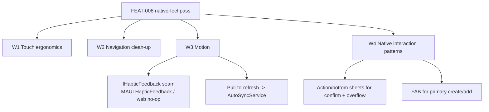

# FEAT-008 — Mobile native-feel polish pass

## Problem & goals

- **Problem:** the MAUI head is at web parity but is the shared MudBlazor UI in a WebView with a *ported*
  feel: dense/small tap targets in places, two entry points to one drawer, a degenerate one-item bottom
  bar when signed out, destructive confirmations as inline `MudAlert` expanders, no floating action
  button, and no motion (no haptics, no pull-to-refresh). None of this is broken, but on a **mobile-first**
  product ([ADR-0054](../adr/0054-mobile-native-feel-strategy.md)) it reads as a web app wearing a phone
  shell rather than a native one.
- **Goals:** realise the near-term (levers 1–4) subset of the
  [mobile native-feel strategy](../adr/0054-mobile-native-feel-strategy.md) — the cheap, high-impact,
  cross-platform wins — while keeping the one shared Material design and the neutral chrome.
- **Non-goals:** iOS Cupertino chrome / platform-adaptive controls (declined by
  [ADR-0054](../adr/0054-mobile-native-feel-strategy.md)/[ADR-0040](../adr/0040-ui-component-library-mudblazor.md));
  local notifications and biometric app lock (parked — each needs its own design/ADR); the distribution
  features QR / add-to-calendar / share-all (separate backlog items); iOS App Links / edge-swipe-back
  (gated on the iOS build host, [ADR-0031](../adr/0031-ios-build-host.md)). No domain, contract, API,
  persistence, or sync change.

## Requirements & use cases covered

| Item | Covered by this feature? | Notes |
|------|--------------------------|-------|
| ADR-0054 | ✅ | Levers 1–4 (ergonomics, navigation, motion, interaction patterns) |
| NFR-007 | ➖ | Touch-target sizing supports store-quality UX; no new obligation |
| New FR/UC | ❌ | UX refinement of existing flows under ADR-0040/0054; no new functional requirement |

No new functional requirement or use case is introduced — this refines the existing organizer/member
flows, the same way the [R2-6 mobile touch/layout pass](../roadmap/backlog.md) did. Traceability is to
the governing ADR, not a new FR.

## Design overview

Four workstreams, each independently shippable and independently verifiable on a real device. All four
keep the shared `SecretSanta.Ui` shell and the neutral MudBlazor theme; native behaviours go behind
platform seams in the [ADR-0028](../adr/0028-browser-platform-adapters-block.md) style already used for
`IShareService`.

### W1 — Touch ergonomics (`SecretSanta.Ui`, shared CSS)
- Audit every screen for tap targets below ~48 px and remove `Size="Size.Small"` / `Margin.Dense` where
  it produces a sub-target control on mobile (kebab items, icon buttons, list-row actions, the
  from-circle checkboxes). Continues, not repeats, the R2-6 pass — that pass fixed primary row buttons;
  this closes the remaining icon-button and menu-item targets.
- Add a mobile density baseline in the shared CSS (min hit area on interactive controls under the narrow
  breakpoint) so new screens inherit it rather than re-solving it.

### W2 — Navigation clean-up (`SecretSantaShell.razor`)
- **One menu entry on narrow viewports.** Today the app bar's hamburger *and* the bottom bar's "More"
  both open the same drawer. Drop the app-bar hamburger under the bottom-bar breakpoint (keep it on
  wide, where there is no bottom bar).
- **No degenerate bottom bar.** Signed out, the bottom bar is "Groups + More" (one real destination).
  Either give it destinations that always exist or suppress the bar when it would carry a single tab;
  decide from what reads best on device.

### W3 — Motion
- **Haptics seam** — a new `IHapticFeedback` port (abstraction in `Ui.Abstractions`), a MAUI
  implementation over `Microsoft.Maui.Devices.HapticFeedback`, and a **no-op** web implementation
  (mirrors `IShareService`). Fire a light tap on: running a draw, revealing an assignment, and
  pin/delete confirmations. Requires the Android `VIBRATE` permission (add to the manifest).
- **Pull-to-refresh** on the list screens (Groups, event lists). Implement as a small JS-interop gesture
  in the shared web layer (works on both heads — the MAUI head is a WebView) that calls the existing
  `AutoSyncService` trigger and re-renders on `SyncCompleted`. No native `RefreshView` (that would fork
  the shell). Must be inert / non-janky where there is nothing to refresh (signed out).

### W4 — Native interaction patterns (`SecretSanta.Ui`)
- **Action / bottom sheets** replace the inline `MudAlert` confirmation expanders for destructive
  actions (delete group/member, redraw) and the kebab overflow menus, using MudBlazor's dialog/sheet
  primitives anchored to the bottom on narrow viewports. `MudDialogProvider` is already registered.
- **Floating action button** for the primary create/add action on the list screens (create group, add
  member), replacing the top-of-page inline `MudButton` on narrow viewports; the inline button can stay
  on wide.

## Domain model impact

- None. No aggregate, entity, value object, or domain event changes.
- **Glossary:** no new terms.

## API / contract changes

- None. No endpoints or DTOs change.

## Data & migration considerations

- **Postgres / SQLite / Sync:** no schema or sync change. Pull-to-refresh reuses the existing
  `AutoSyncService` triggers ([ADR-0044](../adr/0044-sign-in-reconciliation-and-account-scoped-visibility.md)).

## Localization impact

- New user-facing strings are minimal (e.g. a pull-to-refresh hint if any, action-sheet button labels
  that reuse existing `Delete` / `Cancel` / `ConfirmYes` keys where possible). Any genuinely new string
  → **DE / EN / FR** + neutral, per [ADR-0032](../adr/0032-ui-tone-of-voice-and-gender-neutral-terms.md).

## Testing strategy

Paired plan: **TP-008** (to be written). Because these are UX-and-motion changes, the plan is weighted
toward **on-device verification** per `CLAUDE.md`'s "verify UI in a real browser / on the device" rule,
not unit tests:

- bUnit/component tests where cheap: the shell renders one menu entry under the narrow breakpoint; the
  bottom bar does not render a single-tab state; the FAB renders on narrow and the inline button on wide.
- A web no-op vs device haptic seam test (the seam is invoked on draw/reveal; the web impl does nothing).
- **On-device (Pixel) pass:** tap-target sizing under a real finger; haptics fire on draw/reveal/pin;
  pull-to-refresh triggers a sync and settles; action sheets and FAB behave; DE/EN/FR each checked.
  A green suite is **not** sufficient sign-off for this feature.

## Rollout / deployment & feature flags

- No flags. Four independent workstreams — ship in any order; each is a self-contained PR verifiable on
  device. Web heads inherit W1/W2/W4 for free (shared UI) and see the haptic seam as a no-op.

## Risks & open questions

- **Pull-to-refresh in a WebView** can conflict with native overscroll/scroll-to-top. Prototype on device
  early; fall back to a manual refresh affordance if the gesture is janky. (Not architectural — no ADR.)
- **Bottom-bar signed-out decision (W2)** is a product-taste call to make on device, not on paper.
- Anything that turns out to need a *native* control (a real `RefreshView`, a native sheet) would fork
  the shell and must escalate to an [ADR-0054](../adr/0054-mobile-native-feel-strategy.md) amendment
  rather than being decided in code.

## Definition of Done

- [ ] Levers 1–4 implemented per this spec
- [ ] Builds clean under analyzers (warnings = errors)
- [ ] TP-008 scenarios pass; **on-device (Pixel) pass done in DE/EN/FR**, console clean
- [ ] Architecture boundaries respected (native behaviours behind ports; arch tests green)
- [ ] Docs and any new API comments updated
- [ ] Localized strings provided (DE/EN/FR) for any new copy
- [ ] Traceability links closed (ADR-0054 ↔ FEAT-008 ↔ TP-008)

## Traceability

- ADRs: [ADR-0054](../adr/0054-mobile-native-feel-strategy.md) (governing strategy),
  [ADR-0040](../adr/0040-ui-component-library-mudblazor.md) (Material shell it works within),
  [ADR-0028](../adr/0028-browser-platform-adapters-block.md) (platform-seam pattern),
  [ADR-0044](../adr/0044-sign-in-reconciliation-and-account-scoped-visibility.md) (the sync
  pull-to-refresh triggers)
- Backlog: [Mobile native-feel pass (2026-09-02)](../roadmap/backlog.md)
- Brainstorm: [Secret-Santa mobile features (2026-09-01)](../brainstorming/2026-09-01-secret-santa-mobile.md)
- Test plan: TP-008 (to be written)
