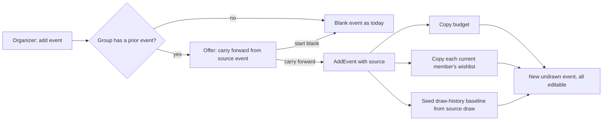

# FEAT-010 — Carry forward a new occasion from a previous event

> **Built & verified (2026-09-02).** Domain (`Group.AddEventFrom` + `Event` baseline draw), application
> (`AddEventCommand.CarryForwardFromEventId`, `RunDrawCommand.IgnoreCarriedBaseline`), persistence
> (`EventState.CarriedForwardBaseline`, no schema/sync change) and UI (`CarryForwardEventDialog` +
> `GroupEditor` wiring, `Draw` escape) all landed. **Solution builds clean (0 warnings/0 errors);**
> 198 tests green — Core 80 (incl. `CarryForwardTests` + the `AddEvent`-carry-forward handler test),
> Ui 33 (incl. localization parity), LocalStore 57, Architecture 28. **Browser-verified** per `CLAUDE.md`
> (Playwright/Chromium, standalone WebApp, **DE/EN/FR**): the carry-forward dialog renders with the
> source picker defaulting to the previous occasion and the anti-repeat hint; confirming creates a
> distinct second occasion; the carried-forward occasion **draws successfully** (the seeded baseline is
> honoured without dead-ending); **console error count 0** in every locale. Carried project-wide item
> only: "CI green" (no pipeline yet).

## Problem & goals

- **Problem:** running the same exchange again starts a blank [Event](../glossary/event.md) — the
  organizer re-types everyone's [Wishlist](../glossary/wishlist.md) (the "children's lists again" pain)
  and re-sets the [Budget](../glossary/budget.md), and a fresh event has no draw history so its first
  [Draw](../glossary/draw.md) can reproduce **last year's pairings** — the two loudest asks in the
  [DE/EN/FR review scan](../brainstorming/2026-09-02-secret-santa-competitor-research.md) (CR-1).
- **Goals:** when adding an event to a group that already has one, offer to **carry forward** from a
  chosen source event — copy each current member's wishlist and the budget (editable), and seed the new
  event's draw-history baseline with the source draw so the next draw avoids it. Realises
  [FR-035](../requirements/functional/FR-035-carry-forward-new-occasion.md) /
  [UC-SS-014](../use-cases/secret-santa/UC-SS-014-carry-forward-new-occasion.md).
- **Non-goals:** carrying the event **date** (occasion-specific); carrying location/description (parked
  extension); any change to sync, the server, or the account-only linked-member self-copy
  ([FR-030](../requirements/functional/FR-030-edit-my-wishlist.md), the existing `CopyFrom` on the
  My-wishlists page); a live link between events (they stay independent — ADR-0042).

## Requirements & use cases covered

| Item | Covered by this feature? | Notes |
|------|--------------------------|-------|
| UC-SS-014 | ✅ | Organizer creates a new occasion by carrying forward |
| FR-035 | ✅ | Wishlists + budget + draw-baseline copied at creation; exclusions already shared |
| FR-034 | ➖ | Unchanged; carry-forward builds on the events model |
| FR-004 | ➖ | Draw rule (c) is what the seeded baseline feeds; no rule change |
| NFR-001/002 | ✅ | Local, account-free, no assignment leaves the device |

## Design overview

Carry-forward is a **copy at creation** inside the `Group` aggregate. A new event is added exactly as
today ([FEAT-007](FEAT-007-events-per-group.md)); when a source event is given, the domain copies the
per-member wishlists (intersected with the **current** roster), the budget, and records the source
event's completed draw as the new event's *previous* draw for rule (c). The new event is **undrawn**.
No I/O, no sync catalogue change, no server change — the whole `Group` is still one opaque synced
document ([ADR-0033](../adr/0033-which-aggregates-sync.md)).

## Domain model impact

- **Aggregates / entities touched:** `Group` (the `AddEvent` behaviour), `Event` (seeded budget,
  wishlists, and an initial draw-history baseline with **no** current draw).
- **Behaviour:** extend the add-event command/handler with an optional
  `carryForwardFromEventId` (+ flags for which parts, defaulting all on). The domain method resolves
  the source event, copies budget and the wishlists of members present on the current shared roster,
  and pushes the source event's last completed draw onto the new event's history as the rule-(c)
  baseline while leaving `CurrentDraw` empty. Members archived since the source draw resolve by id via
  `FindMember` ([ADR-0052](../adr/0052-member-archival-and-permanent-draw-history.md)), so the baseline
  stays valid for the no-repeat comparison.
- **New domain events:** none required (an event add already exists); reuse it.
- **Glossary terms added:** [Carry-forward](../glossary/carry-forward.md) (new).

## API / contract changes

- **DTOs:** the add-event request/command gains optional `CarryForwardFromEventId` and per-part flags;
  `EventDto`/`MemberWishlistDto` are unchanged in shape.
- **Versioning / compatibility:** additive and optional — omitting the field is today's blank add.
  **No endpoint change** (carry-forward is a local domain operation on the synced group document).

## Data & migration considerations

- **Local (LocalStore) & Postgres (server):** **none.** No schema change — the seeded event is an
  ordinary `Event` inside `GroupState`, persisted and synced like any other. The draw-history baseline
  uses the existing per-event draw-history representation.
- **Sync impact:** none — one `Group` document, unchanged catalogue
  ([ADR-0033](../adr/0033-which-aggregates-sync.md)); the copy happens before the ordinary
  post-edit sync and travels as a normal group update.

## UI

- The **add-event** entry point (the `TextInputSheet` + FAB on mobile, inline field on wide — see
  [FEAT-009](FEAT-009-event-section-hub.md)/backlog DGH-5) gains a **"carry forward from …"** control
  when the group already has an event: a source picker defaulting to the most recent event, plus a
  clear **"start blank"** option. After creation the organizer lands on the new event's wishlists/budget
  to review and edit. A short note explains the draw will avoid the carried-forward pairings.

## Localization impact

- New user-facing strings (DE/EN/FR) for: the carry-forward offer, the source-event picker label,
  "start blank", and the "the draw will avoid last time's pairings" note. Display wording per the
  [glossary entry](../glossary/carry-forward.md) (DE *Aus letztem Anlass übernehmen* / FR *Reprendre du
  dernier événement*).

## Testing strategy

Paired plan: [TP-010](TP-010-carry-forward-new-occasion.md). Domain unit tests dominate (copy scope,
roster intersection, archived-member handling, baseline seeding and the resulting no-repeat draw,
graceful failure when avoidance is impossible); a bUnit test for the add-event carry-forward control
and the account-free path; a browser walkthrough (`CLAUDE.md`) creating a second occasion by
carry-forward in DE/EN/FR and confirming a different giftee than the source draw.

## Rollout / deployment & feature flags

- No flag needed — additive and behind an explicit organizer choice. Ships with the next Secret-Santa
  build; account-free, so no server rollout ordering.

## Risks & open questions

- **Copy vs live link** — decided **copy at creation** (events are independent, ADR-0042); a live link
  would contradict that model. Recorded here; **no new ADR** required.
- **"Avoid last year" impossible on a tiny roster** — handled by FR-004's graceful failure plus an
  explicit "re-draw ignoring the baseline" escape (UC-SS-014 5a). Confirm the wording reads clearly.
- **Which parts default on** — v1: wishlists + budget + baseline all on; location/description parked.
  Revisit if organizers want finer control.

## Definition of Done

- [ ] Meets all acceptance criteria of [FR-035](../requirements/functional/FR-035-carry-forward-new-occasion.md)
- [ ] Builds clean under analyzers (warnings = errors)
- [ ] Tests per [TP-010](TP-010-carry-forward-new-occasion.md) pass; coverage target met
- [ ] Architecture boundaries respected (arch tests green; domain stays I/O-free)
- [ ] Docs, glossary ([Carry-forward](../glossary/carry-forward.md)), and XML comments updated
- [ ] Localized strings provided (DE/EN/FR)
- [ ] **Browser-verified** per `CLAUDE.md` (create a second occasion by carry-forward; different giftee
      than the source; console clean) in DE/EN/FR
- [ ] Traceability links closed (UC-SS-014 ↔ FR-035 ↔ FEAT-010 ↔ TP-010)
