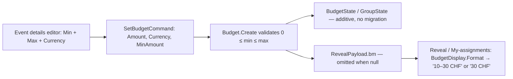

# FEAT-011 — Gift budget minimum as well as maximum

> **Built & verified (2026-09-03).** Domain (`Budget.MinAmount` with the `0 ≤ min ≤ max` invariant),
> contracts (`BudgetDto.MinAmount`, `RevealPayload.bm`), application (`SetBudgetCommand.MinAmount`),
> persistence (`BudgetState.MinAmount`, additive — no schema/sync change) and UI (a **Minimum** field on
> the event-details editor, and a range display on the reveal + my-assignments screens via a shared
> `BudgetDisplay.Format`) all landed. **Solution builds clean (0 warnings/0 errors);** 208 tests green —
> Core 88 (incl. `BudgetTests` + a min round-trip/reject handler test + the reveal-codec omit-when-unset
> test), Ui 35 (incl. two reveal-range tests + localization parity), LocalStore 57, Architecture 28.
> **Browser-verified** per `CLAUDE.md` (Playwright/Chromium, standalone WebApp, **DE/EN/FR**): setting a
> 10–30 budget shows "10–30 CHF" on every reveal link; a max-only budget still shows "30 CHF" with no
> range; the min-exceeds-max save is rejected with the localized inline error; **console error count 0**
> in every locale. Carried project-wide item only: "CI green" (no pipeline yet).

## Problem & goals

- **Problem:** an event's [Budget](../glossary/budget.md) is only a **maximum**. The DE/EN/FR review scan
  ([competitor research](../brainstorming/2026-09-02-secret-santa-competitor-research.md), CR-2) found
  **every** surveyed app does the same, while reviewers recurrently want a **minimum** too, so a
  cheap-out gift can't undercut the exchange.
- **Goals:** add an **optional minimum** to the existing budget (same currency), validate
  `0 ≤ min ≤ max`, and show the budget as a **range** ("10–30 CHF") on the reveal link and the linked
  member's assignment when a minimum is set. Realises
  [FR-036](../requirements/functional/FR-036-budget-minimum-and-maximum.md) /
  [UC-SS-015](../use-cases/secret-santa/UC-SS-015-budget-minimum-and-maximum.md).
- **Non-goals:** a min-only budget (floor with no ceiling — the maximum stays the anchor); per-member or
  per-category budgets; any change to sync, the server, or the reveal-payload **version**.

## Requirements & use cases covered

| Item | Covered by this feature? | Notes |
|------|--------------------------|-------|
| UC-SS-015 | ✅ | Organizer sets a minimum alongside the maximum |
| FR-036 | ✅ | Optional minimum, `0 ≤ min ≤ max`, range display, additive link field |
| FR-034 | ➖ | Unchanged; the budget (and so the range) is already per event |
| NFR-003 | ✅ | Minimum/Maximum labels, min-exceeds-max error, range display in DE/EN/FR |

## Design overview

The existing single budget amount **is the maximum**; the change adds an optional `MinAmount` beside it
in the `Budget` value object, with the invariant enforced in `Budget.Create`. The value flows out to the
`BudgetDto` and into the self-contained reveal payload as a new optional `bm` field. Because the codec
serializes with `WhenWritingNull`, an unset minimum is **omitted from the encoded link**, so max-only
and pre-existing links are unchanged in bytes and the payload version stays `1`.

## Domain model impact

- **Aggregates / entities touched:** `Budget` value object gains `MinAmount` and the
  `0 ≤ min ≤ max` invariant; `Event`/`Group` are unchanged in shape (they already hold a `Budget?`), so
  carry-forward ([FEAT-010](FEAT-010-carry-forward-new-occasion.md)) copies the minimum for free (the
  whole VO is copied).
- **New domain events:** none.
- **Glossary terms added:** none new; [Budget](../glossary/budget.md) is amended to define the range.

## API / contract changes

- **DTOs:** `BudgetDto` and `SetBudgetCommand` gain an optional trailing `MinAmount`; `RevealPayload`
  gains an optional trailing `BudgetMin` (`bm`).
- **Versioning / compatibility:** all additive and optional. Positional constructions keep compiling;
  omitted values default to `null`. The reveal-payload **version is unchanged** — the field is absent
  from any link that has no minimum, so old and new links interoperate both ways.

## Data & migration considerations

- **Local (LocalStore) & Postgres (server):** **none.** `BudgetState.MinAmount` is a new optional field;
  a snapshot written before it existed deserializes to `null` (a bare maximum). The server stores the
  group document opaquely, so nothing server-side changes.
- **Sync impact:** none — one `Group` document, unchanged catalogue.

## UI

- The event-details **Budget** card now has **Minimum**, **Maximum** and **Currency** fields (the prior
  single "Amount" is relabelled **Maximum**). The minimum is optional; **Clear budget** clears both.
  Save validates `0 ≤ min ≤ max` and shows an inline error when the minimum exceeds the maximum.
- The **reveal** page and the **my-assignments** page render the budget through a shared
  `BudgetDisplay.Format`, showing a range with an en-dash when a minimum is present, otherwise the bare
  maximum — both formatted for the active region ([ADR-0056](../adr/0056-decouple-ui-language-from-formatting-region.md)).

## Localization impact

- Resx changes in all four cultures (neutral/EN/DE-CH/FR-CH): the single `AmountLabel` is replaced by
  `BudgetMinLabel` (*Minimum*) and `BudgetMaxLabel` (*Maximum*) — cognates across DE/EN/FR — and a new
  `BudgetMinExceedsMax` error is added. The range separator is a culture-neutral en-dash rendered in
  code, so no format string is localized. Parity test green.

## Testing strategy

Paired plan: [TP-011](TP-011-budget-minimum-and-maximum.md). Domain unit tests for the invariant
(negative min, min > max, min = max, equality distinguishes the minimum); an application handler test
for the min round-trip and the min-exceeds-max rejection; a reveal-codec test that an unset minimum is
omitted from the link; bUnit reveal-page tests for the range and the bare-maximum display; a browser
walkthrough (`CLAUDE.md`) in DE/EN/FR.

## Rollout / deployment & feature flags

- No flag needed — additive and optional; the minimum is blank until an organizer sets one. Ships with
  the next Secret-Santa build; account-free, so no server rollout ordering.

## Risks & open questions

- **Is the existing amount the max or the min?** Decided **maximum** (it is the spending ceiling every
  giver already sees); the new field is the floor. Recorded here; **no new ADR** required.
- **Reveal-link size** — the minimum is a single optional number omitted when unset, so the
  `MaxRecommendedUrlLength` budget is untouched for max-only links and grows only trivially when a
  minimum is present.
- **Min-only budget** — not offered; revisit if requested.

## Definition of Done

- [x] Meets all acceptance criteria of [FR-036](../requirements/functional/FR-036-budget-minimum-and-maximum.md)
- [x] Builds clean under analyzers (warnings = errors)
- [x] Tests per [TP-011](TP-011-budget-minimum-and-maximum.md) pass; coverage target met
- [x] Architecture boundaries respected (arch tests green; domain stays I/O-free)
- [x] Docs, glossary ([Budget](../glossary/budget.md)), and XML comments updated
- [x] Localized strings provided (DE/EN/FR)
- [x] **Browser-verified** per `CLAUDE.md` (range on the reveal; max-only unchanged; min-exceeds-max
      rejected; console clean) in DE/EN/FR
- [x] Traceability links closed (UC-SS-015 ↔ FR-036 ↔ FEAT-011 ↔ TP-011)
