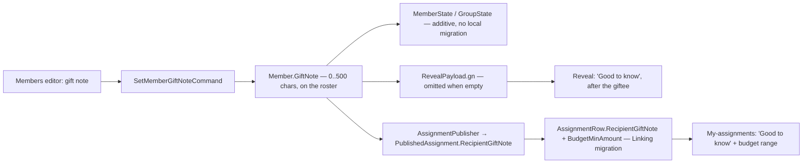

# FEAT-012 — Member gift note (allergies / dietary / do-not-gift)

> **Built & verified (2026-09-03).** Domain (`Member.GiftNote` + `Group.SetMemberGiftNote`, 500-char cap),
> contracts (`MemberDto.GiftNote`, `RevealPayload.gn`, `PublishedAssignment`/`MyAssignmentResponse`),
> application (`SetMemberGiftNoteCommand`, reveal + publisher wiring), persistence
> (`MemberState.GiftNote`, additive), the **server assignment projection** (`AssignmentRow.RecipientGiftNote`
> **and** `BudgetMinAmount`, a Linking EF migration `AddAssignmentBudgetMinAndGiftNote`), and UI (a gift-note
> field on the members editor; a "Good to know" line on the reveal + my-assignments) all landed. This also
> **closes the CR-2 gap**: the budget minimum now reaches a linked member's my-assignments, not only the
> account-free reveal. **Solution builds clean (0 warnings/0 errors);** 218 SecretSanta+architecture tests
> green — Core 97 (incl. `GiftNoteTests` + a reveal-links note handler test + the codec omit-when-unset
> test), Ui 36 (reveal note), LocalStore 57, Architecture 28 — plus a new Main assignment-read test for the
> min+note round-trip (runs under the Testcontainers/Docker suite, not in this session). **Browser-verified**
> per `CLAUDE.md` (Playwright/Chromium, standalone WebApp, **DE/EN/FR**): an organizer sets a member's note;
> the giver's reveal shows it under "Good to know" after the giftee is revealed; a member with no note shows
> nothing extra; **console error count 0** in every locale. Carried project-wide item only: "CI green"
> (no pipeline yet).

## Problem & goals

- **Problem:** there is nowhere to record "please don't get me…", allergies, dietary or lifestyle needs —
  a repeated, cross-market wish in the [DE/EN/FR review scan](../brainstorming/2026-09-02-secret-santa-competitor-research.md)
  (CR-3) that no surveyed app does well.
- **Goals:** add a **stable, per-person gift note** ([Gift note](../glossary/gift-note.md)) the giver
  sees on the reveal and (when linked) on my-assignments. Realises
  [FR-037](../requirements/functional/FR-037-member-gift-note.md) /
  [UC-SS-016](../use-cases/secret-santa/UC-SS-016-member-gift-note.md).
- **Non-goals:** per-event notes (it is stable on the member, not per occasion); linked-member
  self-authoring (parked, v1 is organizer-authored); structured allergen tags (parked, v1 is free text);
  any change to the reveal-payload **version**.

## Requirements & use cases covered

| Item | Covered by this feature? | Notes |
|------|--------------------------|-------|
| UC-SS-016 | ✅ | Organizer sets a member's gift note; the giver sees it |
| FR-037 | ✅ | Stable per-member note, capped, additive on reveal + assignment projection |
| FR-036 | ✅ (gap closed) | Budget minimum now also reaches my-assignments via the same projection change |
| FR-029 | ➖ | The linked-member assignment view now carries the note |
| NFR-002 | ✅ | Shown after the giftee is revealed (it names the giftee) |
| NFR-003 | ✅ | Label, helper, "Good to know" in DE/EN/FR |

## Design overview

The note is modelled where it belongs: on the roster `Member`, not on the `Event` — a person's allergy
is the same for every occasion (the deliberate contrast with the per-event `Wishlist`). It flows to the
giver two ways: the account-free **reveal payload** gains an optional `gn` field (omitted when unset, so
the payload version is unchanged), and the **linked-member assignment projection** gains a
`RecipientGiftNote` column so an authorized my-assignments read returns it. The same projection change
adds `BudgetMinAmount`, closing the CR-2 gap where the budget range reached only the reveal link.

## Domain model impact

- **Aggregates / entities touched:** `Member` gains `GiftNote` (stable, capped at
  `Member.MaxGiftNoteLength` = 500) with `SetGiftNote`; `Group.SetMemberGiftNote` mutates it,
  **independent of renaming** so neither clobbers the other. Carry-forward and archival need no change
  (the note rides on the member).
- **New domain events:** none.
- **Glossary terms added:** [Gift note](../glossary/gift-note.md) (new).

## API / contract changes

- **DTOs:** `MemberDto.GiftNote`; `RevealPayload.GiftNote` (`gn`); `PublishedAssignment.RecipientGiftNote`
  and `MyAssignmentResponse.RecipientGiftNote`; `SetMemberGiftNoteCommand` (new).
- **Server-internal:** `LinkingBudget.MinAmount`, `AssignmentPublication.RecipientGiftNote`,
  `AssignmentView.RecipientGiftNote`.
- **Versioning / compatibility:** all additive and optional. Positional constructions keep compiling;
  omitted values default to empty/null. The reveal-payload **version is unchanged**.

## Data & migration considerations

- **Local (LocalStore):** none — `MemberState.GiftNote` is a new optional field; pre-existing snapshots
  deserialize to `null` (no note).
- **Postgres (server):** a **Linking migration** `AddAssignmentBudgetMinAndGiftNote` adds
  `assignments.BudgetMinAmount` (nullable) and `assignments.RecipientGiftNote` (`varchar(500)` NOT NULL,
  default `''`), so existing rows read back as "no note". No data backfill needed; the next publish
  populates them.
- **Sync impact:** the account-free group document is unchanged in shape; the note travels inside it. The
  linked-member path publishes the note with the assignment it already publishes.

## UI

- The **members editor** edit form gains a multiline **gift note** field (label + helper "Allergies,
  dietary or lifestyle needs, or things not to buy — shown to their giver"), capped and counter-bounded
  at 500. A member's note shows under their name in the roster list when set. Saved alongside the rename
  via the new command (independent operations).
- The **reveal** page and **my-assignments** show the note under **"Good to know"** with the revealed
  giftee (after the reveal, with the wishlist — it names the giftee, so it stays behind the spoiler gate).

## Localization impact

- Three new strings in all four cultures: `GiftNoteLabel`, `GiftNoteHint`, `RevealGiftNoteLabel`
  ("Good to know" / "Gut zu wissen" / "Bon à savoir"), DE *du* / FR *vous* register. The note text itself
  is user content, untranslated. Parity test green.

## Testing strategy

Paired plan: [TP-012](TP-012-member-gift-note.md). Domain unit tests (set/trim/clear, the 500-cap,
rename-independence, state round-trip); a reveal-links handler test that the **recipient's** note reaches
the **giver's** link; a codec test that an unset note is omitted; a bUnit reveal-page test that the note
is behind the spoiler gate; and a Main assignment-read test that the min+note survive the server
projection. Browser walkthrough in DE/EN/FR.

## Rollout / deployment & feature flags

- No flag. The account-free note ships with the next Secret-Santa build. The server column change is
  behind the **Linking migration**, which must run before a client publishes the new field; the column is
  additive with a default, so an older client that omits it is unaffected. Deploy the migration, then the
  clients.

## Risks & open questions

- **Where to store it** — decided **on the member** (stable per person), the deliberate contrast with the
  per-event wishlist. Recorded here; **no new ADR** (ADR-0014/0020 unchanged in decision).
- **Reveal-link size** — bounded by the 500-char cap and omitted when unset; measured within the
  `MaxRecommendedUrlLength` budget.
- **Self-authoring** — organizer-only in v1; a linked-member self-authored note is a parked follow-up.

## Definition of Done

- [x] Meets all acceptance criteria of [FR-037](../requirements/functional/FR-037-member-gift-note.md)
- [x] Builds clean under analyzers (warnings = errors)
- [x] Tests per [TP-012](TP-012-member-gift-note.md) pass; coverage target met (Main projection test runs under Docker)
- [x] Architecture boundaries respected (arch tests green; domain stays I/O-free)
- [x] Docs, glossary ([Gift note](../glossary/gift-note.md)), and XML comments updated
- [x] Localized strings provided (DE/EN/FR)
- [x] **Browser-verified** per `CLAUDE.md` (giver sees the note under "Good to know" after reveal; no note shows nothing; console clean) in DE/EN/FR
- [x] Traceability links closed (UC-SS-016 ↔ FR-037 ↔ FEAT-012 ↔ TP-012)
