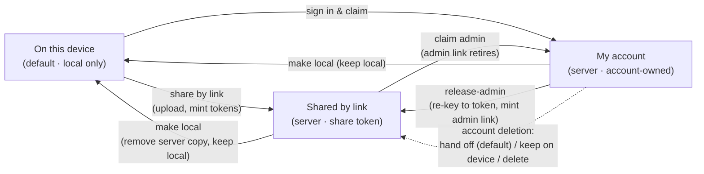

# FEAT-013 — Account-free, link-shared groups (third storage tier)

## Problem & goals

- **Problem:** today a [Group](../glossary/group.md) is either **on the device** (offline, account-free,
  sharing only per-person [reveal links](../glossary/reveal-link.md)) or **synced to an account**. There
  is no way for a co-organizer or a participant to see and act on the *whole group* without either the
  organizer's device or a full sign-up. The jump from private-offline to shared-collaborative is also a
  jump to *create an account* — friction the
  [competitor scan](../brainstorming/2026-09-02-secret-santa-competitor-research.md) found the market
  punishes.
- **Goals:**
  - Add a **third storage mode — "Shared by link"** — where the group lives on the server keyed by an
    unguessable [share token](../glossary/share-token.md), reachable with **no account** by two links: an
    [admin link](../glossary/admin-link.md) (manage) and a [join link](../glossary/join-link.md) (join).
  - Make the mode a **per-group choice at creation** (default *On this device*), switchable anytime in
    both directions, with short plain-language consequences.
  - Let a participant **join and see their own assignment** without an account, and let a co-organizer
    **help run the group** without one.
  - Keep the account-free privacy default intact ([NFR-001](../requirements/non-functional/NFR-001-local-first-offline.md)):
    a group is local until the user deliberately escalates it.
  - Ensure **ownership is never a trap** — an account owner can hand a group back to *Shared by link*,
    and account deletion can keep a group alive for everyone else instead of stranding them.
- **Non-goals (v1):**
  - **Per-person cryptographic secrecy** of assignments — recorded as future hardening
    ([ADR-0058](../adr/0058-account-free-link-shared-groups.md), NFR-002). v1 secrecy is **trust-bounded**
    (first-claim-locks).
  - **iOS deep-link handoff** of a shared link into the app — gated on MNF-10; iOS falls back to the
    browser/PWA until then.
  - **Read/edit link *grades*** beyond the admin/join split (e.g. a read-only observer link).
  - A **conflict-resolution UI** — last-write-wins per aggregate stands, as elsewhere in sync
    ([ADR-0016](../adr/0016-sync-and-conflict-resolution.md)).

## Requirements & use cases covered

| Item | Covered by this feature? | Notes |
|------|--------------------------|-------|
| [UC-SS-017](../use-cases/secret-santa/UC-SS-017-choose-and-switch-storage-mode.md) — choose & switch storage mode | ✅ | Create-time picker + reversible switches, incl. release-admin & downgrade |
| [UC-SS-018](../use-cases/secret-santa/UC-SS-018-share-and-manage-as-admin.md) — share & manage as admin | ✅ | Admin link: share/copy/QR, disable & regenerate, claim admin |
| [UC-SS-019](../use-cases/secret-santa/UC-SS-019-join-a-shared-group.md) — join a shared group | ✅ | Join link: identity × persistence; person-claim |
| [UC-SS-020](../use-cases/secret-santa/UC-SS-020-release-a-claimed-person.md) — release a claimed person | ✅ | Admin recovery |
| [UC-MAIN-006](../use-cases/main/UC-MAIN-006-delete-account-and-export-data.md) — delete account (extended) | ✅ (partial) | Per-group disposition at deletion (hand off / keep on device / delete) |
| [FR-038](../requirements/functional/FR-038-per-group-storage-mode.md) — per-group storage mode | ✅ | |
| [FR-039](../requirements/functional/FR-039-shared-by-link-storage-and-sync.md) — shared-by-link storage & sync | ✅ | |
| [FR-040](../requirements/functional/FR-040-admin-link-capability.md) — admin link capability | ✅ | |
| [FR-041](../requirements/functional/FR-041-join-link-and-person-claim.md) — join link & person claim | ✅ | |
| [FR-042](../requirements/functional/FR-042-release-a-claimed-person.md) — release a claimed person | ✅ | |
| [FR-043](../requirements/functional/FR-043-release-ownership-and-deletion-disposition.md) — release ownership & deletion disposition | ✅ | |
| [NFR-002](../requirements/non-functional/NFR-002-assignment-privacy.md) — assignment privacy (amended) | ✅ | Trust-bounded in this mode; first-claim-locks |
| [NFR-009](../requirements/non-functional/NFR-009-account-free-write-abuse-resistance.md) — account-free write abuse resistance | ✅ | |
| [NFR-010](../requirements/non-functional/NFR-010-shared-group-retention-lifecycle.md) — retention & lifecycle | ✅ | |

## Design overview

A group's **storage mode** is a per-group setting with three values. *On this device* is the default and
unchanged. *Shared by link* uploads the aggregate to the server under a **share token** and issues an
**admin link** and a **join link**; the token — not a user id — is the key, and holding a link is the
credential ("the link is the secret", scaled up). *My account* is today's account-synced mode.

Two capabilities are distinct from *ownership*: the **admin link** grants the admin capability and is a
*shared* capability (many holders), working **only while no account owns the group**; when an account
**claims admin** it becomes the *sole* admin and the admin link retires. The **join link** grants
participant access and survives an admin claim. A joiner performs a **person claim** (which member am I?)
that **first-claim-locks**; only an admin can **release** a locked person. **Release-admin** is the
reverse of claim-admin, so ownership isn't a trap, and it is offered per-group at account deletion.

Key points, all from [ADR-0058](../adr/0058-account-free-link-shared-groups.md):

- **Assignment privacy is trust-bounded here** ([NFR-002](../requirements/non-functional/NFR-002-assignment-privacy.md)):
  the join link is a single shared secret, so a holder could claim someone else first. Accepted under the
  family/friend trust context, bounded by first-claim-locks and admin release. A single per-group key in
  the link cannot keep assignments per-person-secret — hence per-person crypto is deferred, not attempted.
- **The client keeps its `IGroupRepository` port** ([ADR-0015](../adr/0015-mvp-client-offline-storage.md))
  with a token-keyed syncing implementation behind it, so both heads behave identically and mode switches
  route through one seam.
- **Shared across all heads** — the three modes are shared feature code
  ([ADR-0046](../adr/0046-suite-packaging-and-app-composition.md)); only *mechanics* differ (native share
  sheet, deep-link handoff on Android now / iOS later).

## Domain model impact

- **Value objects / state added:**
  - **Share token** — the unguessable, rotatable key a shared-by-link group is addressed by
    ([Share token](../glossary/share-token.md)); separate from the aggregate's GUID id
    ([ADR-0008](../adr/0008-entity-id-strategy.md)).
  - **Storage mode** — a per-group enum (`OnThisDevice` | `SharedByLink` | `Account`).
  - **Admin capability vs. account ownership** — an admin link grants the capability without ownership;
    an account claim converts capability into sole ownership.
  - **Per-member claim state** — a [Member](../glossary/member.md) is *free*, *device-claimed*, or
    *account-claimed* ([Person claim](../glossary/person-claim.md)); first-claim-locks, admin-releasable.
- **New domain events (indicative):** `GroupSharedByLink`, `AdminLinkRotated`, `AdminClaimedByAccount`,
  `MemberClaimed`, `MemberReleased`, `GroupReleasedToLink`, `SharedGroupDeleted`.
- **Glossary terms added:** [Shared-by-link group](../glossary/shared-by-link-group.md),
  [Admin link](../glossary/admin-link.md), [Join link](../glossary/join-link.md),
  [Share token](../glossary/share-token.md), [Person claim](../glossary/person-claim.md). The
  [Claim](../glossary/claim.md) and [Sync](../glossary/sync.md) entries are amended.

## API / contract changes

- **Token-authorized group endpoints:** fetch and push a shared group **by share token** (not by an
  authenticated user). The token in the request path/header authorizes; the **capability grade** (admin
  vs join) is bound to *which* token/link is presented.
- **Claim / release:** endpoints to perform a person claim (bind a member to an account or a device
  handle), enforce first-claim-lock, and (admin only) release a member.
- **Claim-admin / release-admin:** convert a token-keyed group to account-owned (retiring the admin
  link) and back (minting a fresh admin link).
- **Account-free write path** — these writes are unauthenticated by identity, so they are the surface
  [NFR-009](../requirements/non-functional/NFR-009-account-free-write-abuse-resistance.md) governs (rate
  limits, size caps, token entropy).
- **Versioning / compatibility:** additive to the existing account-sync API
  ([ADR-0010](../adr/0010-api-style-and-versioning.md)); reveal links
  ([ADR-0014](../adr/0014-reveal-link-encoding-and-privacy.md)) are unchanged and still work alongside.

## Data & migration considerations

- **Postgres (server):** table(s) for token-keyed shared groups (the aggregate, keyed by share token
  independent of any `UserId`) and for per-member claim state (member → account id | device handle |
  free), plus token rotation/expiry metadata. Claim-admin/release-admin re-key an existing row between
  user-owned and token-owned.
- **SQLite (local):** unchanged — the device copy is still the local aggregate behind `IGroupRepository`.
- **Sync impact:** the **aggregate is the unit of sync** ([ADR-0033](../adr/0033-which-aggregates-sync.md));
  in this mode the "writers" are the link-holders rather than one user's devices, resolved last-write-wins
  per aggregate ([ADR-0016](../adr/0016-sync-and-conflict-resolution.md)).

## Localization impact

New user-facing strings → provide **DE / EN / FR**
([NFR-003](../requirements/non-functional/NFR-003-multilingual-de-en-fr.md)):

- the **storage-mode picker** (three options + one-line explanations) at creation and in settings;
- the **Sharing & sync** screen (admin link / join link sections, share/copy/QR, disable & regenerate,
  claim admin);
- the **join flow** ("who are you?" / "how should we remember you?");
- the **consequence sheets** (upgrade / downgrade / release-admin) and the **retired admin-link** state
  ("<name> has claimed the admin role for this group");
- the **release-a-person** and **account-deletion disposition** copy.

## Testing strategy

See the paired test plan [TP-013](TP-013-account-free-link-shared-groups.md). Levels: unit (mode
transitions, claim-lock/release rules, token rotation), integration (token-keyed store on Postgres via
Testcontainers/Aspire; authorization by capability), contract (admin vs join capability), UI/component
(bUnit: mode picker, join flow, sheets), e2e (Playwright: join-via-link, claim-admin retires the admin
link, join link still works after), and a **network-capture** check that *On this device* still stores
nothing server-side.

## Rollout / deployment & feature flags

- Ship behind a **feature flag** until the account-free write path and its anti-abuse limits (NFR-009)
  are proven; enable Android first (deep links wired), with iOS on browser fallback until MNF-10.
- Order: server token-keyed store + endpoints → client `IGroupRepository` token-keyed implementation →
  mode picker & Sharing & sync UI → join flow → release/claim/deletion flows.

## Risks & open questions

- **Insider spoiler** (a join-link holder claims someone else first) — accepted under trust, bounded by
  first-claim-locks; revisit per-person crypto if it bites.
- **Abuse of the anonymous write path** — mitigated by NFR-009; watch cost/spam telemetry.
- **Owner-less data lifecycle** — TTL/expiry and owner-less delete per
  [NFR-010](../requirements/non-functional/NFR-010-shared-group-retention-lifecycle.md).
- **iOS deep links** — shared links open the browser until MNF-10; acceptable for v1, must be called out
  in the UI.
- **Open:** exact share-token format/length and rotation semantics (pin in implementation, within
  NFR-009); whether a device handle for a device-claim is stable enough across reinstalls (else rely on
  admin release).

## Definition of Done

- [ ] Meets acceptance criteria of all covered requirements
- [ ] Builds clean under analyzers (warnings = errors)
- [ ] Tests per the test plan pass; coverage target met
- [ ] Architecture boundaries respected (arch tests green)
- [ ] Docs, glossary, and API comments updated
- [ ] Localized strings provided (DE/EN/FR)
- [ ] Traceability links closed
