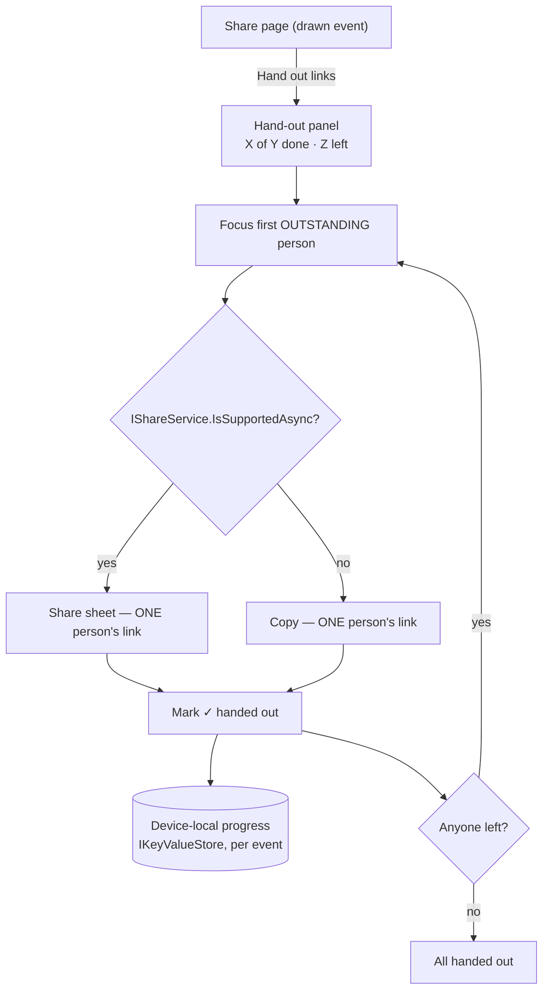

# FEAT-015 — Guided hand-out of reveal links

> Realises MNF-7 from the
> [mobile-native-feel cluster](../roadmap/backlog.md#mobile-native-feel-pass--secret-santa-2026-09-02),
> promoted through the process ([UC-SS-022](../use-cases/secret-santa/UC-SS-022-hand-out-reveal-links.md)
> → [FR-045](../requirements/functional/FR-045-guided-hand-out-of-reveal-links.md)). It needs **no new
> ADR** — it reuses the `IShareService` seam
> ([ADR-0028](../adr/0028-browser-platform-adapters-block.md)).

> **✅ Built & browser-verified 2026-09-15.** A **Hand out links** button + a guided `HandoutDialog` on the
> Share page, backed by `HandoutProgressService` (device-local progress via `IKeyValueStore`), are built with
> DE/EN/FR strings. Solution builds clean (0/0); SecretSanta **Ui 72/72** (new `HandoutProgressServiceTests`
> + Share-page hand-out assertions), **Architecture 28/28**. **Browser-verified** (standalone WebApp,
> headless Chromium): the Share page shows **"Handed out: 0 / 3"** and the button; the dialog steps
> person-by-person (Share / Copy / **Mark as handed out**) with an Al/Bo/Cy checklist; marking one →
> **"Handed out: 1 / 3"** with a *Handed out* chip, and the count + chip **persist across a full page reload**.
> Console clean throughout.
>
> **Implementation note (refines the design below):** progress is keyed by a **stable hash of each reveal
> link** (`HandoutProgressService.MemberKey`), not a member-id read-model field — so no `RevealLinkDto`/DTO
> change was needed, and because a re-draw mints new links the draw fingerprint changes and progress **resets
> by itself**. The count string is a non-inflecting ratio label (*Handed out: {0} / {1}*), so it needs no
> separate singular form.

## Problem & goals

- **Problem:** after a draw the Organizer must hand **each** participant their **own**
  [reveal link](../glossary/reveal-link.md), one person at a time. Done by hand over a large roster,
  someone gets **skipped** — the per-person Share / Copy / QR actions carry no memory of who has already
  been sent their link.
- **Goals:** a **Hand out links** pass that walks the whole draw, delivers one person's link at a time
  through the existing share sheet (or Copy), and **remembers who has been handed out** — showing
  **"X of Y done · Z left"** and resuming after the app is closed — so nobody is forgotten.
- **Non-goals:**
  - **No combined message.** Never a single share/copy payload with more than one reveal link — that
    would spoil the surprise ([NFR-002](../requirements/non-functional/NFR-002-assignment-privacy.md)).
    "Share all" here means "guide me through each", not "send them together".
  - No broadcast of event info to the group (that is a separate idea; the calendar entry already carries
    the when/where — [FEAT-014](FEAT-014-add-event-to-calendar.md)).
  - No sending on the Organizer's behalf — the Organizer always chooses the target in the share sheet.
  - No syncing of hand-out progress across devices; no domain, contract, server, or migration change.

## Requirements & use cases covered

| Item | Covered by this feature? | Notes |
|------|--------------------------|-------|
| [UC-SS-022](../use-cases/secret-santa/UC-SS-022-hand-out-reveal-links.md) — hand out without forgetting | ✅ | Guided pass + persisted progress |
| [FR-045](../requirements/functional/FR-045-guided-hand-out-of-reveal-links.md) — guided hand-out | ✅ | One-at-a-time; "X of Y done"; reset on re-draw |
| [NFR-002](../requirements/non-functional/NFR-002-assignment-privacy.md) — assignment privacy | ✅ | One link per payload, enforced and tested |
| [NFR-001](../requirements/non-functional/NFR-001-local-first-offline.md) — local-first/offline | ✅ | Links + progress on the device; no account/network |
| [NFR-003](../requirements/non-functional/NFR-003-multilingual-de-en-fr.md) — DE/EN/FR | ✅ | Action, count (singular+plural), per-person state |

## Design overview

A **Hand out links** button on the existing Share page
(`/groups/{gid}/events/{eid}/share`, [UC-SS-005](../use-cases/secret-santa/UC-SS-005-share-reveal-links.md))
opens a guided panel over the same reveal links the page already loads (`GetRevealLinksQuery` →
`RevealLinkDto`). The panel is a thin coordinator over machinery that already ships — it invents no new
delivery path:

- **Delivery per person** reuses the Share page's own actions: **Share** through `IShareService` where
  `IsSupportedAsync()` is true (phone, mobile browsers), otherwise **Copy** to the clipboard — exactly the
  degrade the per-person row already does.
- **Progress** is a per-person **handed-out** flag with a running **"X of Y done · Z left"** count. The
  panel focuses the first outstanding person and advances on each mark; a person can be toggled back.
- **Persistence** is device-local (below), so closing the app and returning resumes the pass.

The **one-link-per-payload** rule is structural: the panel only ever calls `IShareService.ShareAsync`
(or the clipboard) with a **single** `RevealLinkDto.Url`. There is no code path that concatenates links —
that is the property [TP-015](TP-015-guided-hand-out-of-reveal-links.md) pins down.

Value is concentrated in the **account-free** and [shared-by-link](../glossary/shared-by-link-group.md)
modes, where a link is the only channel to a participant; in account / linked-member groups participants
see their own assignment in-app ([UC-SS-011](../use-cases/secret-santa/UC-SS-011-see-my-assignment.md)),
so the button is still offered but matters less.

## Domain model impact

- **Aggregates / entities / value objects:** **none.** The draw and reveal links are read as they are
  today; hand-out is a UI concern over the existing read model.
- **Read model:** the panel needs a **stable per-person key** to record progress against. **As built**, the
  key is a **hash of the reveal link** (`HandoutProgressService.MemberKey`), so **no** `RevealLinkDto` /
  read-model change was needed — and it gives free re-draw invalidation (new links → new keys). The encoded
  reveal link itself is unchanged.
- **New domain events:** none. **Glossary:** no new term (reuses
  [Reveal link](../glossary/reveal-link.md), [Draw](../glossary/draw.md)).

## API / contract changes

- **None.** No endpoint, DTO, or wire-format change; the reveal payload and its encoding
  ([ADR-0014](../adr/0014-reveal-link-encoding-and-privacy.md)) are untouched. As built, no read-model change
  was needed either (progress is keyed by a reveal-link hash — see above).

## Data & migration considerations

- **Postgres (server):** none.
- **SQLite / local (device):** hand-out progress is stored via the existing `IKeyValueStore` (the same
  device-local seam used for recently-opened groups and the culture choice — **not** the synced group
  store). Shape, per event:
  - a **draw token** — **as built**, a hash of all current reveal links in order, so a **re-draw
    invalidates** the stored progress and the pass starts fresh;
  - the **set of handed-out person keys** (reveal-link hashes) for that draw token.
  On read, if the stored draw token does not match the current draw, the progress is treated as empty
  (and may be cleared). Key namespace is per group+event; nothing here syncs.
- **Sync impact:** none — hand-out progress is deliberately device-local (it is "what I did from *this*
  device", not group data).

## Platform / delivery matrix

| Concern | Web (mobile/PWA) | Web (desktop) | Android (now) | iOS (deferred) |
|---|---|---|---|---|
| Per-person delivery | Share (Web Share API) | **Copy** (no share sheet) | Share sheet | Share sheet |
| Progress tracking | ✅ device-local | ✅ device-local | ✅ device-local | ✅ device-local |
| One-link-per-payload | enforced | enforced | enforced | enforced |

Web + Android are the v1 targets; the on-device (Pixel) share pass is pending; iOS rides the iOS head
([ADR-0031](../adr/0031-ios-build-host.md)).

## Localization impact

- New user-facing strings → **DE / EN / FR** (+ neutral): the **Hand out links** action, the progress count,
  and the per-person **handed out** state. **As built** the count is a non-inflecting ratio label
  (*Handed out: {0} / {1}* — DE *Verteilt: {0} / {1}*, FR *Distribués : {0} / {1}*), which sidesteps the M2
  counted-string trap without a separate singular form.

## Testing strategy

See [TP-015](TP-015-guided-hand-out-of-reveal-links.md). Weight on: the **one-link-per-payload** property
(no code path shares more than one link), the **persisted progress** (survives reopen; keyed per event;
**reset on re-draw**), the **degrade-to-Copy** where no share sheet, and DE/EN/FR parity incl. the
singular count. bUnit over the panel with a fake `IShareService` and a fake key/value store; an on-device
Pixel pass for the real share sheet.

## Rollout / deployment & feature flags

- No flag needed; it is additive UI on the Share page and inert until a draw exists. Ships with the next
  mobile/web build. No server or migration ordering.

## Risks & open questions

- **Progress is per device (open question, low).** The handed-out state lives on the device that did the
  hand-out; a second device starts fresh. Accepted for v1 (progress is inherently per-device); revisit
  only if continuing a hand-out on another device is actually wanted.
- **Re-draw / roster-change interplay.** A re-draw resets progress (new links); a kept draw after a
  roster change reuses the existing "roster changed" warning on the Share screen
  ([ADR-0052](../adr/0052-member-archival-and-permanent-draw-history.md)). Covered in TP-015.
- **Accidental double-send.** Mitigated by the visible per-person ✓ and the "Z left" count; toggling back
  is available if the Organizer over-marks.

## Definition of Done

- [x] Meets acceptance criteria of all covered requirements (FR-045)
- [x] Builds clean under analyzers (warnings = errors) — `dotnet build CircleTools.slnx` 0/0
- [x] Tests per the test plan pass — SecretSanta **Ui 72/72** (`HandoutProgressServiceTests` + Share-page
      hand-out assertions), **LocalizationParity** green
- [x] Architecture boundaries respected (**Architecture 28/28**)
- [x] Docs, glossary, and API comments updated
- [x] Localized strings provided (DE/EN/FR + neutral)
- [x] Traceability links closed
- [x] Verified in a real browser (2026-09-15): button + "Handed out: 0 / 3", guided dialog, one-at-a-time
      Share/Copy/Mark, progress → 1 / 3 and the chip **persist across a full reload**, console clean.
      **Pending the Pixel:** the real OS share sheet under a finger (device-only)
