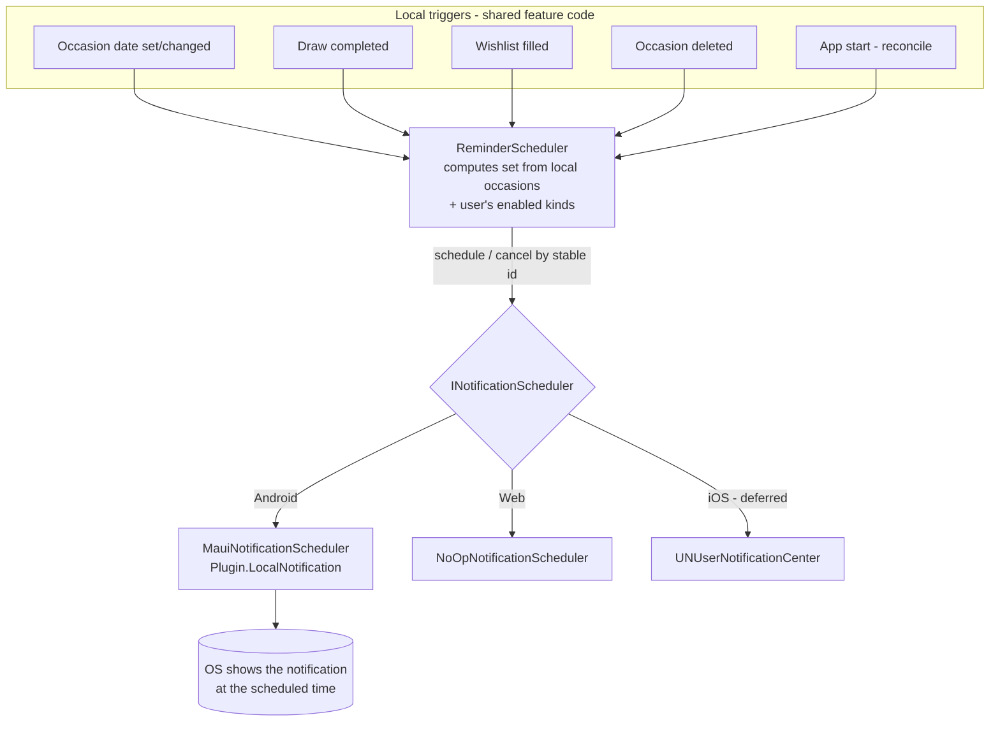

# FEAT-016 — Device-local occasion reminders (local notifications)

> Realises MNF-8 from the
> [mobile-native-feel cluster](../roadmap/backlog.md#mobile-native-feel-pass--secret-santa-2026-09-02),
> promoted through the process ([UC-SS-023](../use-cases/secret-santa/UC-SS-023-be-reminded-about-my-occasions.md)
> → [FR-046](../requirements/functional/FR-046-device-local-occasion-reminders.md)). The scheduling,
> permission and platform-seam strategy is decided in
> [ADR-0060](../adr/0060-local-notification-scheduling-and-permission.md).

> **✅ Built 2026-09-15; on-device delivery pending the Pixel.** The `INotificationScheduler` seam
> (`Ui.Abstractions`), the pure `ReminderPlanner`, the `NotificationPreferences` (device-local per-kind
> toggles), the `ReminderScheduler` coordinator (+ the small `IReminderRescheduler` seam so Settings tests
> need no sync graph), the `BrowserNotificationScheduler` (web no-op) and `MauiNotificationScheduler`
> (**Plugin.LocalNotification 12.0.0**, added to `Directory.Packages.props`), the **Notifications** section
> in Settings, the `POST_NOTIFICATIONS` + `RECEIVE_BOOT_COMPLETED` manifest entries, and DE/EN/FR strings are
> all built. Solution builds clean (0/0, incl. the MAUI **Android** head `-f net10.0-android` 0/0 and the
> Windows head — the plugin restores for net10-android); SecretSanta **Ui 72/72** (new `ReminderPlannerTests`,
> `NotificationPreferencesTests`), **Architecture 28/28**. **Browser-verified** the web-visible part: Settings
> shows the **Reminders** section with the *available in the installed app* note and **no switches** on web
> (device-only, as designed), console clean. **On-device confirmed on the Pixel 9 Pro (2026-09-15):** the app
> launched with no crash and Plugin.LocalNotification's `ScheduledAlarmReceiver` process registered; the
> Settings **Reminders** section rendered the three real **switches** (all off by default); toggling *Draw not
> done yet* on fired the Android **`POST_NOTIFICATIONS` permission prompt** (`GrantPermissionsActivity`), and
> granting it left the switch **on** (`POST_NOTIFICATIONS granted=true`). **Device bug found &amp; fixed:** the
> switch thumbs rendered low (dropped to the bottom of the track) on phone width — the FEAT-008 mobile-density
> rule (`.mud-icon-button { min-height:48px }`) was inflating MudSwitch's internal thumb button; a scoped
> `.mud-switch .mud-icon-button { min-width:0; min-height:0 }` exception in `circletools.css` restores the
> native switch (real icon buttons keep their 48px target). Redeployed and re-confirmed on the Pixel — thumbs
> centered. Residual device item (needs elapsed
> time, per CLAUDE.md): observing each reminder actually **fire at its scheduled time** and the
> cancel-on-draw / cancel-on-wishlist-filled / cancel-on-delete reschedules.
>
> **As-built refinements vs the design below:** the seam's cancellation is **`CancelAllAsync()` + reschedule
> the full set** on each reconcile (rather than `cancel(id)` / `cancelForOccasion`), with **sequential ids
> per reconcile** — simpler and duplicate-free given the cancel-all-first reconcile; the web no-op class is
> `BrowserNotificationScheduler`; the reconcile is driven by app start plus `AutoSyncService.LocalChanged`
> and `SyncCompleted` (debounced), which covers date-change / draw / wishlist / delete / pulled edits.

## Problem & goals

- **Problem:** the app has no way to nudge a user at the moment that matters — to run the draw before the
  event, that the exchange is tomorrow, or that their own [wishlist](../glossary/wishlist.md) is still
  empty. Reviewers across markets ask exactly for this, and it is the strongest reason to *install* rather
  than bookmark.
- **Goals:** **opt-in, device-local reminders** for a user's own occasions, scheduled and fired on the
  device from local data — offline, account-free, privacy-preserving — controlled by a simple per-kind
  switch in Settings.
- **Non-goals:**
  - **No cross-member push** — nudging *another* person / "remind everyone" needs a reachable origin and a
    push backend; parked with the hosting decision
    ([ADR-0053](../adr/0053-backend-free-first-mobile-release.md),
    [ADR-0060](../adr/0060-local-notification-scheduling-and-permission.md)).
  - **No web reminders** — the browser/PWA cannot reliably schedule while closed; the web head is a no-op
    (phone-first, like haptics).
  - No per-occasion reminder settings in v1 (global per-kind toggles); no user-adjustable lead times in v1.
  - No assignment or who-drew-whom in any notification
    ([NFR-002](../requirements/non-functional/NFR-002-assignment-privacy.md)).

## Requirements & use cases covered

| Item | Covered by this feature? | Notes |
|------|--------------------------|-------|
| [UC-SS-023](../use-cases/secret-santa/UC-SS-023-be-reminded-about-my-occasions.md) — be reminded about my occasions | ✅ | Organizer + participant, own device |
| [FR-046](../requirements/functional/FR-046-device-local-occasion-reminders.md) — device-local occasion reminders | ✅ | 3 kinds, global per-kind opt-in, off by default |
| [ADR-0060](../adr/0060-local-notification-scheduling-and-permission.md) — scheduling/permission/seam | ✅ | `INotificationScheduler`, Plugin.LocalNotification, web no-op |
| [ADR-0028](../adr/0028-browser-platform-adapters-block.md) — platform seams | ✅ (follows) | New seam, per-head impls, web no-op |
| [ADR-0053](../adr/0053-backend-free-first-mobile-release.md) — backend-free / origin gate | ✅ (respects) | Keeps cross-member push out of v1 |
| [NFR-001](../requirements/non-functional/NFR-001-local-first-offline.md) — local-first/offline | ✅ | Scheduled + delivered on-device, no network |
| [NFR-002](../requirements/non-functional/NFR-002-assignment-privacy.md) — assignment privacy | ✅ | Reminder body names occasion + reason only |
| [NFR-003](../requirements/non-functional/NFR-003-multilingual-de-en-fr.md) — DE/EN/FR | ✅ | Settings labels + every title/body localized |

## Design overview

A new platform seam, **`INotificationScheduler`**, added under
[ADR-0028](../adr/0028-browser-platform-adapters-block.md) and decided in
[ADR-0060](../adr/0060-local-notification-scheduling-and-permission.md), mirroring `IShareService` /
`IHapticFeedback`. It exposes: **schedule** (stable id, fire time, localized title + body), **cancel(id)**
and **cancelForOccasion(occasionId)**, and **request / query** the OS permission.

A small **shared, head-agnostic scheduling coordinator** (feature code) computes the reminder set from
**local occasion data** and drives the seam. Only *delivery* is per-head:

- **Android** — `MauiNotificationScheduler` over **Plugin.LocalNotification** (via Central Package
  Management), in the App head's `Platform/` folder; requests `POST_NOTIFICATIONS` on first enable.
- **Web** — `NoOpNotificationScheduler`, a deliberate no-op (WASM/PWA cannot schedule while closed); the
  Settings section renders but explains reminders need the installed app.
- **iOS** — over `UNUserNotificationCenter`. **Deferred with the iOS head** ([ADR-0031](../adr/0031-ios-build-host.md)); spec'd here.

### Reminder kinds & timing

| Kind | Who | Condition | Default lead time |
|------|-----|-----------|-------------------|
| **Draw not done yet** | organizer of the occasion | dated occasion, draw not run | 3 days before |
| **Event is tomorrow** | anyone holding the occasion locally | dated occasion | 1 day before |
| **My wishlist is empty** | the user, about their own wishlist | dated occasion, own wishlist empty | 3 days before |

Each has a **stable, deterministic notification id per (occasion, kind)** so a reschedule *replaces* and
never duplicates. Times already in the past are skipped. The bodies name only the group/occasion and the
reason — never an assignment.

### Settings UI & permission

A **Notifications** section on the existing [Settings](../glossary/event.md) page (`Pages/Settings.razor`,
today Appearance/Language/version) holds a **global per-kind on/off** toggle for each kind, **all off by
default**. The **OS permission** is requested the **first time** any kind is enabled; a denial degrades to
a quiet no-op with a one-line note on how to re-enable it at the OS level.

### Scheduling & cancellation discipline

The coordinator reconciles on every relevant trigger (see the diagram) so the live schedule always matches
current local state: date set/changed → (re)schedule; draw run → cancel that occasion's draw reminder;
wishlist filled → cancel that occasion's empty-wishlist reminder; occasion deleted → cancel all of its
reminders; app start → full reconcile (recreate what should exist, drop what should not). This is what
prevents stale ("draw already done") or duplicate reminders.

### Amendment (2026-10-16) — configurable reminders (FR-046 amendment)

- `ReminderSettings` (device-local, key `secretsanta.reminders.settings`): lead days per kind, time of day,
  per-occasion overrides (off / custom event lead), the occasions already offered a reminder after the draw.
- `ReminderPlanner.Plan` takes the settings and a `TimeZoneInfo`; each `PlannedReminder` carries its lead so
  the text can say "tomorrow" or "in N days".
- `INotificationScheduler` gains `GetPermissionAsync` and `OpenSettingsAsync`; the MAUI head answers from
  the plugin and `AppInfo.ShowSettingsUI`. Settings re-checks on resume (`IAppForeground`).
- UI: Settings (switch + lead per kind, time of day, blocked note); event *Details* (override); Draw page
  (after-draw offer).

## Domain model impact

- **None to the domain.** The scheduler reads existing `Event` / `EventDetails` / draw state / the user's
  own [wishlist](../glossary/wishlist.md) ([ADR-0042](../adr/0042-events-as-first-class-entities.md)); it
  adds no aggregate, domain event, or glossary term. The **user's per-kind toggle preferences** are small
  **device-local** settings (via the existing `IKeyValueStore`, like the culture/theme choice) — not
  domain data and not synced.

## API / contract changes

- **None.** No endpoint or DTO; everything is client-side and on-device. Nothing touches the sync or
  reveal payloads.

## Data & migration considerations

- **Postgres / SQLite / sync:** none. The only persisted state is the three device-local boolean
  preferences; no migration.

## Localization impact

- New user-facing strings → **DE / EN / FR** (+ neutral): the **Notifications** section title, the three
  toggle labels, the permission-denied note, the web "needs the app" note, and every reminder **title +
  body**. The occasion date in a body formats for the active culture
  ([ADR-0056](../adr/0056-decouple-ui-language-from-formatting-region.md)).

## Testing strategy

Paired plan: [TP-016](TP-016-device-local-occasion-reminders.md). Levels: **unit** for the reminder
scheduler (which kinds/times are produced from a given local state; stable ids; past-due skipped;
cancellation on draw/wishlist/delete; reconcile on start; **no assignment in any body**); **bUnit** for the
Settings section (toggles render, off by default, enabling requests permission via a fake seam, web variant
shows the "needs the app" note); **platform/E2E notes** for Android delivery + the `POST_NOTIFICATIONS`
prompt (iOS deferred); **localization parity** for all new strings. A **fake `INotificationScheduler`**
lets the coordinator and UI be tested without a device.

## Rollout / deployment & feature flags

- No feature flag — inert until a user opts in; all kinds off by default.
- **Platform matrix:**

  | Concern | Web | Android (now) | iOS (deferred) |
  |---|---|---|---|
  | Schedule/deliver local notification | **no-op** (needs the app) | Plugin.LocalNotification | `UNUserNotificationCenter` |
  | OS permission | n/a | `POST_NOTIFICATIONS` on first enable | authorization on first enable |
  | Settings toggles shown | yes (with "needs the app" note) | yes | yes |

- **Android manifest:** add `POST_NOTIFICATIONS` (and whatever Plugin.LocalNotification requires for
  scheduled delivery, e.g. an exact-alarm/boot-completed receiver per its docs) — the first manifest
  permission the app adds since `VIBRATE` (haptics).
- **iOS** deferred with the iOS head ([ADR-0031](../adr/0031-ios-build-host.md)).

## Risks & open questions

- **Android OEM battery optimisation** may delay or drop a scheduled notification — accepted for a *nudge*
  (not a guarantee); confirm behaviour on the Pixel.
- **Reboot persistence** — scheduled notifications must survive a device restart (Plugin.LocalNotification
  handles this with the right receiver; verify on-device).
- **Reconcile correctness** — the app-start reconcile must not create duplicates or leave stale reminders;
  covered by unit tests on the coordinator with deterministic ids.
- **Open:** whether lead times become user-adjustable later (v1 ships fixed defaults, per-kind on/off
  only).
- **Parked (not a risk of this feature):** cross-member push — a separate future ADR once an origin exists.

## Definition of Done

- [x] Meets acceptance criteria of all covered requirements (FR-046) — device delivery pending the Pixel
- [x] Builds clean under analyzers (warnings = errors) — `dotnet build CircleTools.slnx` 0/0, incl. the MAUI
      Android head (`-f net10.0-android` 0/0, Plugin.LocalNotification 12.0.0 restores) and the Windows head
- [x] Tests per the test plan pass — SecretSanta **Ui 72/72** (`ReminderPlannerTests`,
      `NotificationPreferencesTests`), **LocalizationParity** green
- [x] Architecture boundaries respected (**Architecture 28/28** — seam in `Ui.Abstractions`; MAUI impl
      head-local; web no-op)
- [x] Docs, glossary, and API comments updated
- [x] Localized strings provided (DE/EN/FR + neutral)
- [x] Web-visible part browser-verified (2026-09-15): Settings **Reminders** section shows the "needs the app"
      note with no switches on web, console clean
- [x] **Pixel 9 Pro (2026-09-15):** app launches (no crash), plugin receiver registered, the three switches
      render, and enabling one fires the `POST_NOTIFICATIONS` prompt → granting leaves it on
- [ ] **Still pending on the Pixel (needs elapsed time):** each kind actually fires at its scheduled time, and
      running the draw / filling the wishlist / deleting the occasion cancels the right reminder
- [x] Traceability links closed
