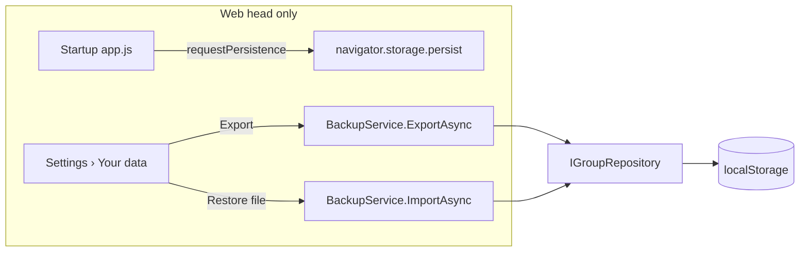

# FEAT-017 — Local data transparency, durability & backup (web)

## Problem & goals

- **Problem:** On the web head, a Secret-Santa group lives **only** in the browser's `localStorage`
  (`CircleTools.Ui.Web/BrowserKeyValueStore` → `CircleTools.SecretSanta.LocalStore/GroupRepository`).
  That storage has two honest weaknesses that confuse and can hurt users:
  1. **It is evictable.** Plain web storage is best-effort — the browser may clear it under storage
     pressure, and Safari/ITP evicts data for low-engagement sites after ~7 days. Users also wipe it
     via "clear browsing data" or a private window without realising what they lost.
  2. **It is invisible.** A user cannot see the data, know it is device-and-browser-only, or move it.
- **Goals:** Keep the local-first, account-free model (NFR-001) — it is a product value, not a defect —
  while making the storage **durable** and **legible**:
  1. Ask the browser to protect the data from eviction (`navigator.storage.persist()`).
  2. Give the user a downloadable **backup** and a **restore**, so their data is tangible, portable
     and recoverable without an account.
  3. Tell the user, in plain language, where their data lives and when it may be cleared.
- **Non-goals:** Changing the storage **model** (still local-first) or the storage **technology**
  (no move to IndexedDB — the data set is well under the `localStorage` quota). Making sync the
  default. Backup/restore on the MAUI heads (native storage is durable and not evictable, so the whole
  problem is web-specific). Any of this would be a new decision and would need its own ADR.

## Requirements & use cases covered

| Item | Covered by this feature? | Notes |
|------|--------------------------|-------|
| NFR-001 (local-first, account-free) | ✅ (upheld) | Durability/transparency only; no server, no account introduced. |
| ADR-0048 (new-version prompt) | ➖ | Reviewed as part of the same user concern; kept as-is (see Risks). |

> No new FR/NFR was minted: this hardens an existing non-functional promise (local-first data the user
> can trust) rather than adding product capability. If review prefers a tracked requirement, add
> **NFR-0xx "local data durability & portability"** and link it back here.

## Design overview

Three independent, web-only pieces, all gated on `OperatingSystem.IsBrowser()`:

1. **Durability** — `wwwroot/js/app.js` gains `window.circletoolsStorage.requestPersistence()`, called
   once at startup right after the service-worker registration. It is best-effort and silent (Chromium
   grants by heuristics; Firefox may prompt) and never blocks the first paint.
2. **Backup / restore** — a storage-agnostic `BackupService`
   (`CircleTools.SecretSanta.LocalStore/BackupService.cs`)
   in the LocalStore project serializes every group to a self-describing JSON envelope
   (`BackupDocument`: `format`, `version`, `exportedAt`, `groups`) and restores it by **merging by id**
   (add new, overwrite same-id, delete nothing). It reuses the existing `GroupState` memento, so a
   backup reads back through the ordinary load-time migrations. Export downloads via
   `circletoolsStorage.download`; import reads a file through the framework `InputFile`.
3. **Transparency** — a new `DataStorageSection` component in Settings explains the model in one
   paragraph, reports whether the browser has agreed to keep the data
   (`navigator.storage.persisted()`), and hosts the backup/restore buttons. The signed-out first-run
   empty state also carries a one-line note, and the `StorageModePicker`'s "On this device" option
   carries a web-only caveat that browser storage can be cleared.

After a restore the component signals `AutoSyncService.RequestSync()`, which raises the `LocalChanged`
event the shell's drawer already listens to (the quick-access refreshes in place) and lets the
background sync flush the restored groups to the account when signed in — so the restored groups appear
**without a full page reload**; the groups list itself re-reads on its next navigation.

## Domain model impact

- **Aggregates / entities / value objects touched or added:** none. `BackupService` reads and writes
  whole `Group` aggregates through the existing `IGroupRepository`; the wire shape is the existing
  `GroupState` memento wrapped in a new `BackupDocument` envelope (infrastructure, not domain).
- **New domain events:** none.
- **Glossary terms added or changed:** none (candidate term "backup" is plain language, not domain).

## API / contract changes

- **Endpoints / DTOs:** none — no server involvement. The backup file is a local artifact; its
  envelope is versioned (`version: 1`) so a future format change is detectable, and an import from a
  newer version is refused with a clear message rather than mis-read.
- **Versioning / compatibility:** `BackupService.CurrentVersion`. `Import` rejects `version >
  CurrentVersion`; same-or-older versions read through `Group.FromState`'s existing migrations.

## Data & migration considerations

- **Postgres (server):** none.
- **SQLite (local):** n/a (web uses `localStorage`). No schema change — the backup reuses `GroupState`.
- **Sync impact:** import writes through whatever `IGroupRepository` the host wired
  (`SyncingGroupRepository` on the web head), so a restored group is treated like any other local
  group and syncs on the next cycle if the user is signed in. No sync-protocol change.

## Localization impact

- New user-facing strings provided in **DE-CH / EN / FR-CH** (`AppStrings`): `DataSectionTitle`,
  `DataStoredExplainer`, `DataPersistedYes`, `DataPersistedNo`, `DataExportAction`, `DataExportHint`,
  `DataExportDone`, `DataImportAction`, `DataImportHint`, `DataImportSuccess`, `DataImportSkipped`,
  `DataImportInvalid`, `DataImportUnsupported`, `DataImportViewGroups`, `EmptyStateLocalDataNote`.

## Testing strategy

Paired plan: **TP-017**. Levels & key scenarios:

- **Unit** (`BackupService`, `BackupServiceTests`, 7 tests, green): export→import round-trip preserves
  groups (members, events, budget); export of an empty device yields a valid empty backup; import
  **merges** (adds new, overwrites same-id, deletes nothing); rejects a non-backup file and malformed
  JSON (`Invalid`); refuses a newer `version` (`UnsupportedVersion`) without writing anything; and skips
  a single malformed entry while restoring the rest.
- **Browser walkthrough (DE/EN/FR)** per `CLAUDE.md`: create a group → Settings shows "Your data" and a
  persistence status → download a backup (file lands) → `localStorage.clear()` → restore the file →
  groups reappear → console clean. Verify the first-run note shows on web only.

## Rollout / deployment & feature flags

- No flags. The section is gated on `OperatingSystem.IsBrowser()`, so the device heads are untouched
  and never resolve `BackupService`. Ships with the production-launch branch.

## Risks & open questions

- **`persist()` is best-effort.** Chromium grants by heuristics, Firefox may prompt, and Safari honours
  it unevenly; it never beats a user manually clearing site data. It is the cheapest durability lever,
  not a guarantee — which is exactly why backup/restore and the plain-language note ship alongside it.
- **Update prompt (ADR-0048) kept as-is.** The reload snackbar exists for correctness (a cached WASM
  app must not run half-new/half-old assets); it is already a non-blocking snackbar, so no change was
  made here beyond noting the option to soften `RequireInteraction`.
- **Escalate to ADR** only if we later change the model (sync-by-default) or the storage tech
  (IndexedDB). This feature deliberately does neither.

## Definition of Done

- [x] Meets the goals above (persist, backup/restore, inform)
- [x] Builds clean under analyzers (warnings = errors)
- [x] Unit tests pass (`BackupServiceTests`, 7/7; full LocalStore suite 82/82 green)
- [x] Architecture boundaries respected (backup is infrastructure over `IGroupRepository`; no domain I/O)
- [x] Docs updated (this spec; index & toc)
- [x] Localized strings provided (DE/EN/FR)
- [x] Browser walkthrough completed: create → Settings "Your data" → export → `localStorage.clear()` →
  restore → groups reappear (silent, no reload) → invalid-file path rejected; console clean; DE picker
  wording and radio layout verified
- [ ] Traceability links closed (add NFR if review wants one)
