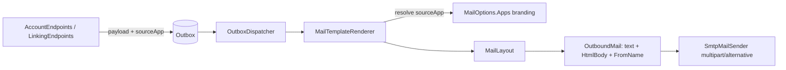

# FEAT-018 — Branded HTML transactional emails

## Problem & goals

- **Problem:** the suite's transactional mails are plaintext with a bare URL, branded "CircleTools"
  regardless of which app the user actually used. They look unprofessional, and a person who signs up in
  **Secret-Santa** gets a **CircleTools** email and a CircleTools-looking page — a recognition gap.
- **Goals:** branded **HTML** mail (logo/colour header, a "click here" CTA button, the full link kept as
  a fallback) with a plaintext alternative; **per-app co-branding** so each mail looks like its source
  app; links that **return to the source app's origin**; and a new **farewell** mail on account deletion.
- **Non-goals:** a templating engine or RESX migration (see [ADR-0064](../adr/0064-transactional-email-html-and-per-app-branding.md));
  explaining cross-app SSO in mail (deferred to app #2); a per-app **PNG logo** image in the header
  (config seam is in place; the asset is a follow-up).

## Requirements & use cases covered

| Item | Covered by this feature? | Notes |
|------|--------------------------|-------|
| [FR-047](../requirements/functional/FR-047-account-deletion-farewell-email.md) | ✅ | New farewell mail (new outbox type). |
| [FR-007](../requirements/functional/FR-007-create-suite-account.md) | ✅ | Verification + sign-up-attempt restyled. |
| [FR-009](../requirements/functional/FR-009-reset-password.md) | ✅ | Password reset restyled. |
| [FR-013](../requirements/functional/FR-013-change-email-address.md) | ✅ | Email-change + notice restyled. |
| [FR-017](../requirements/functional/FR-017-invite-to-circle.md) | ✅ | Circle invitation restyled. |
| [FR-028](../requirements/functional/FR-028-link-member-to-account.md) | ✅ | Member-link restyled (Secret-Santa branded). |
| [NFR-003](../requirements/non-functional/NFR-003-multilingual-de-en-fr.md) | ✅ | All 8 types DE/EN/FR. |
| [NFR-005](../requirements/non-functional/NFR-005-account-enumeration-resistance.md) | ✅ | The two notices stay link-less. |
| [NFR-006](../requirements/non-functional/NFR-006-circle-authorization.md) | ✅ | Has-account invitation carries no secret; user text HTML-encoded. |

## Design overview

All rendering stays in **Infrastructure**, behind the existing `IMailTemplateRenderer`/outbox seam — the
domain never learns about HTML. `OutboundMail` gained an `HtmlBody` and a per-message `FromName`;
`SmtpMailSender` now sends `multipart/alternative`. A new `MailLayout` renders one structured
`MailModel` into **both** a table-based, inline-CSS HTML body and a plaintext fallback, so they cannot
drift; all dynamic (user-supplied) text is HTML-encoded. `MailTemplateRenderer` owns the per-language
copy for all **8** types and resolves branding from a `sourceApp` carried in each outbox payload.

The **source app** is captured at the boundary: `AccountApiClient` stamps each host's id (from
`AddAccountUi(appId)` → `AccountAppContext`) onto the requests that trigger mail; the endpoints copy it
into the payload. Member-link is always `secretsanta`; the circle invitation falls back to the default
app. Unknown/missing → `DefaultApp` (CircleTools/navy), which also covers any future app.

## Domain model impact

- None. Mail is an infrastructure concern behind the outbox; no aggregate, event or glossary change.

## API / contract changes

- **DTOs:** optional `SourceApp` added to `RegisterRequest`, `ForgotPasswordRequest`,
  `ResendVerificationRequest`, `ChangeEmailRequest`, `DeleteAccountRequest` (additive, defaulted `null`).
- **Outbox payloads:** each gains a `sourceApp` field; a new `mail.account-deleted` type.
- **Config:** `MailOptions` gains `DefaultApp` + an `Apps` map (`MailApp`: name, base URL, brand colour,
  sender name, optional logo URL). Falls back to `ClientBaseUrl`/navy when unset — dev and tests need no
  change.
- **Versioning:** all additive and back-compatible; no endpoint routes change.

## Data & migration considerations

- **Postgres (server):** none. **SQLite (local):** none. **Sync impact:** none.

## Localization impact

- All 8 mail types (verification, sign-up-attempt, password-reset, email-change, email-change-notice,
  circle-invitation, member-link, **account-deleted**) provide **DE / EN / FR** subject, heading, body,
  CTA label and footer copy, plus the shared footer chrome (fallback label, legal links, account line).
- User-supplied text (circle/group/member names, labels) is **never re-translated** (FR-016) and is
  HTML-encoded in the HTML body.

## Testing strategy

See [TP-018](TP-018-branded-transactional-emails.md). Unit tests in `MailTemplateRendererTests` cover the
HTML CTA href = exact link, the fallback link, per-`sourceApp` branding/sender/origin, the default-app
fallback, the link-less farewell, and HTML-encoding of user text; existing plaintext assertions and the
`OutboxInvitationMailer` contract test still pass. A live Mailpit/real-client visual pass is still owed.

## Rollout / deployment & feature flags

- No flags. Per-app branding lights up where `Mail:Apps` is configured (production has both apps; dev has
  branding for Mailpit visual checks with links falling back to `ClientBaseUrl`).
- **Follow-ups (backlog):** a white-on-transparent **PNG email logo** per app (sets `MailApp.LogoUrl`);
  the **cross-app SSO explainer** copy when app #2 ships.

## Risks & open questions

- HTML injection from user names → mitigated by `HtmlEncode` in `MailLayout`, covered by a test.
- `Mail:Apps` origins must stay in step with `Cors.AllowedOrigins` — noted in `appsettings.Production.json`.
- The header currently shows the brand-colour band + white wordmark (no image) until the PNG logo exists.

## Definition of Done

- [x] Meets acceptance criteria of the covered requirements
- [x] Builds clean under analyzers (warnings = errors)
- [x] Unit tests pass (`MailTemplateRendererTests`, `OutboxInvitationMailerTests`)
- [x] Architecture boundaries respected (domain untouched; rendering stays in Infrastructure)
- [x] Docs, ADR and API comments updated
- [x] Localized strings provided (DE/EN/FR) for all 8 types
- [x] Traceability links closed
- [x] Live Mailpit pipeline pass (2026-09-17): all 12 representative variants sent through the **real
      renderer + SMTP** into Mailpit; per-app colour/sender/origin, CTA + localized fallback, plaintext
      alternative, DE/EN/FR, the farewell mail, and HTML-encoding (no raw `<script>`) all verified from the
      delivered messages.
- [ ] **Residual (TEM-3):** a human visual eyeball in the Mailpit UI and one real external client
      (Gmail / Outlook / Apple Mail), plus an integration assertion that a farewell follows a successful delete.
