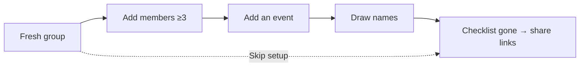

# FEAT-019 — Getting-started checklist

## Summary

A **non-modal, self-dismissing checklist** on the group hub that guides a first-time organizer through the
ordered path from an empty group to a shared draw — **name → add members → add an event → draw names** —
ticking each step off as it is done and disappearing once the group is set up. It is the "OB-8" outcome of
the [first-run onboarding review](../roadmap/backlog.md#first-run-onboarding-pass--secret-santa-2026-09-17):
even after the small first-run fixes (labelled FABs, dead-end recovery, empty-state copy), nothing
*sequenced* the steps, and the hub deliberately leads with events (ADR-0055), so a first-timer could add
an event and hit a draw with no members. This supersedes the one-line first-run hint (OB-6).

## Problem & goals

- **Problem:** the empty→drawn journey has an implicit order (members before draw) and spans three screens,
  each with a different-meaning "+" — easy for a first-timer to get lost in.
- **Goals:** make the next step obvious and one tap away; reach a completed draw quickly; get out of the way
  once set up; never nag (skippable).
- **Non-goals:** a modal setup wizard (rejected — it would gate the lightweight, offline-explore feel); any
  change to the events-first hub structure (ADR-0055 stands); any new domain capability.

## Design overview

A `GettingStartedChecklist` component (in `SecretSanta.Ui/Shared`) is placed at the top of the group hub
(`GroupEditor.razor`). It reads the loaded `GroupDto` and shows four steps:

| Step | Complete when | Tap goes to |
|------|---------------|-------------|
| Name your group | always (the group exists) | — (shown done, for progress) |
| Add members | **≥ 3 members** | Members screen |
| Add an event | ≥ 1 event | the add-event sheet (hub callback) |
| Draw names | any event has a current draw | that event's draw page (**disabled until an event exists**) |

- **Three, not two, members.** A two-person draw would pair them with each other, which the no-reciprocal
  rule forbids ("cannot be drawn without both giving to each other"). Completing at two would tick the step
  done while the draw still fails — so the threshold is three, matching what a successful draw needs.
- **Self-dismissing.** The card renders nothing once all steps are done, and offers **Skip setup** — a
  device-local, per-group flag via `IKeyValueStore` (Durable), like the recent-groups / handout prefs.
- **Additive over ADR-0055.** The hub still leads with events; the checklist sits above it and
  disappears, so it guides the sequence without restructuring the hub. No ADR needed.

## Domain model impact

- None. Reads existing `GroupDto` (`Members`, `Events[].HasCurrentDraw`); no aggregates, events, or
  glossary terms added.

## API / contract changes

- None. No server, DTO, or `IPasskeyCeremony`-style seam change.

## Data & migration considerations

- No schema/migration. One device-local key per group (`secretsanta.setup.dismissed.{groupId}`) via the
  existing `IKeyValueStore`; not synced.

## Localization impact

- New strings in DE/EN/FR (+ neutral): `SetupTitle`, `SetupStepsLeft`, `SetupStepName`, `SetupStepEvent`,
  `SetupStepDraw`, `SetupSkip` (the members step reuses `GoToMembers`). The superseded `HubFirstRunHint` was
  removed from all four resx.

## Testing strategy

Component tests (`GettingStartedChecklistTests`, bUnit): shows on a fresh group with four steps; hides when
fully set up; "Add members" not complete at two members but complete at three; **Skip** persists and a fresh
render stays hidden. Localization parity is covered by `LocalizationParityTests`. Verified end-to-end in a
real browser at 390px in EN + DE (empty → 3 members → event → draw → checklist gone; skip + reload;
"Draw names" locked until an event exists), console clean. (Test plan folded into this section — the
feature is an additive UX composition over already-spec'd capabilities, so no separate TP.)

## Rollout / deployment & feature flags

- No flag. Shipped on the shared UI, so both the web and MAUI heads get it.

## Risks & open questions

- **Mild overlap** with the events empty-state note (`NoEventsYet`) while a group has members but no
  event — both point to "add an event". Accepted for now (both are low-key; `NoEventsYet` also covers
  the skipped-checklist case). Revisit if it reads as redundant on device.
- A fuller guided wizard (the OB-8 modal alternative) remains a future option if first-run still tests
  poorly; deliberately not built.

## Definition of Done

- [x] Meets the covered use case (UC-SS-024) and composes FR-001/002/004/034
- [x] Builds clean under analyzers (warnings = errors)
- [x] Tests pass (Ui.Test 77/77, incl. 5 new + localization parity)
- [x] Architecture boundaries respected (UI-only, reads DTO)
- [x] Docs updated (this spec, UC-SS-024, guidelines §16, backlog)
- [x] Localized strings provided (DE/EN/FR + neutral)
- [x] Traceability links closed
