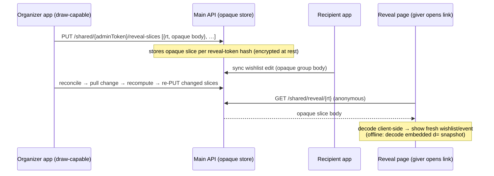

# FEAT-020 — Live reveal links for backend-backed groups

> **Superseded by [FEAT-027](FEAT-027-one-way-to-be-in-a-group.md)** ([ADR-0086](../adr/0086-one-way-to-be-in-a-group.md), 2026-10-25). Live reveal links now come from the group store's reveal tokens and are derived from the current document on read; no slices are published. This spec is kept as the record of what was built then.

## Problem & goals

- **Problem:** A [reveal link](../glossary/reveal-link.md) carries the recipient's wishlist and the event
  details as a **snapshot** baked into the URL at share time ([ADR-0014](../adr/0014-reveal-link-encoding-and-privacy.md)).
  Once a recipient updates their wishlist (or the organizer edits the event) and it syncs, an
  **already-sent link still shows the old data**. For a local-only group there is no shared state, so the
  only recourse is the "links changed — re-share" notice (FEAT-015 / [FR-045](../requirements/functional/FR-045-guided-hand-out-of-reveal-links.md)).
  For a **backend-backed** group ([ADR-0058](../adr/0058-account-free-link-shared-groups.md): shared-by-link,
  and account mode) the backend now exists, so the link can be made to reflect the latest data.
- **Goals:**
  - A reveal link for a **shared-by-link** or **account** group shows the **current** wishlist, gift
    note, budget and event details when opened online — without the organizer re-sending the link.
  - **Per-giver privacy preserved:** a reveal link still discloses only its own giver's assignment,
    never the draw ([NFR-002](../requirements/non-functional/NFR-002-assignment-privacy.md)).
  - **Offline-first preserved:** a reveal still resolves with no network from the embedded snapshot
    ([NFR-001](../requirements/non-functional/NFR-001-local-first-offline.md)).
  - **Local-only groups unchanged** — pure snapshot, exactly as ADR-0014.
  - The Platform backend **stays schema-agnostic** ([ADR-0016](../adr/0016-sync-and-conflict-resolution.md),
    [ADR-0033](../adr/0033-which-aggregates-sync.md)): it never parses the Secret-Santa schema.
- **Non-goals:**
  - **Instant** freshness on a recipient's own edit. Per the [ADR-0068](../adr/0068-live-reveal-links-for-backend-backed-groups.md)
    freshness sub-decision, this feature ships the **eventual, organizer-published** model: a recipient's
    wishlist change reaches the reveal link once a **draw-capable device (the organizer) next reconciles
    and re-publishes** the slices. Recipient-keyed instant freshness is a later, separate feature.
  - Revoking/expiring reveal links beyond what a re-draw already does.
  - Any change to the local-only tier.

## Requirements & use cases covered

| Item | Covered by this feature? | Notes |
|------|--------------------------|-------|
| [ADR-0068](../adr/0068-live-reveal-links-for-backend-backed-groups.md) | ✅ | Implements the chosen option 4 (client-published opaque per-giver slice + snapshot fallback). |
| [FR-005](../requirements/functional/FR-005-generate-reveal-links.md) | ✅ (extends) | Reveal link for a backend-backed group also carries a reveal token. |
| [FR-006](../requirements/functional/FR-006-reveal-page-decode.md) | ✅ (extends) | Reveal page fetches the live slice when online; falls back to the snapshot. |
| [NFR-001](../requirements/non-functional/NFR-001-local-first-offline.md) | ✅ | Offline fallback to the embedded snapshot. |
| [NFR-002](../requirements/non-functional/NFR-002-assignment-privacy.md) | ✅ | One reveal token → one giver's opaque slice; never the draw. |
| [UC-SS-005](../use-cases/secret-santa/UC-SS-005-share-reveal-links.md) / [UC-SS-006](../use-cases/secret-santa/UC-SS-006-open-reveal-link.md) | ✅ (extends) | Sharing publishes slices; opening reads the live slice. |

## Design overview

For a backend-backed group with a current draw, the **organizer's client** (which holds the draw and
every wishlist) computes each giver's reveal payload — the same `RevealPayload` already used for the snapshot — and
**publishes each as an opaque document** to the backend, addressed by
a per-giver **reveal token**. The reveal link carries that token (`rt=`) alongside the offline `d=`
snapshot. The reveal page, when online, GETs the opaque slice by token and decodes it client-side;
offline, it decodes the embedded snapshot. The organizer's client **re-publishes changed slices** on
each reconcile (after a re-draw, an event edit, or a synced wishlist change), which is what keeps the
links fresh (eventually).

The backend only ever stores and returns an **opaque blob** per reveal token — it never parses it — so
the schema-agnostic Platform boundary holds, and a reveal token grants exactly one giver's slice.

## Domain model impact

- **Server (Platform, schema-agnostic):** a new **reveal slice** record — `(revealTokenHash PK, revealTokenCipher,
  groupId, body jsonb (opaque), version, createdAt, lastActivityAt)`. It mirrors how `SharedGroupRow`
  already treats `Body` as opaque. No Secret-Santa types on the server.
- **Secret-Santa client:** per-giver **reveal tokens** persisted alongside the group's existing
  `SharedGroupTokens` (a member-id → reveal-token map), so reveal links are stable across re-opens and the
  builder can append `rt=`. The reveal payload itself is unchanged.
- **New domain events:** none (client-orchestrated; no new server aggregate behaviour beyond store CRUD).
- **Glossary terms added:** **reveal token**, **reveal slice** (link from [reveal link](../glossary/reveal-link.md)).

## API / contract changes

- **`PUT /api/v1/shared/{adminToken}/reveal-slices`** — *admin-token authorized.* Body: the full current
  set `[{ revealToken, body }]` for the group. The server upserts these and **removes any slice for the
  group not in the set** (so a re-draw's stale tokens are revoked). Reuses the existing admin-token
  capability check ([ADR-0058](../adr/0058-account-free-link-shared-groups.md)).
- **`PUT /api/v1/shared/{groupId}/owned/reveal-slices`** — *owner-bearer authorized.* The account-mode
  equivalent of the admin-token publish, for a group whose owner claimed it. Same body and set-replace
  semantics.
- **`GET /api/v1/shared/reveal/{revealToken}`** — *anonymous.* Returns `{ body }` (the opaque slice) or
  `404` if the token is unknown/revoked. The only endpoint the public reveal page calls; identical for
  both tiers.
- **Versioning:** additive under `api/v1` ([ADR-0010](../adr/0010-api-style-and-versioning.md)); no change
  to existing shared-group endpoints.
- **Reveal-link format:** backend-backed → `…/r#for=<label>&v=1&d=<snapshot>&rt=<revealToken>`;
  local-only → unchanged (`…/r#for=<label>&v=1&d=<snapshot>`). The `d=` snapshot always remains.

## Data & migration considerations

- **Postgres (server):** one additive migration adding the `shared_reveal_slice` table in the
  **shared-group DbContext** (same context as `SharedGroupRow`). Token stored as SHA-256 hash + cipher at
  rest ([ADR-0061](../adr/0061-share-token-and-creator-key-at-rest-protection.md)), reusing
  `IShareTokenCipher`. Additive only — no change to existing tables. Covered by the shared-group
  retention sweep (NFR-010) via `lastActivityAt`.
- **SQLite / local:** the per-giver reveal tokens live in the existing local group record's tokens; no
  new local table. (FileKeyValueStore/LocalStore already persist `SharedGroupTokens`.)
- **Sync impact:** none to the account/shared sync path itself; slice publishing is a separate,
  best-effort call from the organizer's reconcile (a failure just retries next reconcile — like the rest
  of the background sync, NFR-008).

## Localization impact

- The reveal page's freshness indicator adds two strings — "showing the latest details" (live) and
  "showing your saved copy / you may be offline" (snapshot fallback) — provided in **DE / EN / FR**.

## Testing strategy

Paired test plan: **TP-020** (to be written). Levels & key scenarios:

- **Domain/application (client):** slice set computed from the draw matches `GetRevealLinks`; re-publish
  only when a giver's payload changed; reveal tokens stable across recompute; a re-draw produces a new
  token set (old ones dropped).
- **Server (integration):** PUT requires a valid admin token; GET by reveal token returns the opaque body
  or 404 after revocation; body is never parsed; slices removed when not in the PUT set; encrypted at rest.
- **Client reveal-fetch:** online → live slice shown; offline / fetch failure → embedded snapshot shown;
  local-only link (no `rt`) → snapshot only.
- **Privacy:** a reveal token returns only that giver's slice; it cannot enumerate the group or the draw.
- **End-to-end (per CLAUDE.md):** two-account, DE/EN/FR, across shared-by-link and account tiers, on the
  phone + browser: edit a wishlist → reconcile as organizer → open the giver's already-sent link → see
  the new wishlist; go offline → still see the last snapshot.

## Rollout / deployment & feature flags

- **Order:** server (endpoint + migration) ships first and is backward-compatible (no client uses it
  yet). Then the client publishes slices and appends `rt=`; then the reveal page reads `rt=`. A reveal
  link minted before this feature has no `rt` and keeps working (snapshot only).
- **CORS:** the reveal page is the standalone WASM web app served from `secretsanta.circletools.ch`; the
  anonymous `GET /api/v1/shared/reveal/{rt}` must allow that origin.
- **Redeploy:** both `circletools-api` (endpoint + migration) and `circletools-web` (reveal page) images.
- **No feature flag** required — the `rt=` token's presence is the switch (absent → snapshot behaviour).

## Risks & open questions

- **Freshness expectation.** Shipped model is **eventual** (organizer re-publishes on reconcile). If a
  recipient edits their wishlist and the organizer's app is not opened for a while, the reveal link lags.
  Documented; instant (recipient-keyed) freshness is a separate future feature (ADR-0068 sub-decision).
- **Reveal-token leakage.** A leaked reveal token exposes that giver's current recipient + wishlist for
  as long as the group stays backend-backed (vs a frozen snapshot). Bounded by per-giver scope + revocation
  on re-draw; encrypted at rest. Same "the link is the secret" model as ADR-0014/0058.
- **Resolved — reveal-page indicator:** the reveal page **shows a status hint** so the opener knows
  whether they are seeing current data — e.g. *"Showing the latest details"* when the live slice loaded,
  vs *"Showing your saved copy — you may be offline"* when it fell back to the embedded snapshot. New
  strings in DE/EN/FR.
- **Resolved — account-mode publishing:** slices are published for **account-owned** groups too, via an
  authorized `PUT /api/v1/shared/{groupId}/owned/reveal-slices` (owner bearer), mirroring the existing
  owned-group endpoints. Shared-by-link uses the admin-token endpoint. The **anonymous GET is identical**
  for both tiers.

## Definition of Done

- [ ] Meets acceptance criteria of all covered requirements
- [ ] Builds clean under analyzers (warnings = errors)
- [ ] Tests per TP-020 pass; coverage target met
- [ ] Architecture boundaries respected (server stays schema-agnostic; arch tests green)
- [ ] Docs, glossary (reveal token/slice), and API comments updated
- [ ] Localized strings provided (DE/EN/FR) if any are added
- [ ] Traceability links closed (ADR-0068 ↔ FEAT-020 ↔ FR-005/006 ↔ UC-SS-005/006)
