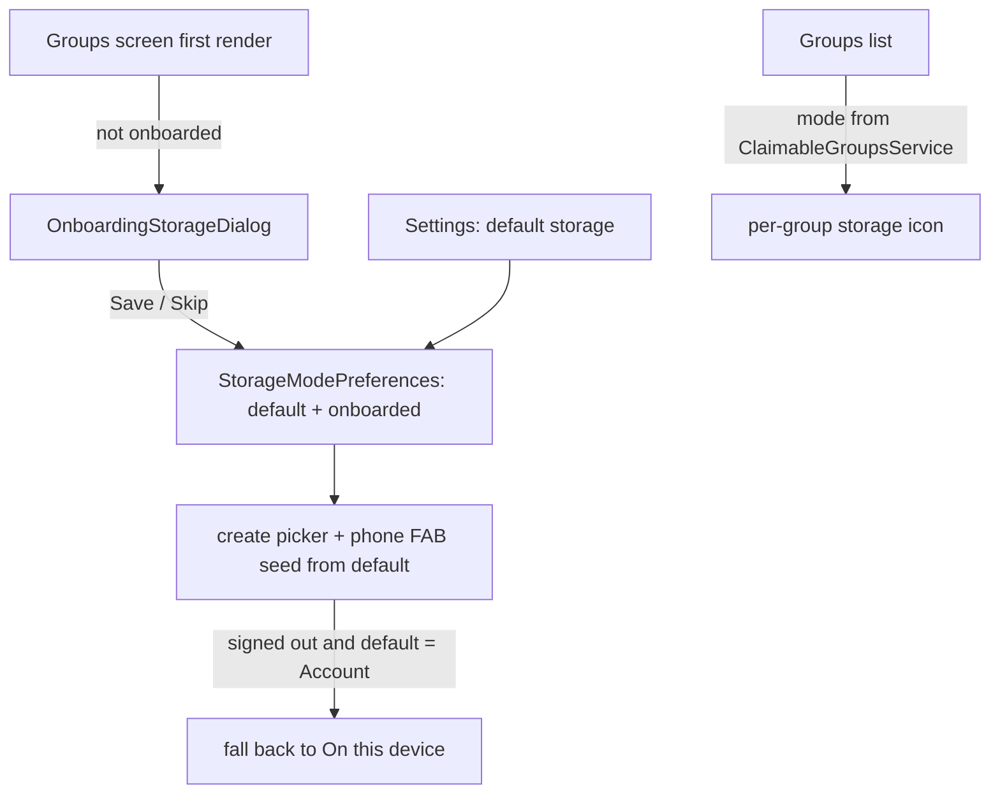

# FEAT-021 — Storage default, first-run onboarding & group-list storage indicator

## Problem & goals

- **Problem:** The three-way per-group storage mode exists (FEAT-013, FR-038) but a new user can't tell
  where a group's data lives, must re-pick storage on every group, and the phone "+" quick-create ignores
  the choice and always creates a local group.
- **Goals:** a **set-once** default storage mode (seeding every create path including the phone FAB), a
  **one-time, skippable onboarding** that explains the three modes and that storage is per-group
  changeable, and a **per-group storage icon** in the group list so where each group lives is visible at a
  glance.
- **Non-goals:** changing the modes, transitions, or consequence prompts of FR-038; syncing the default
  across devices (it is device-local — ADR-0071); any server/domain change.

## Requirements & use cases covered

| Item | Covered by this feature? | Notes |
|------|--------------------------|-------|
| FR-048 | ✅ | Default storage mode, onboarding, list indicator, phone-FAB seeding |
| FR-038 | ➖ (refined) | Pre-selected value becomes the user's default; modes/transitions unchanged |
| UC-SS-017 | ➖ | Choosing/switching storage; this adds the default-seed + visibility |
| ADR-0071 | ✅ | Governing decision |

## Design overview

A new device-local `StorageModePreferences` (same `IKeyValueStore` pattern as `NotificationPreferences` /
`RecentAccessService`) holds two keys: the default `StorageMode` (`secretsanta.storage.default`, default
`OnThisDevice`) and an onboarded flag (`secretsanta.storage.onboarded`). The groups screen checks the flag
on first render and, if unset, shows a one-time `OnboardingStorageDialog` (reusing `StorageModePicker`);
saving or skipping sets the flag. In the onboarding dialog "My account" is **selectable even when signed
out** (the dialog passes `AccountEnabled=true` to the picker); choosing it while signed out saves the
default and routes to `/account/login` (which returns to the groups home, where the account change
re-seeds the create mode). The create picker and the phone FAB both seed from the stored default
(clamped to `OnThisDevice` when the default is `Account` but signed out). The group list joins each
group's mode from `ClaimableGroupsService` (the existing sync read model — no domain change) and renders a
small device/link/cloud icon with a tooltip. Settings gains a "Default storage for new groups" control.

## Domain model impact

- **Aggregates / entities / value objects:** none. The default is a device-local UI preference; the
  per-group mode continues to live on the LocalStore `SyncedGroupRecord` (ADR-0058), kept out of the
  domain by the `SyncLayeringTests` fitness function.
- **New domain events:** none.
- **Glossary terms added or changed:** none new; reuses *On this device / Shared by link / My account*
  and [Shared-by-link group](../glossary/shared-by-link-group.md).

## API / contract changes

- None. No endpoints or DTOs change; the list icon reads the existing `ClaimableGroup.Mode`.

## Data & migration considerations

- **Postgres (server):** none.
- **SQLite / local:** two new `IKeyValueStore` keys (`secretsanta.storage.default`,
  `secretsanta.storage.onboarded`), `StorageScope.Durable`. No migration — absent keys read as
  "default = On this device, not onboarded".
- **Sync impact:** none; the preference is device-local and never synced (ADR-0071, cf. ADR-0041).

## Localization impact

New user-facing strings (DE/EN/FR), added to `AppStrings` resources: onboarding title/intro/per-group
note/account note/save/skip, and the Settings "default storage" label + hint. The per-group list icon
reuses the existing `ModeLocalTitle` / `ModeSharedTitle` / `ModeAccountTitle` strings as tooltips.

## Testing strategy

Paired plan: [TP-021](TP-021-storage-default-onboarding-and-list-indicator.md). Unit-test
`StorageModePreferences` (default, round-trip, onboarded flag, best-effort on failure) and the
signed-out-`Account`→`OnThisDevice` clamp; component/manual-verify the onboarding-once behaviour, the
phone-FAB seeding, the Settings control, and the list icons across DE/EN/FR and both heads.

## Rollout / deployment & feature flags

- No flag. Ships with the next build; the onboarding shows once per device on first open after update
  (existing users: the groups screen already has groups, so the dialog still shows once — acceptable, and
  skippable). No server deploy required.

## Risks & open questions

- **First-run surface overload** — kept once-only + skippable and distinct from the FEAT-019 per-group
  checklist (app-level vs per-group). Verify on device it doesn't stack awkwardly with the FEAT-017 web
  note.
- **Default = Account while signed out** — resolved by the clamp to On this device (FR-048); the group
  auto-claims after sign-in.

## Definition of Done

- [ ] Meets acceptance criteria of FR-048
- [ ] Builds clean under analyzers (warnings = errors)
- [ ] Tests per TP-021 pass; coverage target met
- [ ] Architecture boundaries respected (arch/sync-layering tests green)
- [ ] Docs, glossary, and API comments updated
- [ ] Localized strings provided (DE/EN/FR)
- [ ] Verified in a real browser and on device (onboarding once, FAB seeding, list icons, Settings)
- [ ] Traceability links closed (FR-048 ↔ ADR-0071 ↔ UC-SS-017 ↔ FEAT-021 ↔ TP-021)
