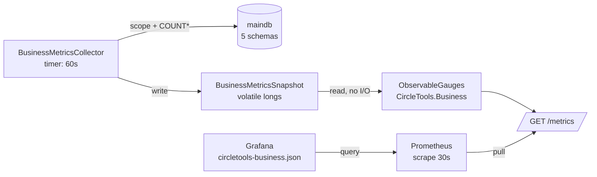

# FEAT-022 — Business-metrics dashboard (groups / events / draws / accounts over time)

## Problem & goals

- **Problem:** The operator has no at-a-glance view of how the product is being used — how many accounts,
  groups, events and draws exist and how fast they grow. The data is in Postgres (`maindb`), but reading
  it means raw DB access, which (per [ADR-0020](../adr/0020-server-side-assignment-privacy.md)) exposes the
  most sensitive data in the suite (gift pairings + PII). There is no safe, standing **aggregate** view.
- **Goals:** expose a small set of **PII-free business counters** from the Main service as OpenTelemetry
  metrics, scraped by the existing Prometheus and charted on a dedicated **Grafana dashboard** that shows
  current totals and growth over time for **accounts, groups, events, draws** (and members). Reuse the
  observability stack already decided in [ADR-0051](../adr/0051-production-observability-backend.md) — no
  new infrastructure.
- **Non-goals:** per-account / per-group drill-down or any high-cardinality breakdown; row-level data
  inspection (that is the separate [ADR-0075](../adr/0075-operator-read-only-database-access.md) read-only
  access path); client-side/product analytics or user tracking (ADR-0012 keeps client telemetry
  consent-gated and out of scope here — this is **server-side** operational counting only); alerting.

## Requirements & use cases covered

This is an operational-visibility feature, not a user-facing requirement; it realises the "measure what is
happening in production" intent of the observability ADRs rather than an `FR`.

| Item | Covered by this feature? | Notes |
|------|--------------------------|-------|
| ADR-0051 | ✅ | Uses the self-hosted Prometheus/Grafana backend; adds a provisioned dashboard |
| ADR-0012 | ✅ (constrains) | No PII in metrics; counts + low-cardinality tags only |
| ADR-0020 | ✅ (constrains) | Aggregates only — never a giver→recipient pairing or any body |
| NFR-004 | ✅ (constrains) | Data minimisation — emit the fewest, coarsest numbers that answer the question |

## Design overview

A single new **meter `CircleTools.Business`** in the Main service publishes a handful of
`ObservableGauge<long>` instruments (cumulative totals). Because an observable-gauge callback runs
**synchronously on the Prometheus scrape thread**, it must not do database I/O. So the counts are produced
by a background **`BusinessMetricsCollector`** (`IHostedService`) that, on a configurable interval
(`Observability:BusinessMetrics:RefreshIntervalSeconds`, default 60), opens a DI scope, runs cheap
`COUNT(*)` queries across the read stores, and writes the results into a shared, volatile
**`BusinessMetricsSnapshot`** singleton. The gauges' callbacks only read that snapshot — no I/O, no
blocking. Collection is **best-effort**: a transient DB error is logged and the previous snapshot is kept,
never crashing the host.

Prometheus already scrapes `GET /metrics` (ADR-0051), so the new `circletools_business_*` series appear
with no scrape-config change. A new provisioned dashboard `circletools-business.json` charts them; the
Prometheus time series of a cumulative gauge **is** the "over time" growth curve, which conveniently
sidesteps the fact that some tables carry no `CreatedAt` (see below).

### Instruments

All are `ObservableGauge<long>`; names follow the existing `circletools.*` convention (exported by
Prometheus as `circletools_business_*`). Tags are a **closed, low-cardinality set** only.

| Instrument | Source (see §Data) | Tags | Notes |
|------------|--------------------|------|-------|
| `circletools.business.accounts` | `public.AspNetUsers` | `confirmed` = `true`/`false` | Growth of the gauge = accounts created over time |
| `circletools.business.groups` | `circles.circles` + `shared.groups` | `kind` = `circle`/`shared` | Two distinct server group stores; no single "groups" table |
| `circletools.business.events` | `linking.group_events` | — | `GroupEventRow` has no `CreatedAt`; the gauge's series gives the trend |
| `circletools.business.members` | `circles.circle_memberships` | — | Cross-account circle memberships |
| `circletools.business.draws` | distinct `(GroupId, EventId, DrawVersion)` in `linking.assignments` | — | **Derived & partial** — see risks |

### Where the code lives

- **Meter + snapshot + collector:** `src/Apps/Main/CircleTools.Main.Service/BusinessMetrics.cs` — the
  **host**, not the Repository project. Only the host references all five EF contexts (the Repository
  project does not reference Circles), so only the host can count them. Patterned on `SyncTelemetry.cs`.
  The meter is folded into the `BusinessMetricsCollector` `BackgroundService`: the host always constructs
  a hosted service, which avoids an eager-instantiation problem (nothing else depends on the meter, so a
  plain singleton would never be created and its gauges never observed).
- **Meter registration:** add `.AddMeter("CircleTools.Business")` next to the existing
  `.AddMeter("CircleTools.Sync")` in `src/Aspire/CircleTools.ServiceDefaults/Extensions.cs`. As with Sync,
  the name is a **literal** mirrored by `BusinessMetricsCollector.MeterName` — ServiceDefaults must not
  depend up into the app modules.
- **DI:** the Main service registers `BusinessMetricsCollector` as a hosted service in its composition
  root (`Program.cs`), alongside the context registrations.
- **Dashboard:** `deploy/grafana/provisioning/dashboards/circletools-business.json`, auto-loaded by the
  existing provider (`deploy/grafana/provisioning/dashboards/dashboards.yaml`); uses the provisioned
  Prometheus datasource (uid `prometheus`). A "stat" row for current totals + a "time series" row for
  growth, modelled on the existing `circletools-overview.json` panel for `circletools_sync_collisions_total`.

## Domain model impact

- **Aggregates / entities / value objects:** none. The collector reads existing read stores only; it adds
  no domain type and no write path.
- **New domain events:** none.
- **Glossary terms added or changed:** none (reuses *circle / group / event / draw / account*).

## API / contract changes

- None. No new endpoint; the counts ride the existing Prometheus `/metrics` endpoint, which the reverse
  proxy already denies on the public `api.circletools.ch` origin (ADR-0051) — the numbers never leave the
  box.

## Data & migration considerations

- **Postgres (server):** read-only. `COUNT(*)` on `AspNetUsers`, `circles.circles`, `shared.groups`,
  `group_events`, `circle_memberships`, and a `COUNT(DISTINCT (GroupId, EventId, DrawVersion))` on
  `assignments`. No schema change, **no migration**. The queries touch small tables and run once per
  interval; cost is negligible at this scale and must stay off the scrape path (see design).
- **SQLite / local:** none — this is server-only.
- **Sync impact:** none.

## Localization impact

- None. Grafana panel titles and metric descriptions are operator-facing English (code/ops surface), not
  product UI — the localization guidelines do not apply.

## Testing strategy

Paired plan: [TP-022](TP-022-business-metrics-dashboard.md). Integration-test the collector against a real
Postgres (Testcontainers, per the testing guidelines): seed known numbers of accounts / circles / shared
groups / events / assignments across two draw versions, run one collection pass, and assert the snapshot
counts match — including the `confirmed` split and the **distinct-draw-version** derivation. A
**metric-hygiene** test asserts the instrument names and that every emitted tag key is from the allowed
low-cardinality set (guards ADR-0012/0020 — no accidental id/email/name tag). A registration test asserts
the `CircleTools.Business` meter is wired so the gauges are exported. Manual: run the
`https-observability` dev profile, create data through the app, confirm the panels move and `/metrics`
exposes `circletools_business_*`.

## Rollout / deployment & feature flags

- No flag. The collector starts with the API; the dashboard provisions on the next Grafana container start.
  An `Observability:BusinessMetrics:Enabled` config (default `true`) allows switching the collector off,
  and `RefreshIntervalSeconds` tunes cost. No data migration, so it is safe to ship in any deploy.

## Risks & open questions

- **"Draws" is derived and partial.** There is no first-class draw table server-side, and account-free /
  zero-knowledge draws (ADR-0020) may never reach the server at all — so this counts **server-visible draw
  publications** (distinct draw versions in `assignments`), not all draws. The panel must label it as such
  so the number is not over-read.
- **`events` / `draws` have no `CreatedAt`.** Handled by charting the cumulative gauge's time series rather
  than a created-at histogram; acceptable for a growth view.
- **Two group stores.** `circles.circles` and `shared.groups` are distinct; the `kind` tag keeps them
  separate rather than inventing a misleading unified total. A summed "all groups" panel can add them in
  Grafana.
- **Cardinality discipline.** Tags are a fixed enum only; a reviewer must never add a per-id/per-user tag
  (would explode Prometheus series and risk re-identification — ADR-0012).
- **Collector cost.** Kept off the scrape thread and on a 60 s timer; `COUNT(*)` on these tables is cheap
  now, revisit only if a table grows large (a `reltuples` estimate is the fallback).

## Definition of Done

- [ ] `CircleTools.Business` meter + `BusinessMetricsCollector` + snapshot implemented and registered
- [ ] `.AddMeter("CircleTools.Business")` added in ServiceDefaults (literal mirrored by `MeterName`)
- [ ] `circletools-business.json` dashboard provisioned (totals + growth, draws labelled "server-visible")
- [ ] Builds clean under analyzers (warnings = errors)
- [ ] Tests per TP-022 pass (collector counts, draws derivation, metric-hygiene, registration)
- [ ] Architecture boundaries respected (ServiceDefaults does not depend up; arch tests green)
- [ ] No PII / no pairing in any metric or tag (ADR-0012/0020 confirmed by the hygiene test)
- [ ] Verified on the `https-observability` dev stack: `/metrics` exposes the series, panels move
- [ ] Traceability links closed (ADR-0051 ↔ ADR-0012 ↔ FEAT-022 ↔ TP-022)
