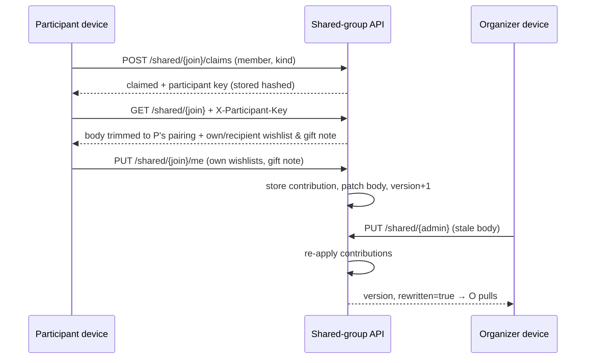

# FEAT-024 — Participants in shared groups — secrecy, own entry, organizer-only publish

## Problem & goals

- **Problem:** the [2026-10-16 two-account test](../brainstorming/2026-10-16-secret-santa-two-account-device-test.md)
  found that a person who joined a shared-by-link group holds the complete draw on their device (Q2), can
  turn the group into a local copy with everyone's reveal links (Q1), cannot edit their own wishlist (Q5),
  can claim a member who is already taken (Q6), and that every participant device publishes the linking
  projection, crashing the server endpoints (Q3/Q4). The join page also defaults to "just this device"
  for a signed-in person (Q7), the organizer's share counter counts people who need no link (Q20), the
  member badges are unclear (Q30), and password fields need an accessibility check (Q19).
- **Goals:** ADR-0058's participant promises hold — own pairing only, own entry editable, never others';
  only the organizer writes the linking projection; joining is clear about who is taken; the organizer sees
  who needs a reveal link.
- **Non-goals:** per-person cryptographic secrecy (ADR-0058 future hardening); changing the storage model
  (WP-2, Q31); the participant seeing other people's wishlists.

## Requirements & use cases covered

| Item | Covered? | Notes |
|------|----------|-------|
| ADR-0058 participant promises | ✅ | own assignment, own wishlist / gift note, never others' |
| [NFR-002](../requirements/non-functional/NFR-002-assignment-privacy.md) | ✅ | amended: a participant device receives only its own pairing |
| [FEAT-013](FEAT-013-account-free-link-shared-groups.md) | ✅ | join flow, claims, release |
| [FEAT-005](FEAT-005-m4-linking.md) | ✅ | linking publish authorized |
| Q1–Q7, Q19, Q20, Q30 | ✅ | backlog WP-1 |

## Design overview

Per [ADR-0080](../adr/0080-participant-access-to-shared-groups.md):

- **Server:** redaction of join reads; participant key on claim; legacy key exchange; `PUT /me`;
  `DELETE /claims/me` (leave); `GET /shared/joined`; contributions re-applied on admin/owner push;
  `takenMembers` in the view; organizer check on the two linking publish endpoints (403).
- **Client:** join records keep the participant key and always adopt the server body; reads send the
  key (and the bearer when signed in); joined groups of the account are imported on sync; publishing
  skips join-only groups and sends the admin token for shared groups; participant *Sharing & sync* =
  "You joined as …" + *Leave group*; participant *Wishlists* = own entry only, autosaved; *Your
  assignment* shows the recipient's wishlist and gift note; *My wishlists* / *My assignments* include
  joined groups; join page disables taken members and preselects the account when signed in, sign-in
  returns to the join page; organizer: claimed members' own fields read-only, one badge **"Verbunden"**,
  share counter counts only members who need a link.

## Domain model impact

- **Aggregates touched:** none in the Secret-Santa domain; the client's `SyncedGroupRecord` gains the
  participant key (in `SharedGroupTokens`).
- **Server:** new `SharedMemberContribution` row; `SharedMemberClaim` gains `ParticipantKeyHash`.
- **Glossary:** [participant key](../glossary/participant-key.md), [participant contribution](../glossary/participant-contribution.md)
  (new); [person claim](../glossary/person-claim.md) (proof added).

## API / contract changes

| Route | Change |
|---|---|
| `GET /shared/{token}` | join read trimmed; optional `X-Participant-Key` / bearer; view adds `claimedMemberId`, `redacted`, `takenMembers` |
| `POST /shared/{token}/claims` | response adds `participantKey` |
| `POST /shared/{token}/claims/{memberId}/key` | **new** — legacy device-handle → key exchange |
| `PUT /shared/{token}/me` | **new** — own gift note + per-event wishlists |
| `DELETE /shared/{token}/claims/me` | **new** — leave the group |
| `GET /shared/joined` | **new** (bearer) — joined groups of the account |
| `PUT /shared/{token}`, `PUT /shared/{id}/owned` | contributions re-applied; result adds `rewritten` |
| `PUT /groups/{id}/events`, `POST /groups/{id}/assignments/publish` | organizer only (`X-Admin-Token` accepted); 403 otherwise |

All additions are optional fields or new routes: old apps keep working (they see the trimmed body).

## Data & migration considerations

- **Postgres:** migration on the shared-group context — `claims.participant_key_hash` (nullable, unique
  when set), table `contributions` (group, member, gift note, wishlists JSON, updated at; cascade with the
  group). No data migration; legacy claims get a key on exchange.
- **Local:** additive `ParticipantKey` in the join record's tokens (older documents read as null).
- **Sync:** join-only records never push; they adopt the server body on every reconcile.

## Localization impact

New strings (DE/EN/FR): leave group (button, confirmation, done), "You joined as …", own-wishlist heading
and hint, read-only hint for claimed members on the organizer side, "Verbunden" badge and its
explanation, taken-member notes on the join page ("Organizer", "already joined"), all-taken message,
signed-in account hint, share counter states ("Sees the assignment in the app", "Share link anyway",
"Everyone has their assignment").

## Testing strategy

See [TP-024](TP-024-participants-in-shared-groups.md): server tests for redaction, key, contribution
merge, leave, joined list and organizer authorization; client unit tests for publish filtering, adopt-on-
reconcile and the participant view; component tests for the participant pages; browser walkthrough with
two accounts and the device check on the Pixel.

## Rollout / deployment & feature flags

Server first (old apps are safe against the new server), then the apps. No flag.

## Risks & open questions

- A redaction bug leaks data — covered by tests over a real `GroupState` body.
- Old participant apps lose "Your assignment" until they update — accepted (few joined groups exist).

## Definition of Done

- [x] Meets acceptance criteria of all covered items
- [x] Builds clean under analyzers (warnings = errors)
- [x] Tests per TP-024 pass
- [x] Architecture boundaries respected
- [x] Docs, glossary, and API comments updated
- [x] Localized strings provided (DE/EN/FR)
- [x] Browser walkthrough (two accounts) — [ ] Pixel check (after the next build is installed)
