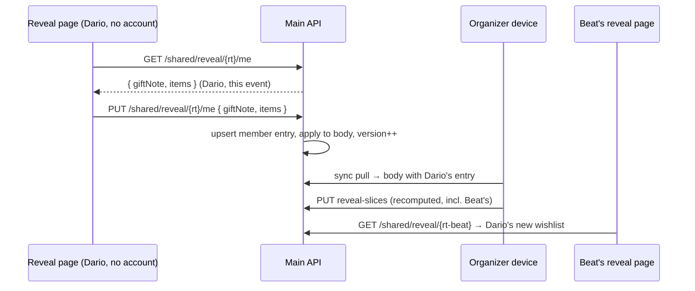

# FEAT-026 — Own wishlist and gift note from the reveal link (live-link groups)

## Problem & goals

- **Problem:** the reveal page told every recipient "tell the organizer what you would like" — for anyone
  without an account or a join that was the only way their wishes reached their Secret Santa (backlog
  BTP-11, 2026-10-17).
- **Goals:** on a live reveal link, the holder edits their own wishlist for that event and their gift note
  in place, autosaved; the organizer's copy becomes read-only; the giver sees it after the organizer's
  device syncs.
- **Non-goals:** live reveal links for private *My account* or on-this-device groups; server-side slice
  patching (would need the pairing — NFR-002); editing other events from one link.

## Requirements & use cases covered

| Item | Covered by this feature? | Notes |
|------|--------------------------|-------|
| [UC-SS-006](../use-cases/secret-santa/UC-SS-006-open-reveal-link.md) | ✅ (extends) | the reveal page gains "your own wishlist" |
| [FR-050](../requirements/functional/FR-050-edit-own-entry-from-reveal-link.md) | ✅ | the whole feature |
| [NFR-002](../requirements/non-functional/NFR-002-assignment-privacy.md) | ✅ | the server learns only the giver of a token, never the recipient |

## Design overview

Decided in [ADR-0084](../adr/0084-own-entry-from-the-reveal-link.md). The organizer's client publishes
each reveal slice with its event and giver member id; the server keeps them beside the slice. The reveal
page reads and writes the holder's entry by reveal token; the write is ADR-0080's participant-entry write
(upsert entry, merge into body, bump version). The organizer's device pulls the new body, shows the
member's fields read-only, and republishes the slices so the giver's live link updates.

## Domain model impact

- **Aggregates / entities / value objects touched or added:** none in the Secret-Santa domain; the server's
  `SharedRevealSlice` gains nullable `EventId`/`MemberId`.
- **New domain events:** none.
- **Glossary terms added or changed:** none ([reveal link](../glossary/reveal-link.md) unchanged in meaning).

## API / contract changes

- **`RevealSlice`** gains optional `EventId`, `MemberId` (the giver).
- **`GET /api/v1/shared/reveal/{revealToken}/me`** → `RevealEntryView { giftNote, items }`; 404 when the
  token is unknown, the slice carries no member/event, or the member is linked to an account.
- **`PUT /api/v1/shared/reveal/{revealToken}/me`** with `RevealEntryWrite { giftNote, items }` →
  `ParticipantEntryResult`; 404 / 413 as above. Both anonymous, account-free rate-limited.
- **`ClaimedMembers`** gains `SelfMaintained` (members with an own entry).
- **Versioning / compatibility:** all additive. An older client sends slices without ids (no editor until
  the next publish) and ignores `SelfMaintained`.

## Data & migration considerations

- **Postgres (server):** migration `AddRevealSliceMember` — nullable `EventId`, `MemberId` on `RevealSlices`.
- **SQLite (local):** none.
- **Sync impact:** the write bumps the group version; organizer devices pull it like any participant write.

## Localization impact

New strings (DE/EN/FR): the editor heading and lead, the saved/not-yet-saved states, and the label for the
gift note on the reveal page.

## Testing strategy

[TP-026](TP-026-own-entry-from-the-reveal-link.md): store tests (read/write by token, merge with other
events, linked member refused, release deletes, size cap), bUnit tests for the reveal-page editor, and a
browser walkthrough across organizer, holder and giver.

## Rollout / deployment & feature flags

Server first (migration + endpoints), then the apps — as SYNC-1. No flag.

## Risks & open questions

- A forwarded reveal link lets its holder edit that person's entry (accepted in ADR-0084).
- The giver sees the change only after an organizer device syncs (accepted, ADR-0068 freshness model).

## Definition of Done

- [x] Meets acceptance criteria of all covered requirements
- [x] Builds clean under analyzers (warnings = errors)
- [x] Tests per the test plan pass (`RevealEntryTests`, `RevealOwnEntryTests`); browser walkthrough
  organizer → holder → giver on 2026-10-17
- [x] Architecture boundaries respected (arch tests green)
- [x] Docs, glossary, and API comments updated
- [x] Localized strings provided (DE/EN/FR)
- [x] Traceability links closed (ADR-0084 ↔ FR-050 ↔ FEAT-026 ↔ TP-026 ↔ UC-SS-006)

The reveal-page editor also offers "Undo" after a saved change, like every text autosave (backlog BTP-12).
