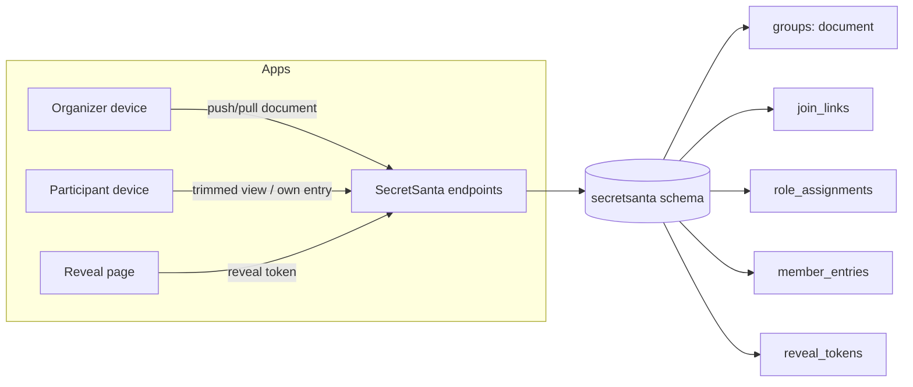

# FEAT-027 — One way to be in a group

## Problem & goals

- **Problem:** group data lives in three server stores, people with an account reach a group two different
  ways, and the organizer's device publishes copies that go stale. See
  [ADR-0086](../adr/0086-one-way-to-be-in-a-group.md) and its
  [analysis](../brainstorming/2026-10-22-one-way-to-be-in-a-group.md).
- **Goals:**
  - A group is *on this device* or *online*. An online group is stored once.
  - Every person in an online group is a **participant**, whatever route brought them in.
  - Every view is derived from the document on read.
  - The client's group record says only where the group lives and what this device may do.
- **Non-goals:**
  - Several admins per group. Not built now, but the model is ready for it: role assignments plus a role →
    permission table (ADR-0086).
  - Per-person cryptographic secrecy (stays parked).
  - A data migration (decision D2: the new store starts empty).
  - Cross-member push notifications.

## Requirements & use cases covered

| Item | Covered? | Notes |
|------|----------|-------|
| FR-038, FR-048 | ✅ (rewritten) | Two places instead of four kinds; default place |
| FR-039, FR-040, FR-043 | ✅ (rewritten) | One store; organizer link kept (D1); take over / hand over |
| FR-023, FR-024 | ✅ (rewritten) | An organizer's online groups on all devices of the account; dirty edits pushed before pull |
| FR-027, FR-028, FR-032, FR-041 | ✅ (rewritten) | Circle, email invitation, own member, join link: all create a participant |
| FR-029, FR-030, FR-037, FR-050 | ✅ (rewritten) | Participant view and own entry; reveal-link entry for members without a participant |
| FR-042 | ✅ | Release a participant |
| FR-005, FR-006 | ✅ | Online groups: short reveal links, always derived; device groups: snapshot links (unchanged) |
| NFR-001, NFR-002 | ✅ | Device groups never touch the server; online: owner-only full read, participant-only trimmed read |

## Design overview

- **Server module.** `CircleTools.SecretSanta.Service.Core` holds the access rules, view builders and entry merge,
  over `SecretSanta.Core`'s `GroupState`. `CircleTools.SecretSanta.Service.Repository` holds EF Core and schema
  `secretsanta`. `CircleTools.SecretSanta.Service` holds the minimal-API endpoints. The Main service hosts all
  three. The DTOs live in `CircleTools.SecretSanta.Contracts`.
- **Access.**
  - Every request resolves to a principal (account, organizer link or device key) and its role assignment.
  - Endpoints require a **permission**; one table maps roles to permissions. Today: owner and participant.
  - A later admin role is a new row in that table (see ADR-0086).
- **Organizer** (the owner today).
  - An account (bearer) or an organizer link (`X-Organizer-Token`).
  - Reads the full document, plus who takes part and which members keep their own entry.
  - Pushes with the version it was based on. The server re-applies member entries and returns the merged
    document whenever it differs from the pushed one. It records who wrote last.
- **Participant.**
  - An account (bearer) or a device key (`X-Device-Key`).
  - Reads `GET /groups/{id}/me`: own pairing per event, recipient's wishlist and gift note, budget, event details.
  - Writes `PUT /groups/{id}/me/entry`.
- **Derived reads.**
  - The participant view, the account overview (`GET /me/groups`) and the reveal page (`GET /reveal/{token}`)
    are computed from the document plus entries.
  - Nothing is published by a device except the document itself.

## Domain model impact

- **`GroupState` gains `SchemaVersion`.** The server refuses a push whose schema version is lower than the stored
  one.
- **No domain-model change to `Group` itself.** Participants, tokens and entries are server-side access state,
  not part of the document.
- **Glossary:** add *participant*, *organizer*, *online group*, *organizer link*, *member entry*. Retire *linked
  member* and *link request* as product terms, and *Shared by link* / *My account* as storage kinds.

## API / contract changes

All routes are under `/api/v1/secretsanta`.

| Route | Who | Purpose |
|---|---|---|
| `POST /groups` | bearer (owner = account) or anonymous + creator key (owner = organizer link) | Make a group online; returns organizer token (link-owned) and join token |
| `GET /groups/{id}` | read-document permission | Full document, version, role assignments, members keeping their own entry, the caller's permissions |
| `PUT /groups/{id}` | write-document permission | Push `{baseVersion, schemaVersion, body}`; answers merged document, new version and whether it was rewritten |
| `DELETE /groups/{id}` | delete-group permission | Keep only on this device / delete online copy |
| `PUT /groups/{id}/join-link` | manage-links permission | `{enabled}`; `POST …/join-link/rotate` mints a new one |
| `POST /groups/{id}/organizer-link/rotate` | manage-links permission (link-owned group) | New organizer link |
| `POST /groups/{id}/take-over` | bearer + organizer token | An account takes over a link-owned group |
| `POST /groups/{id}/hand-over` | manage-roles permission (owner account) | Back to an organizer link |
| `POST /groups/{id}/participants` | manage-participants permission | `{memberId, route: self \| invitation(email) \| circle(circleId, accountId)}` |
| `DELETE /groups/{id}/participants/{memberId}` | manage-participants permission | Release a participant / withdraw an invitation |
| `GET /groups/{id}/reveal-tokens` | read-document permission | Tokens for the current draw's givers, minted on first ask, stable across re-draws |
| `GET /join/{joinToken}` | anyone with the link | Group name and the members still free |
| `POST /join/{joinToken}` | anyone with the link | `{memberId \| newName, withAccount}` → participant (device key for a device-only join) |
| `GET /groups/{id}/me` | read-own-view permission | Trimmed view |
| `PUT /groups/{id}/me/entry` | write-own-entry permission | Own gift note and per-event wishlists |
| `DELETE /groups/{id}/me` | participant | Leave |
| `GET /me/groups` | bearer | Every group the account has a role in, with its role and permissions, and pending invitations |
| `POST /me/invitations/{groupId}/accept` / `decline` | bearer | Answer an email invitation |
| `GET /reveal/{token}` | reveal-link holder | Derived reveal page |
| `GET`/`PUT /reveal/{token}/entry` | reveal-link holder | Own entry, only for a member without a participant |

- **Removed:**
  - all `/api/v1/member-links/*`, `/api/v1/groups/*` linking routes, `/my-assignments`, `/my-wishlists`,
    `/my-memberships`;
  - all `/api/v1/shared/*`;
  - `/api/v1/sync/groups/*` (claim/unclaim).
- **Kept:** `/api/v1/sync` for the preferences kind only.
- **Added on the account:** `GET /api/v1/account/owned-groups` → `{count}`, how many online groups the account
  owns, so the delete screen can offer their disposition (FR-043). It replaces `GET /api/v1/shared/owned`.
- **Compatibility:** none needed (not live). The app builds on the test devices are updated together with the
  server.

## Data & migration considerations

- **Postgres, schema `secretsanta`:**

  | Table | Key | Columns |
  |---|---|---|
  | `groups` | `GroupId` | `CreatorKeyHash?`, `Version`, `SchemaVersion`, `Body` (jsonb), `JoinEnabled`, `UpdatedBy` (role assignment id), `CreatedAt`, `UpdatedAt`, `LastActivityAt` |
  | `join_links` | `TokenHash` | `GroupId`, `TokenCipher`, `Active`, `CreatedAt` (a rotated link stays inactive) |
  | `role_assignments` | `Id` (v7) | `GroupId`, `Role` (owner / participant; admin later), `PrincipalKind` (account / organizer link / device key), `AccountId?`, `SecretHash?` (organizer link or device key), `SecretCipher?` (organizer link, so its devices can be handed it again), `MemberId?`, `State` (invited / active), `Route`, `CreatedAt`, `ExpiresAt?`. Unique per group: `AccountId`, `MemberId`; unique: `SecretHash` |
  | `member_entries` | (`GroupId`, `MemberId`) | `GiftNote?` (500), `Wishlists` (jsonb), `KeptBy` (participant / reveal link), `Version`, `UpdatedAt` |
  | `reveal_tokens` | `TokenHash` | `TokenCipher`, `GroupId`, `EventId`, `GiverMemberId` (unique with group and event), `CreatedAt` |

  Writes to `groups` lock the row (`SELECT … FOR UPDATE`) so concurrent entry writes and pushes can't lose
  updates (C3).
- **Dropped on deploy:** schema `linking`, schema `shared`, and `sync.aggregates`/`markers` rows of kind
  `group`.
- **Account deletion:**
  - Owned groups are handed over to an organizer link or deleted, as the user chose (FR-043).
  - The account's participants are released, their merged content staying in the document.
  - The account's sync rows are deleted (S3).
- **Retention (NFR-010):** a daily sweep deletes the groups no account owns that nobody used for 365 days
  (`SharedGroups:RetentionDays`). Every read and write counts as use; reads record it at most once a day. A
  group an account owns follows the account's lifecycle instead.
- **Limits (NFR-009):** a document over 256 KiB or with more than 200 members is refused on create and push
  (`SharedGroups:MaxBodyBytes`, `SharedGroups:MaxMembers`). The configuration section keeps the retired
  store's name, because deployments already set it (and its `Security` key).
- **Local store:**
  - The group record becomes `(State, Version, Dirty, Place, Access)`.
  - `Access` = principal (account / organizer link / device key), role, member if any, the permissions the
    server reported, and the principal's secret if any. Pages decide from permissions.
  - A participant's record holds the trimmed view, not a document it could edit.
  - A schema bump, under a new key. On first load the groups the device organized under the old key become
    groups on this device; copies it only took part in, or held through a join link, are left behind (the
    person joins again). D2 covers the server only: what a device holds is never dropped (NFR-001).
- **Sync:**
  - One online sync service.
  - Organizer: push if dirty, then pull if newer.
  - Participant: send a pending entry, then pull the view.
  - Accounts discover their groups through `GET /me/groups`.

## Localization impact

New or reworded DE/EN/FR strings:
- the place picker (*On this device* / *Online*), the join-link setting;
- invite by email, join, leave, release;
- the participant's group page (your assignment, your wishlist);
- removed pages' strings deleted.

## Testing strategy

See [TP-027](TP-027-one-way-to-be-in-a-group.md). Each phase leaves the solution building and its tests green.

## Rollout / deployment & feature flags

Phases, each a reviewable unit:

1. **Server module.**
   - Projects, schema, store, access rules, view builders, endpoints.
   - Integration tests for every route and every access rule.
   - The old stores stay untouched.
2. **Apps: local store and sync.**
   - New record, online sync service, API clients, unit tests.
3. **Apps: pages.**
   - Place picker, group list for every role, participant group page, members (participants and invitations),
     share (join link, reveal links), join, reveal.
   - Remove *My assignments*, *My wishlists* and the linking UI.
4. **Remove the old stores.**
   - Linking, shared and the sync group kind, with their endpoints, contexts, migrations, client code and tests.
   - Drop the schemas.
5. **Verify.**
   - E2E suite adapted.
   - Browser walkthrough of every route in (two accounts, a device-only participant, a reveal link).
   - Pixel check.
   - Docs: requirements, glossary, arc42, schema diagram.

Deploy server and apps together after phase 5; production test data is dropped (D2).

### Progress

- **Phase 1 — done (2026-10-22).**
  - Projects:
    - `SecretSanta.Service.Core`: access model, member-entry merge, derived views, `GroupService`, ports;
    - `SecretSanta.Service.Repository`: schema `secretsanta`, `GroupStore`, migration `InitialGroupStore`;
    - `SecretSanta.Service`: endpoints.
  - Wired into the Main host under `/api/v1/secretsanta`, with platform adapters in `SecretSantaGroupAdapters.cs`.
  - Tests: 20 unit tests, 13 integration tests (`OnlineGroupEndpointTests`) and 2 architecture tests.
  - The old stores are untouched.
- **Phase 2 — done (2026-10-22).** In `SecretSanta.LocalStore/Online`:
  - `GroupRecord` (place, access, document or participant view) and `GroupRecordStore`, under a new storage key;
    old local records aren't read (D2);
  - `GroupRecordRepository`, the domain repository: only a holder of the write permission edits; deleting an
    online group queues the server delete;
  - `IOnlineGroupApi` and `HttpOnlineGroupApi`, with a source-generated JSON context;
  - `OnlineGroupSync`: organizer push-then-pull, participant entry-then-view, discovery of the account's groups
    and invitations, join, leave, take over, hand over, participants, reveal tokens.
  - Registered in both apps (`AddSecretSantaOnlineGroups`); the pages still use the old model until phase 3.
  - Tests: 6 client-against-server tests (`OnlineGroupClientTests`, several devices per test) and 6 repository
    tests.
- **Phase 3 — done (2026-10-22), including the browser walkthrough.**
  - Domain repository switched to `GroupRecordRepository`.
  - The sync runs `OnlineGroupSync` for every online group; the sync store keeps profile and preferences only.
  - Place picker (on this device / online) in Settings, the create dialog and Sharing & sync.
  - Sharing & sync: join link on/off and new link, management link, keep in my account / hand over.
  - Group list: invitations, groups taken part in and groups organized.
  - New participant page `groups/{id}/me`: own assignment per event, own wishlist and gift note.
  - Members: "This is me", invite by email, free a spot, connected and invited badges.
  - Share page: reveal tokens from the server.
  - Join: pick or add yourself, with the account or this device.
  - Reveal page and own entry: new API.
  - Management link: `/admin#g=…&t=…`.
  - Create from a circle: online at once, circle people as participants.
  - Removed: *My assignments*, *My wishlists*, *My links*, sign-in reconciliation and import prompt, assignment and
    reveal-slice publishers, link resolutions.
  - DE/EN/FR strings added or reworded; UI tests rewritten for the new model.
- **Browser walkthrough (2026-10-22).** Full Aspire stack, Chrome via Playwright, two accounts registered in the
  local database, plus signed-out browsers.
  - Covered:
    - an online group made by an account, members, an email invitation accepted from the group list;
    - the participant page: wishlist, gift note and reveal;
    - event, draw and the organizer's merged wishlists;
    - share page, a reveal link with its own entry (seen by the giver at once);
    - the join link on a device without an account;
    - a group organized without an account, opened through its management link on a second browser, edits converging;
    - DE, EN and FR for every changed page; the console stayed clean.
  - Found and fixed:
    - An organizer who is also in the roster could not see their own assignment (*My assignments* was gone). Having
      a member now grants **read own view** (ADR-0086, role assignments). The organizer's sync pulls that view, and
      the group page shows a *My assignment* row that opens `groups/{id}/me` read-only.
    - The invitation mail linked to the removed `/my-links` page and spoke of "linking". It now invites to the
      group and links to the group list.
    - The reveal page said the giver sees changes after the organizer's next sync; entries now reach the giver at
      once, and the note says so.
    - Settings → Your data still named «My account» and said nothing leaves the device without signing in;
      reworded for *on this device* / *online*.
    - Nine strings no page used any more were removed.
  - Seen, left as is:
    - the narrow email field in the members row;
    - the phone icon on the *Connected* badge also for accounts;
    - "joined as" on the organizer's own assignment page.
- **Phase 4 — done (2026-10-25).**
  - Server removed: the linking store, the shared-group store, their endpoints, contexts, migrations and
    tests; the sync store's claim, un-claim, un-claim markers and organizer check (`GetHoldingAsync`).
  - Moved to the new store before removal:
    - business metrics (FEAT-022): groups, events and draws now come from `secretsanta.groups`;
    - retention of groups without an account owner (NFR-010) and the document limits (NFR-009);
    - the owned-group count for the account-deletion screen (`GET /api/v1/account/owned-groups`).
  - Migrations: `RetireOldGroupStores` drops the `linking` and `shared` schemas; `DropGroupSync` deletes the
    group rows and un-claim markers from the sync store.
  - Apps removed: the group part of the account sync, the shared-group and linking clients, the claimable-groups
    service, the old local group store and its record types. The account sync carries the preferences only.
  - Domain: `Member.UserId` and member linking are gone, so the document carries no account ids. Create from a
    circle returns the member–account pairs, and the app makes them participants.
  - Local import: groups this device organized in the old model become groups on this device (see Data).
  - Strings: the delete screen's group section speaks of online groups; the "kept as a local copy" notice
    went with un-claim.
  - Checked in the browser: the import of an old local document, and the delete screen's online-group section.
  - Tests: every suite green, apart from one run of the circle-invitation timing test, which passed alone and in
    the next full run. New tests cover the limits, retention, the import, the owned-group count and the
    preferences sync between two devices.
- **Phase 5 — E2E suite done (2026-10-25).**
  - The old six tests (shared-by-link groups, admin links, claiming) are replaced by nine tests of the new model,
    passing twice in a row against the full stack:
    - without an account: co-organizing through the management link; joining on a device and seeing only one's
      own pairing; freeing a spot and taking it again;
    - with accounts: an email invitation answered from the group list; keeping a group in the account and handing
      it back; a group reaching the account's other device and a delete reaching it too; deleting the account
      while its group stays online;
    - reveal links: a group on the device; an online group whose link takes a wishlist the giver sees at once.
  - A failing wait saves a screenshot under `e2e-screenshots` in the test output.
  - Found and fixed: inviting a member right after adding them failed ("That could not be completed"), because
    the invitation reached the server before the new member did. Adding a participant now pushes unsent edits
    first, as reveal tokens already did; a client-against-server test covers it.
  - The participant page got test ids (`joined-as`, `participant-reveal`, `participant-recipient`,
    `participant-wishlist`).
- **Phase 5 — docs done (2026-10-25).**
  - Requirements rewritten for the new model: FR-023, FR-024, FR-027..030, FR-032, FR-038..043, FR-048, FR-050,
    NFR-002, NFR-009, NFR-010; passing mentions fixed in FR-001, FR-005, FR-015, FR-033, FR-034, FR-036, FR-037,
    FR-044 and NFR-008. FR-025/026 stay superseded.
  - Use cases rewritten: UC-SS-009..012, UC-SS-017..020; UC-SS-007/008 superseded; UC-MAIN-002, 006, 015, 016
    and UC-SS-015, 016, 021, 022 amended.
  - Glossary: new *Device key, Member entry, Online group, Organizer, Organizer link, Owner, Participant, Place,
    Role assignment*; *Admin link, Claim, Participant contribution, Participant key, Person claim, Share token,
    Shared-by-link group* marked replaced; *Member, Join link, Sync, Event, Group* updated.
  - arc42 §5 and §8, the database schema (schema `secretsanta`; `linking` and `shared` gone), the operator-access
    note and the release plan updated. ADR-0017 marked superseded by ADR-0086 (claiming is gone).
  - Superseded feature specs marked: FEAT-005, FEAT-013, FEAT-020, FEAT-024; amended: FEAT-004, FEAT-025,
    FEAT-026.
- **Carried to phase 5:**
  - The rate limit for signed-in calls is still the per-IP limit for account-free calls; deciding whether
    signed-in calls get their own needs real traffic.
  - Groups taken part in have no reminders yet: the reminder scheduler reads organized groups only.

## Risks & open questions

- **Scope:** this touches every sharing flow. Mitigation: the phases above; old code removed only in phase 4.
- **Offline organizer edits on several devices** stay whole-document last-write-wins per group (ADR-0016), now
  in one store.
- **Open:** whether *Groups you take part in* needs its own section in the list or a role chip is enough;
  decided in phase 3 with screenshots.

## Definition of Done

- [ ] Meets acceptance criteria of all covered requirements
- [ ] Builds clean under analyzers (warnings = errors)
- [ ] Tests per TP-027 pass; coverage target met
- [ ] Architecture boundaries respected (arch tests green, new module included)
- [ ] Docs, glossary, and API comments updated
- [ ] Localized strings provided (DE/EN/FR)
- [ ] Traceability links closed
- [ ] Browser walkthrough and Pixel check of every route in
