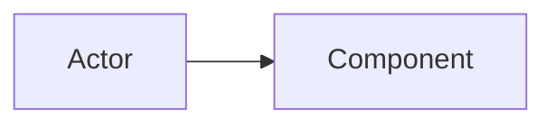

# {{id}} — {{title}}

## Problem & goals

- **Problem:** <what user/business problem this solves>
- **Goals:** <what success looks like>
- **Non-goals:** <explicitly out of scope>

## Requirements & use cases covered

| Item | Covered by this feature? | Notes |
|------|--------------------------|-------|
| UC-… | ✅ | |
| FR-… | ✅ | |
| NFR-… | ✅ | |

## Design overview

Short narrative of the approach.

## Domain model impact

- **Aggregates / entities / value objects touched or added:** <…>
- **New domain events:** <…>
- **Glossary terms added or changed:** <links>

## API / contract changes

- **Endpoints / DTOs:** <…>
- **Versioning / compatibility:** <…>

## Data & migration considerations

- **Postgres (server):** <schema/migrations>
- **SQLite (local):** <schema/migrations>
- **Sync impact:** <aggregates affected, conflict considerations>

## Localization impact

- New user-facing strings → provide **DE / EN / FR**.

## Testing strategy

Link to the paired test plan: <TP-…>. Summarize levels and key scenarios.

## Rollout / deployment & feature flags

- <flags, phased rollout, migration order>

## Risks & open questions

- <risk / question — escalate to ADR if it's an architectural decision>

## Definition of Done

- [ ] Meets acceptance criteria of all covered requirements
- [ ] Builds clean under analyzers (warnings = errors)
- [ ] Tests per the test plan pass; coverage target met
- [ ] Architecture boundaries respected (arch tests green)
- [ ] Docs, glossary, and API comments updated
- [ ] Localized strings provided (DE/EN/FR)
- [ ] Traceability links closed
