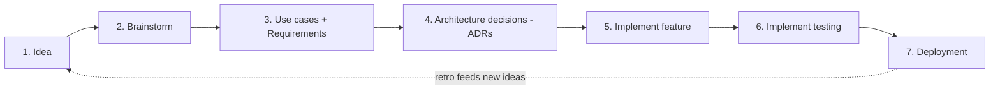

# Ways of Working

This is how work flows — from a raw idea to something shipped. Each phase has **entry criteria**,
**activities**, the **artifact** it produces (from a template), and a **Definition of Done**. A
**traceability spine** links every artifact by ID so anyone can trace a line of code back to the
idea that motivated it.

Traceability: `idea → brainstorm → UC + FR/NFR + glossary → ADR + arc42 → FEAT spec → code → TP + tests → deployment runbook → shipped`.

---

## Phase 1 — Idea Analysis
- **Entry:** a raw idea or problem exists.
- **Activities:** frame the problem, identify target users, rough value/fit, alignment with the
  Swiss-first vision.
- **Artifact:** idea stub in [`roadmap/backlog.md`](../roadmap/backlog.md).
- **DoD:** problem statement + target user + value articulated; explore-or-drop decision made.

## Phase 2 — Brainstorming
- **Entry:** an accepted idea.
- **Activities:** divergent generation, clustering, convergent selection (impact/effort/fit).
- **Artifact:** a [brainstorming session](../brainstorming/index.md) doc.
- **DoD:** selected direction documented with rationale; rejected options recorded; follow-ups listed.

## Phase 3 — Use Cases / Requirements
- **Entry:** a selected direction.
- **Activities:** write use cases; derive FRs & user stories; capture NFRs (privacy, i18n,
  performance, Swiss/GDPR); extend the glossary.
- **Artifacts:** [use cases](../use-cases/index.md), [requirements](../requirements/index.md),
  [glossary](../glossary/index.md) entries.
- **DoD:** use cases have acceptance criteria & traceability; NFRs have measurable targets; new
  terms in the glossary; PR-reviewed.

## Phase 4 — Architecture & Tech Decisions
- **Entry:** requirements with architectural significance.
- **Activities:** identify decisions, evaluate options, write [ADRs](../adr/index.md), update the
  affected [arc42](../arc42/09-architecture-decisions.md) chapters.
- **Artifacts:** ADRs; updated arc42.
- **DoD:** ADR **Accepted** with consequences; arc42 consistent; supersede links set.

## Phase 5 — Implement Feature
- **Entry:** use cases/requirements defined; governing ADRs accepted; feature spec drafted.
- **Activities:** write the [feature spec](../features/index.md); implement in the correct bounded
  context/layer per the [guidelines](../guidelines/architecture-guidelines.md); keep XML doc
  comments and glossary current.
- **Artifacts:** feature spec, `src/` code, doc updates.
- **DoD:** compiles clean under analyzers; matches guidelines & spec; traceability closed; docs
  updated; PR-reviewed.

## Phase 6 — Implement Testing
- **Entry:** feature implemented (or TDD in parallel); acceptance criteria known.
- **Activities:** author the [test plan](../features/index.md); write unit/integration/architecture/
  contract/E2E tests per the [testing guidelines](../guidelines/testing-guidelines.md); run
  localization/accessibility checks.
- **Artifacts:** test plan; `tests/` projects.
- **DoD:** all acceptance criteria covered by automated tests; coverage target met; architecture
  tests enforce boundaries; CI green.

## Phase 7 — Deployment
- **Entry:** feature + tests merged; release scope defined; deployment ADRs in place.
- **Activities (Web/API/DB):** provision/update cloud infra (Aspire deployment), configure
  environments & secrets, run migrations, deploy under the `.ch`/`.com` domain, smoke test.
- **Activities (mobile):** build signed Android/iOS artifacts, prepare localized store listings
  (DE/EN/FR), submit, staged rollout.
- **Artifacts:** [deployment](../deployment/index.md) runbooks; release notes; roadmap update.
- **DoD:** deployed & smoke-tested; monitoring/rollback documented; release notes published;
  backlog/roadmap updated; retro feeds new ideas (→ Phase 1).

---

## Adding a new app-type
A new app follows the same spine and the project template in
[arc42 ch. 5](../arc42/05-building-block-view.md): idea → brainstorm → UC/requirements → ADRs →
scaffold projects (`Service.Core/Repository/Service`, `Ui`, `WebApp`, `App`, `LocalStore`, tests)
→ implement → test → deploy (new subdomain).
