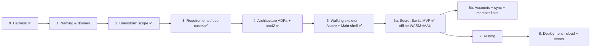

# Roadmap

High-level sequence. Each milestone flows through the [ways of working](../process/ways-of-working.md).

## Milestones

| # | Milestone | Outcome |
|---|-----------|---------|
| 0 | **Harness** | Repo, docs framework, process, DocFX site (this deliverable). ✅ |
| 1 | Naming & domain | Working name `AppSuite` in use across code + docs; **final brand deferred** (leading candidate: Walf, `walf.ch`); domain registration TBD. See [naming](../process/naming.md). |
| 2 | Brainstorm | ✅ AppSuite + Secret-Santa MVP scope decided: offline, account-free core with self-contained reveal links ([session](../brainstorming/2026-07-24-secret-santa-scope.md)). |
| 3 | Requirements | ✅ Secret-Santa MVP [use cases](../use-cases/index.md) (UC-SS-001..006) & [requirements](../requirements/index.md) (FR-001..006, NFR-001..003). |
| 4 | Architecture | ✅ ADR-0005..0021 accepted — MVP set (render model, mediation, persistence, IDs, auth/passkeys, API, localization, telemetry, WASM↔API, reveal-link privacy, client storage) plus the **v2 set**: [sync & conflicts](../adr/0016-sync-and-conflict-resolution.md), [account claim](../adr/0017-anonymous-to-account-claim.md), [circle model](../adr/0018-circle-and-sharing-model.md), [Member↔User linking](../adr/0019-member-user-linking.md), [server-side assignment privacy](../adr/0020-server-side-assignment-privacy.md), [web token model](../adr/0021-web-auth-token-model.md); arc42 updated. Only **deployment** choices remain deferred — see the [ADR backlog](../adr/index.md). |
| 5 | Walking skeleton | ✅ Aspire AppHost + ServiceDefaults + SharedKernel + Application + Main slice (API + WASM PWA) + Postgres, exercised by a throwaway `Heartbeat` sample; unit + ArchUnitNET tests; DocFX API reference generating. |
| 6 | Secret-Santa | **6a ✅** — local-first, offline MVP built (WASM PWA + MAUI Blazor Hybrid): group / members / wishlists / exclusions / fair draw (rules + history) / self-contained reveal links; localStorage (web) + file (MAUI); 22 Core tests. **6b (post-MVP)** — **M1 Identity ✅ built and closed 2026-07-29** ([FEAT-002](../features/FEAT-002-m1-identity.md) *Done*, [TP-002](../features/TP-002-m1-identity.md) *Reviewed*): sign-up + verification, password and passkey sign-in, refresh rotation with reuse detection, reset, profile, email change, export, deletion. Secret-Santa then **migrated onto the shared UI blocks** (2026-07-28, ADR-0025's follow-up → [ADR-0028](../adr/0028-browser-platform-adapters-block.md), [ADR-0029](../adr/0029-storage-write-failure-contract.md)) — **281 tests green across 10 projects**. Two M1 criteria were **carried to milestone 7** rather than ticked: automating the WebAuthn ceremony (which also gives NFR-004's stored-credential check something to inspect) and a CI pipeline. **M2 Circles ✅ built and closed 2026-07-30** ([FEAT-003](../features/FEAT-003-m2-circles.md) *Done*, [TP-003](../features/TP-003-m2-circles.md) *Reviewed*): the `Circles` bounded context (`Contracts` / `Core` / `Repository` with its own `circles` schema in `maindb`), `/api/v1/circles` + `/api/v1/invitations` behind `CircleRoleFilter`, the invitation mail through an outbox port, the three application-level rate limits over rolling-window rows, both account-deletion seams, and four Main UI pages. Its [use cases](../use-cases/index.md) (UC-MAIN-008..014), [requirements](../requirements/index.md) (FR-016..022 + [NFR-006](../requirements/non-functional/NFR-006-circle-authorization.md) circle data authorization) and arc42 ch. 5's **Circles** context were written on 2026-07-29, the spec fixing the invitation lifetime, rate limits, decline cooldown and caps the requirements deferred to it. **It also closed FR-015's sole-circle-owner guard**, the criterion M1 carried. **542 tests green across 12 projects.** Closing it was not a formality: reconciling TP-003 against the code found the NFR-006 endpoint-guard fitness function missing (its metadata had been built to be read back and nothing read it), a "role matrix" that was three spot checks rather than 14 routes × 5 caller kinds, invitation-revoke with no functional test, and **two acceptance criteria unmet in the product** — both destructive confirmations (FR-021, FR-022) — all four fixed at close. The browser walk-through of those two confirmations, the last box left open, was completed **2026-07-30** and found two more, both the same defect: a counted string with no singular. FR-022's delete confirmation read *"1 Personen verlieren" / "1 people will lose" / "1 personnes en perdront"*, and the **circle list** read *"1 Personen" / "1 people" / "1 personnes"* — the state every circle is in the moment it is created, on the first screen a new user reaches. All three languages inflect, so each string gained a singular entry; both are now covered by tests, and the rule is written into the [localization guidelines](../guidelines/localization-guidelines.md). Three criteria are carried rather than ticked: deliverability (FR-017, the email-provider decision) and two that need **M4** (FR-019's and FR-022's Secret-Santa halves). **M3 Sync & claim specified 2026-07-30** — [use cases](../use-cases/index.md) UC-MAIN-015..016 (sync across devices; work offline and reconcile) and UC-SS-007..008 (take my groups into my account; take one back out), [requirements](../requirements/index.md) FR-023..026 plus [NFR-008](../requirements/non-functional/NFR-008-sync-convergence-and-data-safety.md) (sync convergence & data safety), and the glossary terms [Claim](../glossary/claim.md) and [Tombstone](../glossary/tombstone.md). Three things the specification fixes that the ADRs had left implicit: **the claim screen, not M4, is where a completed draw first leaves the device**, so it is where the amended [NFR-002](../requirements/non-functional/NFR-002-assignment-privacy.md) has to be said out loud; **removing a group from the account is not a delete** — the other devices keep their local copies, or the action would be a remote wipe wearing a tidy-up's label; and **circle data does not sync**, which narrows [ADR-0016](../adr/0016-sync-and-conflict-resolution.md) — the one open decision that blocked the build, closed as [ADR-0033](../adr/0033-which-aggregates-sync.md). FR-023 also carries **FR-012**'s offline language change, the criterion M1 left for sync. **M3 ✅ built and closed 2026-08-12** ([FEAT-004](../features/FEAT-004-m3-sync-and-claim.md) *Done*, [TP-004](../features/TP-004-m3-sync-and-claim.md) *Reviewed*): the `/api/v1/sync` delta exchange + claim/un-claim routes on the Main host, the client sync engine over the local store, the offline profile writer, and the shared `AppSuite.Ui.Account` block — FR-023..026 and NFR-008 `Implemented`, FR-012's offline-language criterion closed with them. The two-device DE/EN/FR **browser walkthrough against a live Main service** was completed and is green (Playwright over real Chrome, two isolated contexts as two devices, 37 assertions) — convergence, data safety, LWW with a reported collision, delete-without-resurrection, un-claim-as-marker, the FR-012 cross-device language change, the claim-list singular count in all three languages, and the offline circle notice, all confirmed on screen — and found **no product defects**; two behaviour questions were recorded (first-sign-in claim prompt; the signed-in nav language picker being local-only). As with M1, **"CI green" is carried to milestone 7** (no pipeline yet). **M4 Linking ✅ built and closed 2026-08-12** ([FEAT-005](../features/FEAT-005-m4-linking.md) *Done*, [TP-005](../features/TP-005-m4-linking.md) *Reviewed*): create a group from a circle, link/unlink a member with consent, see my own assignment in-app behind the anti-spoiler step, and own my wishlist — FR-027..030 `Implemented`, and **FR-019's and FR-022's carried Secret-Santa halves closed** (the `linking` Postgres schema, the ADR-0020 assignment projection, the per-caller-authorized surface with its 403-vs-404 rule, the M2 invitation machinery reused for the member-link, and four Blazor flows). The two-account DE/EN/FR **browser walkthrough against a live Main service** was completed and is green, and **found one product defect a green suite had missed** — create-from-circle registered the link only client-side, so a linked person could see their assignment but not own their wishlist; fixed via `POST /api/v1/member-links/circle` and now covered by `LinkingCircleTests`. **M4 is the last v2 milestone.** M1–M4 cannot *ship* until the hosting and transactional-email decisions land, and "CI green" awaits the milestone-7 pipeline. |
| 7 | Testing | Full test suite; CI green. **Carries two items from M1** ([arc42 ch. 11](../arc42/11-risks-and-technical-debt.md) D4–D5): automating the WebAuthn ceremony in a browser-driving test host, and the CI pipeline itself — which needs a CI/CD ADR first ([ADR backlog](../adr/index.md#open-decisions-backlog)). |
| 8 | Deployment | Cloud (Web/API/DB under the suite domain) + app stores. **Store side scoped 2026-07-29**: publisher identity ([ADR-0030](../adr/0030-mobile-store-publisher-identity.md)) and iOS build host ([ADR-0031](../adr/0031-ios-build-host.md)) decided, obligations stated as [NFR-007](../requirements/non-functional/NFR-007-store-distributability.md), procedure in the [mobile runbook](../deployment/mobile-apps.md). Two long poles to start early: Google Play's **12 testers × 14 days** before production access (≈4–6 weeks), and buying a Mac. Both gated on the [brand & domain](../process/naming.md) for submission, not for account setup. |
