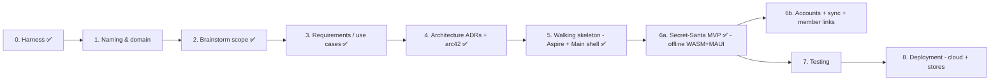

# Roadmap

High-level sequence. Each milestone flows through the [ways of working](../process/ways-of-working.md).

## Milestones

| # | Milestone | Outcome |
|---|-----------|---------|
| 0 | **Harness** | Repo, docs framework, process, DocFX site (this deliverable). ✅ |
| 1 | Naming & domain | Working name `AppSuite` in use across code + docs; **final brand deferred** (leading candidate: Walf, `walf.ch`); domain registration TBD. See [naming](../process/naming.md). |
| 2 | Brainstorm | ✅ AppSuite + Secret-Santa MVP scope decided: offline, account-free core with self-contained reveal links ([session](../brainstorming/2026-07-24-secret-santa-scope.md)). |
| 3 | Requirements | ✅ Secret-Santa MVP [use cases](../use-cases/index.md) (UC-SS-001..006) & [requirements](../requirements/index.md) (FR-001..006, NFR-001..003). |
| 4 | Architecture | ✅ ADR-0005..0021 accepted — MVP set (render model, mediation, persistence, IDs, auth/passkeys, API, localization, telemetry, WASM↔API, reveal-link privacy, client storage) plus the **v2 set**: [sync & conflicts](../adr/0016-sync-and-conflict-resolution.md), [account claim](../adr/0017-anonymous-to-account-claim.md), [circle model](../adr/0018-circle-and-sharing-model.md), [Member↔User linking](../adr/0019-member-user-linking.md), [server-side assignment privacy](../adr/0020-server-side-assignment-privacy.md), [web token model](../adr/0021-web-auth-token-model.md); arc42 updated. Only **deployment** choices remain deferred — see the [ADR backlog](../adr/index.md). |
| 5 | Walking skeleton | ✅ Aspire AppHost + ServiceDefaults + SharedKernel + Application + Main slice (API + WASM PWA) + Postgres, exercised by a throwaway `Heartbeat` sample; unit + ArchUnitNET tests; DocFX API reference generating. |
| 6 | Secret-Santa | **6a ✅** — local-first, offline MVP built (WASM PWA + MAUI Blazor Hybrid): group / members / wishlists / exclusions / fair draw (rules + history) / self-contained reveal links; localStorage (web) + file (MAUI); 22 Core tests. **6b (post-MVP)** — **M1 Identity ✅ built and closed 2026-07-29** ([FEAT-002](../features/FEAT-002-m1-identity.md) *Done*, [TP-002](../features/TP-002-m1-identity.md) *Reviewed*): sign-up + verification, password and passkey sign-in, refresh rotation with reuse detection, reset, profile, email change, export, deletion. Secret-Santa then **migrated onto the shared UI blocks** (2026-07-28, ADR-0025's follow-up → [ADR-0028](../adr/0028-browser-platform-adapters-block.md), [ADR-0029](../adr/0029-storage-write-failure-contract.md)) — **281 tests green across 10 projects**. Two M1 criteria were **carried to milestone 7** rather than ticked: automating the WebAuthn ceremony (which also gives NFR-004's stored-credential check something to inspect) and a CI pipeline. Still to come: **M2** circles, **M3** App↔backend sync + the anonymous→account claim, **M4** linking Secret-Santa `Member`s to user accounts. M1 cannot *ship* until the hosting and transactional-email decisions land. |
| 7 | Testing | Full test suite; CI green. **Carries two items from M1** ([arc42 ch. 11](../arc42/11-risks-and-technical-debt.md) D4–D5): automating the WebAuthn ceremony in a browser-driving test host, and the CI pipeline itself — which needs a CI/CD ADR first ([ADR backlog](../adr/index.md#open-decisions-backlog)). |
| 8 | Deployment | Cloud (Web/API/DB under the suite domain) + app stores. |
