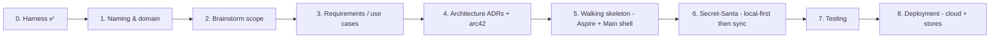

# Roadmap

High-level sequence. Each milestone flows through the [ways of working](../process/ways-of-working.md).

## Milestones

| # | Milestone | Outcome |
|---|-----------|---------|
| 0 | **Harness** | Repo, docs framework, process, DocFX site (this deliverable). ✅ |
| 1 | Naming & domain | Final suite name chosen; `.ch` domain registered; placeholders replaced. |
| 2 | Brainstorm | Walf + Secret-Santa scope decided. |
| 3 | Requirements | Secret-Santa MVP use cases & requirements. |
| 4 | Architecture | Open ADRs decided; arc42 updated. |
| 5 | Walking skeleton | ✅ Aspire AppHost + ServiceDefaults + SharedKernel + Application + Main slice (API + WASM PWA) + Postgres, exercised by a throwaway `Heartbeat` sample; unit + ArchUnitNET tests; DocFX API reference generating. |
| 6 | Secret-Santa | Local-first implementation, then account + sync. |
| 7 | Testing | Full test suite; CI green. |
| 8 | Deployment | Cloud (Web/API/DB under the suite domain) + app stores. |
