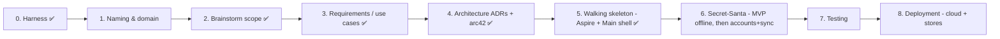

# Roadmap

High-level sequence. Each milestone flows through the [ways of working](../process/ways-of-working.md).

## Milestones

| # | Milestone | Outcome |
|---|-----------|---------|
| 0 | **Harness** | Repo, docs framework, process, DocFX site (this deliverable). ✅ |
| 1 | Naming & domain | Working name `AppSuite` in use across code + docs; **final brand deferred** (leading candidate: Walf, `walf.ch`); domain registration TBD. See [naming](../process/naming.md). |
| 2 | Brainstorm | ✅ AppSuite + Secret-Santa MVP scope decided: offline, account-free core with self-contained reveal links ([session](../brainstorming/2026-07-24-secret-santa-scope.md)). |
| 3 | Requirements | ✅ Secret-Santa MVP [use cases](../use-cases/index.md) (UC-SS-001..006) & [requirements](../requirements/index.md) (FR-001..006, NFR-001..003). |
| 4 | Architecture | ✅ ADR-0005..0013 accepted (render model, mediation, persistence, IDs, auth/passkeys, API, localization, telemetry, WASM↔API); arc42 updated. Remaining choices deferred with rationale in the [ADR backlog](../adr/index.md). |
| 5 | Walking skeleton | ✅ Aspire AppHost + ServiceDefaults + SharedKernel + Application + Main slice (API + WASM PWA) + Postgres, exercised by a throwaway `Heartbeat` sample; unit + ArchUnitNET tests; DocFX API reference generating. |
| 6 | Secret-Santa | **6a** — local-first, offline MVP (group / members / wishlists / exclusions / fair draw / self-contained reveal links). **6b (post-MVP)** — central login in the Main shell + App↔backend sync + linking Secret-Santa `Member`s to AppSuite user accounts. |
| 7 | Testing | Full test suite; CI green. |
| 8 | Deployment | Cloud (Web/API/DB under the suite domain) + app stores. |
